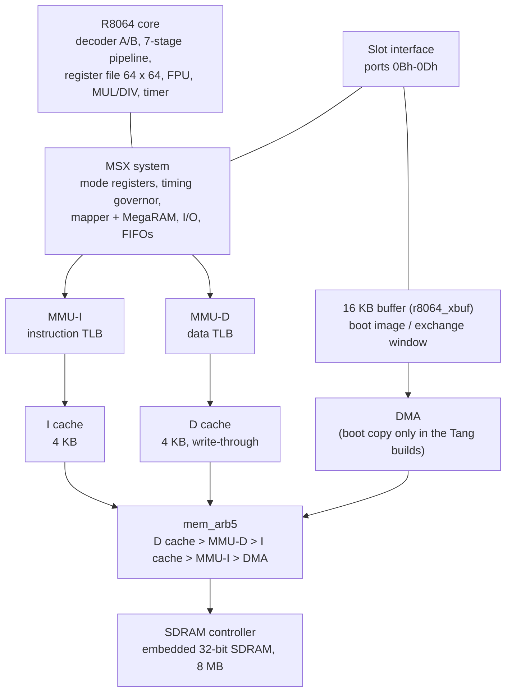

# R8064 — 64-bit CPU for the MSX — Datasheet

> **Edition 1.0, architecture and interfaces · November 23, 2026 · Edison · design revision REV54**
>
> This edition is final for the architecture, programming model, memory, interfaces, exceptions, FPGA implementation and system-software chapters. Instruction timing is **not** part of it. That covers section 6.2 and Appendices B to D. It will be issued as a separate timing edition after the REV55 hardware run. Appendix C (complete instruction list) and Appendix D (measured timing) are generated from the sources by `modulos/13_soc/sim/meas/gen_doc_tables.py`.

The R8064 is a 64-bit CPU derived from the Z80. It is implemented in the Gowin GW2AR-18 FPGA of the Sipeed Tang Nano 20K and is designed as an MSX cartridge. It executes Z80 and R800 code with the original MSX timing, and adds a native 64-bit mode with an MMU, privilege levels and an 80-bit floating-point unit. REV54 runs on the Tang Nano 20K: the timing bench gives 256 of 256 cases equal to the simulation and the FPU test gives 60 of 60 (chapter 11).

## 1. Overview

**Main features**

- **One core with five operating modes:** Z80 in ROM, Z80 in DRAM, R800 in ROM, R800 in DRAM and native 64-bit. A timing governor reproduces the original Z80 and R800 instruction times in the first four modes (chapter 3).
- **Registers:** 64-bit registers accessed in four sizes: B (8 bits), W (16), L (32) and Q (64). There is a shadow set and eight bank registers N0 to N7, reached through prefixes.
- **Pipeline:** an overlapped two-stage decoder with static branch prediction and a return stack, followed by a 7-stage execution pipeline with forwarding.
- **FPU:** an 80-bit floating-point unit in x87 extended format, in hardware. It has an 8-register stack and a sequenced arithmetic core with DSP multiplication. Transcendental functions run as step programs in a ROM.
- **Memory:** 4 KB instruction cache and 4 KB data cache (direct-mapped, 32-byte lines, write-through data cache with a 4-entry write buffer). There is an MMU with instruction and data TLBs and paging modes Sv39, Sv48, Sv57 and Sv64. Physical memory is the board's embedded 32-bit SDRAM (8 MB).
- **MSX memory:** a 4 MB MSX memory mapper and a 2 MB MegaRAM inside the physical memory. They are usable in every mode.
- **System:** supervisor and user modes, exceptions, a system call, a 64-bit timer comparator, atomic CAS and XCHG, and a 128-byte context save and load (SVCTX/LDCTX).
- **MSX interface:** a message protocol on I/O ports 0Bh to 0Dh with 2 KB FIFOs. A 16 KB exchange window at 8000h–BFFFh is implemented in RTL for slot boards that wire the memory signals.
- **Software:** a resident monitor on the R8064, `R8064.COM` and the `r8064io` driver for MSX-DOS, and the R8064AS assembler that runs on the MSX (section 8.5).

**Implementation (REV54, Tang Nano 20K builds)**

| Item | Cartridge (`r8064_cart_top`) | Timing bench (`r8064_bench_top`) |
| --- | --- | --- |
| Clock | 28.636 MHz = 3.579545 MHz × 8, from the 14.31818 MHz oscillator of the cartridge board | 27 MHz, from the Tang Nano 20K crystal |
| Logic (Gowin EDA 1.9.11.03) | 17,879 of 20,736 (87 %), REV53c build | 18,411 (89 %) |
| Registers / BSRAM / DSP | 6,954 (44 %) / 41 of 46 / 4 of 24 | 7,467 (47 %) / 45 of 46 / 7.5 of 24 |
| Fmax (Gowin timing analysis) | 33.44 MHz, no setup or hold violations | 34.54 MHz, no setup or hold violations |
| Status | Bitstream generated; MSX test pending | Tested on the board |

Both builds use the build macros `R8064_NO_DMA`, `R8064_AW32` and `R8064_NO_MD64` (section 10.2). The full core without these macros is the reference model used in simulation.

## 2. Architecture

The SoC has four parts:

- **The core:** pipeline, register file, FPU, multiplier and divider, timer and interrupt logic.
- **The MSX system:** mode registers, the timing governor, the MSX memory mapper and MegaRAM, the I/O ports and the FIFOs.
- **The memory subsystem:** MMU, caches, arbiter and SDRAM controller.
- **The MSX interface:** the slot interface and the 16 KB buffer, which also holds the boot image.



### 2.1 Core pipeline

- **Fetch:** a 32-byte prefetch queue is filled by 8-byte requests to the I cache. A 13-byte aligner presents the instruction window to the decoder.
- **Decoder, stage A:** captures the window, removes the prefixes (DD/FD, CB, ED and the bank prefixes) and reads the ED decoder ROMs (ROM_A, ROM_B) and the main-page ROM. It then reads the first micro-operation and computes the instruction length. Stage A starts the next instruction as soon as the length of the current one is known.
- **Branch prediction:** stage A predicts JP nn, JR e, CALL nn, RET (through a 4-entry return stack) and the backward conditional branches (JR cc, DJNZ, JP cc). It restarts the fetch at the target at once. Stage X2 verifies each prediction. A wrong prediction flushes the front end and resumes at the correct address.
- **Decoder, stage B:** holds the complete decoded candidate (register indices, interlocks) and issues it.
- **Execution:** each instruction runs as one or more micro-operations from the micro-operation ROM (107 bits wide). The pipeline stages are XR (register read) → X1 → X2 (ALU, branch resolution) → X3 → M (memory, multiplier, divider, FPU) → W (write-back). Results are forwarded from M and W, and a load-use interlock covers the remaining cases.
- **Serializing instructions:** instructions that change state read at decode time wait for an empty pipeline. These are CR writes, I/O, EI/DI/RETN/IM, privileged instructions and EXX/EX AF. Instructions that write CRs (except EI/DI/RETN/IM) or are privileged also refetch the instructions that follow them.
- **Register file:** 64 entries of 64 bits with three read ports and one write port (section 4.1).
- **Multiplier and divider:** the multiplier uses DSP blocks; the divider is iterative, one bit per clock.
- **Memory order:** the core keeps program order for memory. Writes are posted to the data cache's 4-entry write buffer, which has the highest priority in the memory arbiter. FENCE and ISYNC are accepted and execute as NOPs in REV54.

### 2.2 Memory subsystem

- **Instruction path:** core → MMU-I → I cache → arbiter → SDRAM controller.
- **Data path:** core → MMU-D → D cache → arbiter → SDRAM controller.
- **MMU off:** with the MMU off (CR14 bit 0 = 0) each request skips the translation stage and reaches the cache in the same clock.
- **Arbiter priority (`mem_arb5`):** D cache > MMU-D walker > I cache > MMU-I walker > DMA.
- Details are in chapter 7.

## 3. Operating modes

The core is single. The five modes come from three configuration signals: `native64`, `is_z80` and `is_rom`.

| Mode | native64 | is\_z80 | is\_rom | Timing governor |
| --- | --- | --- | --- | --- |
| Z80 in ROM (after reset) | 0 | 1 | 1 | active, Z80 timing |
| Z80 in DRAM | 0 | 1 | 0 | active, Z80 timing |
| R800 in ROM | 0 | 0 | 1 | active, R800 timing (+ ROM wait) |
| R800 in DRAM | 0 | 0 | 0 | active, R800 timing |
| Native 64-bit | 1 | – | – | off |

**Mode registers (`r8064_mode.v`)**

- **Port 3DH:** a read returns 64H (the R8064 ID). Writing A5H arms **one** write to port 3EH; any other value disarms.
- **Port 3EH (R8064\_MODE):** bit 0 = NATIVE64. Bits 2:1 are reserved: they are stored and read back, with no effect. Bit 3 = BUSY (read-only, 1 while a requested mode change is pending).
- **Ports E4H/E5H:** an emulated S1990 that handles only register 6 (bit 5: 0 = R800, 1 = Z80; bit 6: 0 = DRAM, 1 = ROM). The reset value is 60H (Z80 in ROM). The other S1990 registers pass through.
- A mode change takes effect at an instruction boundary, with the pipeline empty.

**Timing governor (`timing_gov.v`).** In the four governed modes, the governor holds the issue of each instruction until the original Z80 or R800 time of the previous one has elapsed. Z80 and R800 software therefore keeps its timing. The core itself executes the instruction in less time. Chapter 6 gives the clock units.

**Native mode.** The governor is off and instructions run at pipeline speed. The MMU, privilege levels and all 64-bit extensions are available. The extensions also decode in the governed modes, with the governor timing applied to the Z80 instructions.

## 4. Programming model

**Registers and sizes.** The registers are 64 bits wide and are accessed in four sizes: B (8 bits), W (16), L (32) and Q (64). The size is part of the mnemonic (ADDW, LDL, PUSHQ ...). In the ED extensions the size field is encoded 00 = B, 01 = W, 10 = L, 11 = Q.

- **Architectural registers:** QAX (accumulator), QBC, QDE, QHL, QIX, QIY, QSP and QPC. The Z80 registers are their low parts: A and F, BC, DE, HL, IX, IY, SP and PC.
- **QWX:** an extra 64-bit working register.
- **Shadow set:** AX', BC', DE' and HL', switched by EXX and EX AF,AF'. EXINI (`ED 09`) undoes both switches.
- **Bank registers:** N0 to N7, reached through the bank prefixes (section 4.2).

**Registers addressable in the ED 26 family (CPL/NEG)**: 3-bit `rr` field:

| rr | Register |
| --- | --- |
| 000 | BC |
| 010 | DE |
| 011 | IY |
| 100 | HL |
| 101 | IX |
| 111 | AX (accumulator, 64 bits) |
| 001, 110 | not registers |

### 4.1 Physical register bank

The bank has 64 entries of 64 bits (`regfile64.v`): three read ports and one write port. Two read ports are in BSRAM; the third (port D) is in LUT RAM.

| Index | Register |
| --- | --- |
| 0 | QAX (accumulator AX) |
| 1, 2, 3 | QBC, QDE, QHL |
| 4 | QWX |
| 5, 6, 7, 8 | AX', BC', DE', HL' (shadow set) |
| 9, 10 | QIX, QIY |
| 11, 12 | QSP, QPC |
| 13 | internal temporary |
| 14 | I (interrupt vector register) |
| 16 to 23 | N0 to N7 (bank registers) |
| 32 to 63 | control registers CR00 to CR31 |

EXX swaps BC/DE/HL with BC'/DE'/HL', and EX AF,AF' swaps AX with AX'. The swap is a register-mapping change; no data moves.

### 4.2 Bank prefixes

| Prefix | Effect |
| --- | --- |
| ED 0B | shadow bank: the instruction uses BC', DE', HL' and AX' (as EXX, instruction, EXX) |
| ED 0E | bank N0 to N3: BC → N0, DE → N1, HL → N2, AX → N3 |
| ED 0D | bank N4 to N7: BC → N4, DE → N5, HL → N6, AX → N7 |

A prefixed instruction is illegal in these cases:

- it uses IX, IY, SP or PC, which are never banked;
- it has an 8-bit operand in an N bank;
- it has no bankable operand;
- it is longer than 12 bytes.

An illegal prefixed instruction executes as a NOP with no write.

### 4.3 Control registers

Control registers are read by MFCR (`ED 0A n`, AX ← CR[n]) and STCR (`ED 21`, rr ← CR[k]). They are written by MTCR (`ED 0C n`, CR[n] ← AX) and LDCR (`ED 20`, CR[k] ← rr). All four instructions are privileged. CRnn is register-bank index 32 + nn, and the instruction operand is nn itself; for example, CR17 = index 49 = `MTCR 17`.

| CR | Bank index | Function |
| --- | --- | --- |
| CR00 to CR07 | 32 to 39 | free: software scratch, no hardware function. Exception handlers use them, for example to switch stacks. |
| CR08 | 40 | 64-bit timer comparator: an interrupt is requested when the timer equals CR08 (chapter 9). Reset: all ones. |
| CR09 | 41 | exception and interrupt vector (0040h after reset) |
| CR10 | 42 | interrupt enable: bit 0 = IE. A write sets IFF1 and IFF2. |
| CR11 | 43 | exception cause (chapter 9) |
| CR12 | 44 | fault address, or an auxiliary value (SCALL: n; cause 7: 0 = illegal ED opcode, 2 = privileged in user mode) |
| CR13 | 45 | EPC: return address of the exception |
| CR14 | 46 | MMU control: bit 0 = enable; bit 1 = user (old form, accepted on write); bit 2 = TE (enables the illegal-instruction and divide-error exceptions); bits 15:8 = ASID; bits 18:16 = paging mode (0 Sv39, 1 Sv48, 2 Sv57, 3 Sv64) |
| CR15 | 47 | MMU: page-table root (20-bit PPN) |
| CR16 | 48 | write: flushes the TLB entry of a virtual address |
| CR17 | 49 | write: bit 0 = flush the whole TLB; bit 1 = flush by ASID (bits 15:8); bit 2 = invalidate both caches |
| CR18 | 50 | privilege: bit 0 = U (current mode, 1 = user); bit 1 = PU (previous mode). Exception entry sets {PU = U, U = 0}; SYSRT shifts it right by one bit. |
| CR19 to CR30 | 51 to 62 | DMA channels 0 to 3: SRC, DST and CTRL of each channel (section 7.6). Ignored in the Tang Nano 20K builds (`R8064_NO_DMA`). |
| CR31 | 63 | free |

**Write timing.** Writes to CR14 or CR18 through MTCR or LDCR take effect a few clocks later: the instruction right after may still decode with the old value. To change the privilege mode, use JP USER, SYSRT or an exception, which flush the pipeline. Reading CR14 does not return the current mode; read CR18 instead.

### 4.4 Flags

The flag register F is 8 bits wide, with the Z80 bit layout, including the undocumented Y and X bits. There is no 64-bit flag register. IFF1, IFF2 and the interrupt modes IM 0/1/2 exist as on the Z80.

| Bit | 7 | 6 | 5 | 4 | 3 | 2 | 1 | 0 |
| --- | --- | --- | --- | --- | --- | --- | --- | --- |
| Flag | S | Z | Y | H | X | P/V | N | C |

Calculation rules by operation size (B = 8, W = 16, L = 32, Q = 64 bits):

- **C (carry):** the carry out of the top bit of the size (bit 7, 15, 31 or 63).
- **Z (zero):** tests the whole result at the operation size.
- **S (sign):** the top bit of the size.
- **P/V:** in logical operations, the parity of the low byte of the result, as on the Z80. In arithmetic operations, overflow from the sign bit of the size.
- **H (half-carry):** the carry from bit 3 to bit 4 at any size, except:
  - ADD HL,pp, ADD IX,xx, ADD IY,yy and ADC HL,pp use the carry from bit 11 to bit 12, and SBC HL,pp the borrow at bit 12, as on the Z80;
  - shifts and rotations clear H (RLCA, RLA, RRCA, RRA, RLC, RL, RRC, RR, RLD, RRD and the multi-bit shifts).
- **N:** set by subtractions, cleared by additions, at any size.
- **Y and X:** copy bits 5 and 3 of the result.

These rules apply only to the flags an instruction affects. For example, 16-bit INC and DEC change no flags. PUSH AF, POP AF, SVCTX, LDCTX and FSTSW use this layout. The flag rules of the multiply, divide and FPU instructions are in Appendix A.

## 5. Instruction set

The set starts from the Z80 and adds extensions through the ED prefix. It has 245 mnemonics in 495 operand forms:

- **The whole Z80 set,** including the undocumented instructions: IXH/IXL/IYH/IYL, SLL, IN F,(C), OUT (C),0 and the DD CB / FD CB forms with a register copy.
- **The R800 multiplications** MULUB and MULUW.
- **The R8064 extensions:**
  - arithmetic and logic: 16/32/64-bit arithmetic, logic, shifts, rotations, compare and bit operations;
  - loads and stack: loads with 64-bit absolute addresses and 16-bit displacements (QIX/QIY + dd), push and pop;
  - control flow: 16/32/64-bit jumps, calls and returns (absolute, relative, through a register, conditional);
  - multiply and divide;
  - atomics: CAS and XCHG;
  - I/O and system: port I/O by size, control registers, MMU and cache control, privilege and system calls, context save and load;
  - the 80-bit FPU.

Where to find the details:

- **Complete list:** Appendix C (syntax, encoding, length and instruction id). It is generated from the assembler's instruction table, which is checked against the decode ROMs of the RTL.
- **Descriptions:** Appendix A (operation, flags, encoding; the per-instruction Z80 and R800 times that the governor reproduces).
- **Tables by group:** Appendix B.
- **Native-mode timing:** the timing edition (Appendix D).

**Build options.** Two hardware build options change the instruction set:

- **`R8064_NO_MD64`** (used in the Tang Nano 20K builds): MLTSQ, MLTUQ, DIVSQ and DIVUQ do not exist.
- **`R8064_NO_FPU`** (not used in REV54): the FPU instructions finish at once, return zero and store nothing.

A removed instruction raises the illegal-instruction exception (cause 7) when CR14.TE = 1; otherwise it executes as a NOP of its own length.

**Encoding notes**

- **ED 26 family: CPL and NEG by size.** The third byte holds the size in bits \[7:6\] and the register `rr` (table in chapter 4):
  - CPL x = `size,001,x`, with the register in \[2:0\]; NEG x = `size,x,001`, with the register in \[5:3\].
  - Mnemonics: CPLB/CPLW/CPLL/CPLQ and NEGB/NEGW/NEGL/NEGQ.
  - The Z80 accumulator A is excluded: the original CPL and NEG remain valid for it. NEGB operates on AX.
  - Valid registers: BC, DE and HL for B; BC, DE, HL and AX for W, L and Q.
- **Block instructions:** LDIR `ED B0`, CPIR `ED B1`, INIR `ED B2`, OTIR `ED B3`, LDDR `ED B8`, CPDR `ED B9`, INDR `ED BA`, OTDR `ED BB`.
- **Undefined ED opcodes** (including `ED 08` and `ED 0F`) are illegal: cause 7 with TE = 1, otherwise a NOP.
- **Removed 3D instructions:** ED F8, FA and FB were removed and are undefined.

**Known limitation.** NEGB, IN A,(C) and LD A,I write the main AX and ignore an active EX AF,AF' swap.

### 5.1 ED prefix opcode table

Opcodes ED 40 to 7F are the instructions inherited from the Z80. `rr` is a register as in chapter 4; `uu`, `vv`, `tt`, `kk` and `u` are operand fields defined in Appendix A.

| ED | Instructions |
| --- | --- |
| 00\~01 | PROT 0 / PROT 1 |
| 02 | CMPW, CMPL, CMPQ rr, rr' |
| 03 | RETL cc; RETQ cc |
| 04 | RETL |
| 05 | RETQ |
| 06\~07 | (removed; undefined) |
| 09 | EXINI |
| 0A n | MFCR n |
| 0B | shadow bank prefix |
| 0C n | MTCR n |
| 0D | bank prefix N4 to N7 |
| 0E | bank prefix N0 to N3 |
| 10 | FSINC ST0 |
| 11 | FSQRT ST0 |
| 12 | FST80 (QHL) |
| 13 | FSTP8 (QHL) |
| 14 | FSTSW |
| 15 | FTAN ST0 |
| 16 | FYL2P ST0 |
| 17 | FYL2X ST0 |
| 18\~1F | FSUB ST0, STn |
| 20 | LDCR kk, rr |
| 21 | STCR rr, kk |
| 22 | SCALL n |
| 23 | WAKE |
| 24 | STDBY |
| 25 | RESET |
| 26 | CPLB, CPLW, CPLL, CPLQ; NEGB, NEGW, NEGL, NEGQ (3rd byte: size in \[7:6\]) |
| 27 | INW, INL, INQ rr,(C); OUTW, OUTL, OUTQ (C),rr |
| 28 | SRLW, SRLL, SRLQ rr |
| 29 | SARB u; SARW, SARL, SARQ rr; SLAW, SLAL, SLAQ rr |
| 2A | JRW cc,nn; JPL (vv); JPL cc,(vv); JPL cc,nnnn; JPQ (vv); JPQ cc,(vv); JPQ cc,nnnnnnnn |
| 2B | JPQ nnnnnnnn |
| 2C | JPL nnnn |
| 2D | JRW nn |
| 2E | DJNZW nn |
| 2F | SETW bbbb,tt |
| 30 | BITW bbbb,tt; RESW bbbb,tt |
| 31 | SETL bbbbb,tt |
| 32 | RESL bbbbb,tt |
| 33 | BITL bbbbb,tt |
| 34 | CALLQ nnnnnnnn |
| 35 | CALLL nnnn |
| 36 | XORW, XORL, XORQ rr,rr'; CALLQ (rr); CALLQ cc,(rr) |
| 37 | ORW, ORL, ORQ rr,rr'; CALLL (rr); CALLL cc,(rr) |
| 38 | POPL, POPQ, PUSHL, PUSHQ rr; ANDW, ANDL, ANDQ rr,rr' |
| 39 | LDQ: (nnnnnnnn),rr; (rr),rr'; rr,(rr'); rr,nnnnnnnn; rr,rr'; rr,(nnnnnnnn) |
| 3A | LDL: (nnnnnnnn),rr; (rr),rr'; rr,(rr'); rr,nnnn; rr,rr'; rr,(nnnnnnnn) |
| 3B | LDW: (nnnnnnnn),rr; (rr),rr'; rr,(rr'); rr,nn; rr,rr'; rr,(nnnnnnnn) |
| 3C | DECW, DECL, DECQ rr; SUBW, SUBL, SUBQ rr,rr'; DIVUB, DIVUW, DIVUL, DIVUQ |
| 3D | SUBCW, SUBCL, SUBCQ rr,rr'; DIVSB, DIVSW, DIVSL, DIVSQ |
| 3E | ADDW, ADDL, ADDQ rr,rr'; INCW, INCL, INCQ rr; MLTUW, MLTUL, MLTUQ |
| 3F | ADCW, ADCL, ADCQ; MLTSB, MLTSW, MLTSL, MLTSQ |
| 40\~7F | Z80 ED instructions (IN r,(C); OUT (C),r; SBC/ADC HL,rr; LD (nn),rr; LD rr,(nn); NEG; RETN; RETI; IM 0/1/2; LD I,A; LD R,A; LD A,I; LD A,R; RRD; RLD) |
| 80 | FCOPP ST0,ST1 |
| 81 | FCOS ST0 |
| 82 | FINIT |
| 83 | FIST |
| 84 | FISTP |
| 85 | FLD80 (QHL) |
| 86 | FLDL2 |
| 87 | FLDLG |
| 88\~8F | FDIV ST0,STn |
| 90 | FLDLN |
| 91 | FLDPI |
| 92 | FLDZ |
| 93 | FLN ST0 |
| 94 | FLUSH |
| 95 | FREM |
| 96 | FREM1 |
| 97 | FSIN ST0 |
| 98\~9F | FMUL ST0,STn |
| A0 to A3 | LDI, CPI, INI, OUTI |
| A4 | SYSRT |
| A5 | FENCE |
| A6 | ISYNC |
| A8 to AB | LDD, CPD, IND, OUTD |
| AC | XCHGL rr,(rr'); XCHGQ rr,(rr') |
| AD | CASL (rr'),rr; CASQ (rr'),rr |
| AE | SVCTX (uu); LDCTX (uu) |
| AF | FSAVE (uu); FRSTR (uu) |
| B0 to B3 | LDIR, CPIR, INIR, OTIR |
| B4\~B7 | JP USER, (uu): B4 = BC, B5 = DE, B6 = HL, B7 = AX |
| B8 to BB | LDDR, CPDR, INDR, OTDR |
| BC | FADD ST0,STn; FXCH STn; FLD STn; FSTP STn; FCOM STn; FCHS; FABS; FLD1; FRINT; FILD, FLD32, FLD64, FST32, FSP32, FST64, FSP64 (QHL) |
| C3 | MLTUW HL,BC |
| C4\~FC | PGINV (uu) |
| F3 | MLTUW HL,SP |
| DD | LDW, LDL, LDQ with (QIX+dd), register or immediate |
| FD | LDW, LDL, LDQ with (QIY+dd), register or immediate |

Notes:

- `MLTUB HL,u` is inherited from the R800 and has no third byte; the register is given in the second byte (`ED` followed by `11 r 001`).
- Instructions without the ED prefix are the Z80 base set, with the Z80 timing of `ref/z80_classico_tstates.csv` in the governed modes.

## 6. Clock

### 6.1 System clock and governor units

The clock is a parameter chain. `CPT`, the number of clocks per Z80 T-state, goes from the top level to the SoC, the MSX system and the governor. It also sets the PLL multiplier and the SDRAM refresh interval (`REF_INT` = 25 × CPT clocks = 6.98 µs).

| Build | Source (`r8064_clkgen`, SRC) | System clock | CPT | Z80 T-state | R800 cycle |
| --- | --- | --- | --- | --- | --- |
| Cartridge (default) | SRC 3: 14.31818 MHz × 2 (rPLL) | 28.6364 MHz | 8 | 8 clocks (3.579545 MHz) | 4 clocks |
| Cartridge, `R8064_CLK43` | SRC 3: 14.31818 MHz × 3 | 42.9545 MHz | 12 | 12 clocks | 6 clocks |
| Cartridge, `R8064_CLK57` | SRC 3: 14.31818 MHz × 4 | 57.2727 MHz | 16 | 16 clocks | 8 clocks |
| Timing bench (default) | SRC 5: 27 MHz × 1 (rPLL for the SDRAM phase) | 27 MHz | 8 | 8 clocks (3.375 MHz) | 4 clocks |

The 42.95 and 57.27 MHz options need a build without the FPU: the FPU sequencer path closes at about 34 to 40 MHz. Other `r8064_clkgen` sources:

- **SRC 0:** 27 MHz × 17/8 = 57.375 MHz.
- **SRC 1:** an external 3.579545 MHz clock × 16.
- **SRC 2:** a direct 57.2727 MHz oscillator.
- **SRC 4:** 27 MHz × 8/5 = 43.2 MHz.

The cartridge does not use the MSX slot CLOCK (3.58 MHz). It runs from its own 14.31818 MHz oscillator. All exchanges with the MSX are asynchronous I/O cycles, synchronized inside the FPGA (section 8.2).

**Timing in the governed modes**

- **Z80:** the T-states of the instruction (table) + (2-byte M1 ? 2 : 1) × M1\_WAIT. This is the same in ROM and DRAM.
- **R800:** the total DRAM cycles of the instruction (table) + WAIT\_ROM in ROM mode + a dynamic extra (page break, external memory).
- **Short paths:** for a false condition or the last iteration of a block instruction, the `alt_ev` event shortens the time already loaded.
- **R800 extras:** a refresh of REF\_CYC = 25 cycles every REF\_PER = 210 cycles, and an 8 µs pause between accesses to ports 98H–9BH (VDP).
- **Defaults:** M1\_WAIT = 1, WAIT\_ROM = 3.

The Z80 modes are exact at every CPT; for example, the Z80 Dhrystone program takes 267,319 T × 8 clocks at CPT 8 on the RTL. The R800 timing is reproduced at CPT 12 and 16. At CPT 8 an R800 cycle is 4 clocks, which is the core's issue floor. Short R800 instructions therefore run longer than on a real R800.

### 6.2 Native-mode instruction timing

Native-mode instruction timing is in the timing edition of this datasheet (Appendix D), which will be issued after the REV55 hardware run. The timing reference files of the board bench are `modulos/13_soc/bench/ref_rev54.json` (REV54, confirmed on the board) and `ref_rev55.json` (REV55).

## 7. Memory

| Block | Characteristic |
| --- | --- |
| Instruction cache | 4 KB, direct-mapped, 128 lines of 32 bytes (4 × 64 bits), BSRAM; hit in 1 clock |
| Data cache | 4 KB, direct-mapped, 128 lines of 32 bytes; write-through with a 4-entry write buffer; no write allocate; byte enables |
| TLBs | one for instructions and one for data, fully associative, 2 entries each, tagged with an 8-bit ASID and the global bit |
| Physical memory | 8 MB (64-bit word index of 20 bits = `p_addr[22:3]`) |
| SDRAM | embedded in the GW2AR-18: 64 Mbit, 32 bits, 4 banks × 2048 rows × 256 columns; CL = 2, BL = 2 (one 64-bit access = 2 words); open-page policy |
| Boot ROM | 16 KB image in the BSRAM buffer, copied to SDRAM address 0 before the core leaves reset |

**Cache miss.** A miss fills the 32-byte line with four 64-bit SDRAM reads and repeats the access. A data write never allocates a line; it goes to the write buffer and then to the SDRAM.

**Cache coherence.** The I cache and the prefetch queue do not see stores. Code that the program writes is fetched correctly only if its line is not already in the I cache. After writing code over a region that may have run before, write CR17 bit 2: this invalidates both caches, and the CR write also refetches the instructions that follow. Neither cache sees writes by the DMA; the DMA invalidates both caches when it completes (section 7.6).

**Self-modifying Z80 code.** In the governed modes this has a consequence for MSX software. A program that changes an instruction it has already executed (for example, an operand patched inside a loop) can run the old bytes while the line stays in the I cache. Software written for the R8064 must use the CR17 invalidation above.

### 7.1 Physical memory map

| Physical range | Size | Use |
| --- | --- | --- |
| 000000h–3FFFFFh | 4 MB | MSX memory mapper: 256 segments of 16 KB |
| 400000h–5FFFFFh | 2 MB | MegaRAM: 256 banks of 8 KB |
| 600000h–7FFFFFh | 2 MB | free (general RAM; reachable through the MMU and the DMA) |
| 800000h–803FFFh | 16 KB | exchange buffer, reachable by the DMA only (section 7.6) |

The boot image is copied to 000000h at reset. The monitor runs from there in Z80 mode.

### 7.2 MSX mapper and MegaRAM

**The mapper and MegaRAM work in all modes** (Z80, R800 and native 64-bit). Their registers and ports are always active. What changes between modes is the 16-bit address window:

- **Z80 and R800 modes:** the 64 KB window always applies; the MMU does not take part.
- **Native mode, MMU off:** the window applies to addresses below 64 KB (VA\[63:16\] = 0). Higher addresses pass straight through (low 32 bits).
- **Native mode, MMU on:** the window is off and the MMU translates. The mapper and MegaRAM areas are ordinary memory that software can map through the page tables.

With the slot register A8h at 00h (reset value), no page falls in the mapper or the MegaRAM. Programs that do not use these ports are not affected.

| Port | Function | Reset |
| --- | --- | --- |
| A8h | primary slot, 2 bits per page (bits 1:0 = page 0 ... bits 7:6 = page 3); read and write | 00h |
| FCh | mapper segment in page 0 (0000h–3FFFh) | 3 |
| FDh | segment in page 1 (4000h–7FFFh) | 2 |
| FEh | segment in page 2 (8000h–BFFFh) | 1 |
| FFh | segment in page 3 (C000h–FFFFh) | 0 |
| 8Eh | MegaRAM mode (write: ASCII8 read-only mode; read: write mode) | ASCII8 |

**Mapper.** The mapper answers when the page's slot (A8h) is 3. Physical address = 000000h + {segment\[7:0\], address\[13:0\]}. The mapper RAM is always writable. A read of FCh–FFh returns the segment register; all 8 bits are valid (4 MB).

**MegaRAM.** The MegaRAM appears in slot 2, in pages 1 and 2 only (4000h–BFFFh). It has 256 banks of 8 KB (2 MB) at 400000h–5FFFFFh, seen through four 8 KB windows. Each window has a bank register (reset 0):

| Window | Bank register | Write address that changes it |
| --- | --- | --- |
| 4000h–5FFFh | bank 0 | 6000h |
| 6000h–7FFFh | bank 1 | 6800h |
| 8000h–9FFFh | bank 2 | 7000h |
| A000h–BFFFh | bank 3 | 7800h |

Physical address = 400000h + {bank\[7:0\], address\[12:0\]}. On a write to 6000h–7FFFh, address bits \[12:11\] select the bank register.

- **ASCII8 mode, `OUT (8Eh)`:** the RAM is read-only, and writes to 6000h–7FFFh only switch the bank. A data write in this mode goes out with byte-enable zero and does not change memory.
- **Write mode, `IN (8Eh)`:** writes store the byte in the RAM. A write to 6000h–7FFFh also updates the bank register.

### 7.3 MMU

The MMU translates in native mode when CR14 bit 0 = 1. With CR14 bit 0 = 0, the address passes straight through: the low 32 bits are used, and addresses of 8 MB and up are not checked (the high part is ignored).

- **Pages:** 4 KB pages with 9 index bits per level and a 64-bit PTE: \[0\] V, \[1\] R, \[2\] W, \[3\] X, \[4\] U, \[5\] G, \[6\] A, \[7\] D, \[53:10\] PPN (44 bits).
- **Paging mode:** set in CR14\[18:16\]. Changing the mode flushes the TLB.

| Mode | Name | Levels | VA bits translated | Canonicity check |
| --- | --- | --- | --- | --- |
| 0 | Sv39 (default) | 3 | 39 | bits 63:39 = copy of bit 38 |
| 1 | Sv48 | 4 | 48 | bits 63:48 = copy of bit 47 |
| 2 | Sv57 | 5 | 57 | bits 63:57 = copy of bit 56 |
| 3 | Sv64 | 6 | 64 (the top level indexes VA\[63:57\], 7 bits) | none: the whole 64-bit space is translatable |
| 4 to 7 | reserved | — | — | every translation faults (cause 1) |

- **Superpages:** a leaf may sit at any level k (2 MB, 1 GB, ...). Its PPN must be aligned to 2^(9k) pages; otherwise the access faults (cause 1).
- **TLB:** the tag holds VA\[63:12\] (52 bits), the leaf level, the ASID and G. The comparison ignores the low bits according to the level. Replacement takes the first invalid entry, otherwise round-robin. A flush by virtual address (CR16) compares all 64 bits.
- **Table walk:** on a TLB miss the walker reads the page table through the same arbiter as the caches. Each level costs the PTE read plus 1 clock to decode it.
- **Physical limit:** only PPNs within 8 MB are accepted; any other gives cause 4. The PTE format holds physical addresses of up to 56 bits, but the memory path (caches, arbiter, SDRAM controller, DMA) uses a 20-bit word index.
- **A and D bits:** maintained by software. An access that needs A = 1 or D = 1 when the bit is 0 faults with cause 3.
- **Protection:** user mode only accesses pages with U = 1. Supervisor mode does not execute pages with U = 1.
- **Faults:** a fault sets CR11 = {write\[4\], data\[3\], code\[2:0\]}, where the code is 1 (invalid page, non-canonical address or misaligned superpage), 2 (permission), 3 (A/D) or 4 (outside memory). CR12 receives the address and CR13 the PC of the faulting instruction; execution continues at CR09 (chapter 9).

**Use of the 8 MB.** In Z80 and R800 modes only the mapper (4 MB) and the MegaRAM (2 MB) are reachable. In native mode the MMU can map any page of the 8 MB, and with the MMU off the program reaches the low 8 MB directly or the mapper and MegaRAM through the 64 KB window.

**Address width in the Tang builds.** With `R8064_AW32` only the low 32 address bits are implemented. PC, fetch addresses, effective addresses and branch targets wrap modulo 2^32, and the high bits read as 0. The MMU still accepts 64-bit virtual addresses whose high bits are those of the canonical form; the 32-bit core always presents them as zero.

### 7.4 SDRAM interface

**Controller.** The controller (`sdram_ctrl.v`) handles one request at a time with an open-page policy:

- a 64-bit access is a burst of two 32-bit words;
- writes are posted (done when the WRITE command is issued);
- the 8 byte enables become per-byte DQM;
- refresh runs every `REF_INT` clocks (6.98 µs at every supported clock).

The timing parameters are generic SDR values in clocks: tRCD = 2, tRP = 2, tRAS = 5, tRC = 7, tRFC = 7, tWR = 2, tMRD = 2. They hold at all the clocks used, which are below 60 MHz.

**SDRAM clock phase.** The SDRAM clock is the rPLL output CLKOUTP, shifted from the system clock by `SDR_PSDA` × T/16. The design value is **14 at CPT 8** (27 and 28.64 MHz) and **12 at CPT 12 and 16**. These values come from the phase sweep of `r8064_sdtest_top`, which writes and reads back 8,192 words per phase:

| Clock | Phases without errors | Design value |
| --- | --- | --- |
| 57.375 MHz | 10 to 13 (7 also passed) | 12 |
| 43.2 MHz | 12 | 12 |
| 27 MHz | 12 to 15 | 14 |

The usable window is about T − 7.0 ns to T − 2.7 ns of clock lag. A wrong phase reads every word one clock late (the low 32 bits return the high 32 bits).

**I/O standard.** The embedded SDRAM ports (`O_sdram_*`, `IO_sdram_dq`) have no `IO_LOC`, but they must be constrained as `LVCMOS33`. Gowin defaults unconstrained ports to LVCMOS18, which locks their bank at 1.8 V and conflicts with the 3.3 V pins of the same bank.

**Part number.** The Tang Nano 20K uses the GW2AR-LV18QN88**C8/I7** (with the SDRAM). The GW2AR-LV18QN88**P**C8/I7 variant has a 1.8 V PSRAM instead and must not be selected.

### 7.5 Boot

After reset the SoC holds the core while it:

1. initializes the SDRAM (`INIT_CYC` = 20,000 clocks, then the mode-register sequence);
2. copies `BOOT_WORDS` 64-bit words from the 16 KB buffer to SDRAM address 0 (2,048 words in the cartridge, the whole buffer);
3. invalidates the caches and releases the core.

The core starts in Z80-in-ROM mode at address 0. The buffer contents come from the bitstream: `monitor_l0..7.hex`, one file per byte lane. In the cartridge the image is the monitor; in the timing bench it is the bench firmware.

### 7.6 DMA

The `r8064_dma` block is the lowest-priority memory master. It is a 4-channel engine (2 channels with `R8064_DMA2`). Its features are part of the architecture, but **the Tang Nano 20K builds use `R8064_NO_DMA`**:

- only the boot copy of section 7.5 remains;
- writes to CR19–CR30 are ignored;
- ports EDh–EFh read 00h and raise no interrupt.

The full DMA is used in simulation and in larger devices. It has these features:

- **Programming.** Each channel is programmed through MTCR in CR19 to CR30 (SRC, DST and CTRL; channel 0 at CR19–CR21 up to channel 3 at CR28–CR30).
  - SRC and DST are physical byte addresses aligned to 8 bytes.
  - Bits \[63:24\] must be 0; bit 23 selects the exchange buffer.
  - CTRL holds COUNT\[18:0\] in 64-bit words (0 = nothing), MODE\[20:19\] and START\[31\]. START is accepted only while the channel is stopped.
  - CTRL\[21\] and CTRL\[62:32\] are reserved and must be 0. A nonzero reserved field ends the channel with an error.
- **Modes:**
  - 0: memory → memory;
  - 1: memory → R8064→MSX FIFO;
  - 2: MSX→R8064 FIFO → memory;
  - 3: reserved (error).

  In modes 1 and 2 each word becomes 8 bytes, least significant first.
- **Exchange buffer.** In mode 0, SRC or DST at 800000h–803FFFh addresses the 16 KB buffer (2,048 words).
  - Only one side may be the buffer, and offset + COUNT must not exceed 2,048 words.
  - The DMA waits while the window belongs to the MSX.
- **Status and interrupts.**
  - Port EEh is the status of channels 0 and 1 (read: b0 active0, b1 done0, b2 error0, b3 IRQ, b4 active1, b5 done1, b6 error1; write: b0/b4 clear done and error, b1/b5 abort). Port EDh is the same for channels 2 and 3.
  - Port EFh enables the interrupt (b0 to b3, one bit per channel).
  - The channels are served round-robin, one 64-bit word at a time.
- **Coherence.** When a transfer that writes memory completes (modes 0 and 2), or on an abort, the DMA invalidates both caches. Data the core wrote reaches memory before a DMA read, because the D-cache write buffer has the highest priority in the arbiter; FENCE (a NOP in REV54) is kept in software for ordering on future versions.

## 8. Interfaces

### 8.1 Cartridge board and slot pins

The cartridge top (`r8064_cart_top`) targets the **V9968\_Cartridge board**: a Tang Nano 20K with three SN74LVC8T245 level converters and three MOSFET outputs. The board wires only some slot signals to the FPGA, so the R8064 is an MSX **I/O peripheral** on ports 0Bh, 0Ch and 0Dh.

| Signal | FPGA pin | Direction | Function |
| --- | --- | --- | --- |
| clk14m | 80 | in | 14.31818 MHz oscillator of the cartridge board (system clock source) |
| clk27 | 4 | in | Tang Nano 20K crystal (unused in the cartridge) |
| btn\_rst | 88 | in | KEY1: reset (pressed = 1) |
| slot\_reset\_n | 86 | in | slot /RESET |
| slot\_iorq\_n, slot\_rd\_n, slot\_wr\_n | 18, 15, 16 | in | slot /IORQ, /RD, /WR |
| slot\_a\[7:0\] | 17, 49, 48, 41, 42, 76, 31, 30 | in | A7 to A0 |
| slot\_d\[7:0\] | 73, 74, 75, 85, 77, 27, 28, 29 | in/out | D7 to D0 (LVTTL33, 8 mA) |
| slot\_data\_dir | 19 | out | converter direction: 1 = FPGA drives the bus (MSX read); also pulls /BUSDIR low |
| slot\_wait | 72 | out | slot WAIT (through a MOSFET; held inactive) |
| slot\_intr | 71 | out | slot /INT (through a MOSFET; 1 = active) |
| oe\_n | 20 | out | converter enable (always 0 = enabled) |
| dbg\_sig, dbg\_hb | 25, 26 | out | observation: core activity and heartbeat |

The slot inputs are LVTTL33 with pull-ups. The embedded SDRAM uses fixed pads; its ports are constrained as LVCMOS33. The pin file is `modulos/13_soc/pnr/tangnano20k_cart.cst`.

**MSX slot pinout (reference).** The table lists the 50-pin MSX expansion slot; direction is seen from the computer. The V9968\_Cartridge board uses A0–A7, D0–D7, /IORQ, /RD, /WR, /RESET, /WAIT, /INT, /BUSDIR and +5 V.

| Pin | Signal | Direction | Description |
| --- | --- | --- | --- |
| 1 | /CS1 | Output | Memory read select, 4000h–7FFFh |
| 2 | /CS2 | Output | Memory read select, 8000h–BFFFh |
| 3 | /CS12 | Output | Memory read select, 4000h–BFFFh |
| 4 | /SLTSL | Output | Low when this slot is selected |
| 5 | n/c | – | Not connected |
| 6 | /RFSH | Output | CPU refresh cycle |
| 7 | /WAIT | Input (open collector) | Extends the bus cycle |
| 8 | /INT | Input (open collector) | Interrupt request |
| 9 | /M1 | Output | Opcode fetch cycle |
| 10 | /BUSDIR | Input | Data direction control |
| 11 | /IORQ | Output | I/O request (port number on the address bus) |
| 12 | /MREQ | Output | Memory request |
| 13 | /WR | Output | Write strobe |
| 14 | /RD | Output | Read strobe |
| 15 | /RESET | Output | System reset |
| 16 | n/c | – | Not connected |
| 17 to 32 | A0 to A15 | Output | Address bus |
| 33 to 40 | D0 to D7 | Bidirectional | Data bus |
| 41, 43 | GND | – | Ground |
| 42 | CLOCK | Output | 3.58 MHz clock |
| 44, 46 | SW1, SW2 | – | Insertion detection |
| 45, 47 | +5 V | Output | Supply, up to 300 mA per slot |
| 48 | +12 V | Output | Supply, 50 mA shared by all slots |
| 49 | SOUNDIN | Input | Audio input |
| 50 | −12 V | Output | Supply, 50 mA shared by all slots |

### 8.2 Slot I/O cycles (`r8064_slot_if`)

The block synchronizes /IORQ, /RD, /WR and A0–A7 to the system clock (2 flip-flops). It answers only I/O cycles on ports 0Bh, 0Ch and 0Dh. Outside these ports it drives neither the data bus nor the direction line.

- **Read:** when /IORQ and /RD are active with a valid port address, the block generates one read pulse to the FIFO interface. Reading port 0Ch pops one byte. The block then drives the bus until /IORQ or /RD returns high. The data is ready about 3 system clocks after /RD (about 105 ns at 28.64 MHz), well inside the Z80 I/O cycle.
- **Write:** the data is sampled 8 clocks after the synchronized /WR falls (`WR_DLY`; about 280 ns at 28.64 MHz), then one write pulse is generated. The delay covers data bits that are still rising after the /WR edge, as seen on real MSX machines. The Z80 write cycle lasts at least 400 ns.
- **WAIT:** not used. The status is polled, so the output stays inactive.
- **INT:** the level of the FIFO interrupt (`fifo_irq`, section 8.3) drives the slot /INT line.
- **/RESET:** the slot /RESET, KEY1 and the "restart the R8064" command each reset the SoC, which repeats the SDRAM initialization and the boot. These resets are synchronized and stretched to 16 clocks.

### 8.3 MSX ↔ R8064 protocol

The protocol uses I/O ports 0Bh, 0Ch and 0Dh and has two layers:

1. **Layer 1 (messages):** messages of up to 2,048 bytes through two FIFOs, for commands, replies and small data. **This is the layer available on the V9968\_Cartridge board.**
2. **Layer 2 (window):** 16 KB blocks through a window at 8000h–BFFFh. It needs /SLTSL, A8–A15 and /MREQ, which the V9968\_Cartridge board does not wire, so window accesses are disabled in `r8064_cart_top`. The window is implemented in RTL (`r8064_xbuf`) and passes simulation.

**General rules.**

- The MSX is always the master, with one pending message at a time (stop and wait).
- /WAIT is not used: every status and data read answers within the Z80 cycle.
- /INT is optional (command bit 2).
- On the R8064 side, the FIFO interface (`r8064_fifo_if`) sits at I/O base E8h: E8h DATA, E9h STATUS, EAh LEN\_L, EBh LEN\_H, ECh FLAGS.

**Ports.**

| Port (MSX) | R8064 side (E8h + n) | Read | Write |
| --- | --- | --- | --- |
| 0Bh | +1 (STATUS) and +4 (FLAGS) | STATUS | COMMAND |
| 0Ch | +0 (DATA) | next byte of the R8064→MSX FIFO | pushes into the MSX→R8064 FIFO |
| 0Dh | +2 (LEN\_L) and +3 (LEN\_H) | LEN\_L then LEN\_H | LEN\_L then LEN\_H |

On port 0Dh a pointer alternates between LEN\_L and LEN\_H on each access. It returns to LEN\_L on reset and on the clear command (bit 1), so the two bytes are always read or written in pairs, L first.

**STATUS (read of port 0Bh).**

| Bit | Name | Meaning |
| --- | --- | --- |
| 0 | DATA | there is a byte to read at 0Ch |
| 1 | SPACE | there is room to write at 0Ch |
| 2 | BUSY | the R8064 is processing; set by hardware on START |
| 3 | DONE | reply or event ready |
| 4 | IRQ | DONE with the interrupt enabled |
| 5 | WINDOW | 1 = the window belongs to the MSX |
| 6 | ERROR | FIFO overflow or underflow; cleared by the clear command |
| 7 | — | always 0 (a floating bus without the card reads FFh) |

**COMMAND (write to port 0Bh).**

| Bit | Function |
| --- | --- |
| 0 | START: the message is in the FIFO and LEN has been written |
| 1 | clears the FIFOs, the LEN pointer and ERROR |
| 2 | enables /INT (level) |
| 3 | restarts the R8064 (pulse) |
| 4 to 6 | reserved (write 0) |
| 7 | clears DONE and IRQ |

On START the hardware sets BUSY = 1, DONE = 0 and WINDOW = 0 in the same cycle, so a status read right after START already sees BUSY. When the R8064 marks DONE (FLAGS bit 2), the hardware sets BUSY = 0 and WINDOW = 1.

**Window (layer 2).** With WINDOW = 1, a read or write at 8000h–BFFFh with /SLTSL active accesses the 16 KB buffer (address A\[13:0\]). With WINDOW = 0 a read returns FFh and a write is ignored. The MSX writes a block, gives START and loses the window; the R8064 consumes the block and gives the window back with DONE.

**Message format.** Integers are little-endian.

- **Request:** `OP`, `SEQ`, parameters.
- **Reply:** `OP` with bit 7 set, `SEQ` repeated, `ST`, data.
- **`SEQ`:** a counter kept by the MSX; the R8064 only repeats it, and the MSX discards replies with a different `SEQ`.
- **Size:** at most 2,048 bytes in LEN, for both requests and replies.

| OP | Name | Parameters | Reply data |
| --- | --- | --- | --- |
| 00h | PING | — | — |
| 01h | HELLO | host version (1) | "R8064" (5), protocol version (1), maximum message size (2 = 2048), window block size (2 = 16384), features (1: b0 window, b1 EXEC, b2 CRC) |
| 02h | RESET | — | — (clears the protocol state and gives the window back to the MSX; does not stop a running program) |
| 10h | WIN\_PUT | physical destination (4), size (2; 0 = 16384) | block CRC-16 (2); copies the window to SDRAM |
| 11h | WIN\_GET | physical source (4), size (2; 0 = 16384) | block CRC-16 (2); copies SDRAM to the window |
| 12h | POKE | physical destination (4), data (up to 2,040) | — |
| 13h | PEEK | physical source (4), size (2, up to 2,040) | the bytes read |
| 20h | EXEC | entry (8), mode (1), argument (8) | — (replies when the program starts) |
| 21h | STOP | — | — (asks the program to stop) |
| 30h | CRC | physical address (4), size (4) | CRC-16 of the area (2) |
| F0h | EVT | code (1), data; sent by the R8064 with `SEQ` = 0 | 01 program finished (exit code, 4); 02 exception (CR11 cause, 1; CR13 EPC, 8); 03 application message (n bytes) |

The CRC-16 is CCITT-FALSE (polynomial 1021h, initial value FFFFh). Addresses are physical (8 MB SDRAM, 0 to 7FFFFFh).

**EXEC.** The parameters are the entry (8 bytes), the mode (1 byte) and the argument (8 bytes).

- **Mode codes:** 00h Z80 in ROM, 01h Z80 in DRAM, 02h R800 in ROM, 03h R800 in DRAM, 04h native 64-bit. Any other value returns ST = 02.
- **Mode switch:**
  - for codes 00h to 03h, the monitor writes S1990 register 6 (port E4h = 06h, then E5h = 60h, 20h, 40h or 00h) and sets NATIVE64 = 0 (port 3Dh = A5h, then 3Eh = 00h);
  - for 04h, it sets NATIVE64 = 1 (3Dh = A5h, 3Eh = 01h).
- **Entry and argument:** the argument reaches the program in **HL** (64 bits in native mode, 16 bits otherwise). The entry becomes the PC; only its low 16 bits are used in modes 00h to 03h.
- **Call and return:** the monitor calls the program as a subroutine. The program ends with RET and returns its exit code in HL (low 32 bits, sent in EVT 01). SP points to the monitor's stack, and the program may replace it.
- **Mapper:** the monitor does not change the mapper (A8h, FCh to FFh); the MSX sets it up before EXEC.
- **Monitor v1 limit:** the entry must be below 10000h; a higher entry returns ST = 02.

**ST codes.**

| ST | Meaning |
| --- | --- |
| 00 | ok |
| 01 | unknown command |
| 02 | invalid parameter |
| 03 | address misaligned or outside SDRAM |
| 04 | DMA error (or the DMA is not present) |
| 05 | reserved |

**Sequences.**

1. **Message:** the MSX writes the request to 0Ch, writes LEN to 0Dh (L, H) and gives START. It then polls DONE (or waits for /INT), reads LEN and the reply, checks `ST` and `SEQ`, and clears DONE (command bit 7).
2. **Program load:** HELLO, then POKE in blocks of up to 2,040 bytes at consecutive addresses. On boards with the window, WIN\_PUT is used instead in 16 KB blocks. An optional CRC follows, then EXEC with the entry point and mode.
3. **Events:** the R8064 sends an EVT only with BUSY = 0 and DONE = 0. The MSX notices it by polling the status or through /INT.
4. **Recovery:** if there is no reply within 1 s, the MSX gives the clear command, increments `SEQ` and retries, up to 3 times. After that it restarts the R8064 (command bit 3).

**Transfer rate (calculated).** With 1 wait state per M1 and per I/O cycle, OTIR to port 0Ch takes about 24 T-states per byte. That is about 14 ms per 2 KB message, or about 150 KB/s. The limit is the Z80, not the R800 interface.

**MSX routine example** (sends one layer-1 message and reads the reply; `MSG` holds the request and `RESP` receives the reply):

```
PORT_ST EQU 0Bh
PORT_DT EQU 0Ch
PORT_LN EQU 0Dh
; Input: HL = message, B = length (1 to 255)
SEND:   LD   A,B
        LD   C,PORT_DT
        OTIR                ; message -> FIFO
        OUT  (PORT_LN),A    ; LEN_L
        XOR  A
        OUT  (PORT_LN),A    ; LEN_H
        LD   A,01h
        OUT  (PORT_ST),A    ; START
WAITD:  IN   A,(PORT_ST)
        BIT  3,A            ; DONE?
        JR   Z,WAITD        ; (add the 1 s timeout)
        IN   A,(PORT_LN)    ; LEN_L
        LD   B,A
        IN   A,(PORT_LN)    ; LEN_H
        LD   HL,RESP
        LD   C,PORT_DT
        INIR                ; reads the reply (B bytes, B <> 0)
        LD   A,80h
        OUT  (PORT_ST),A    ; clears DONE
        RET
```

### 8.4 I/O port map

| Port | Function | Module |
| --- | --- | --- |
| 0Bh, 0Ch, 0Dh | MSX side of the protocol (cartridge; section 8.3) | `r8064_slot_dec` |
| 3DH | read = 64H (ID); writing A5H arms one write to 3EH | `r8064_mode` |
| 3EH | R8064\_MODE: bit 0 NATIVE64, bits 2:1 reserved, bit 3 BUSY | `r8064_mode` |
| 8EH | MegaRAM mode (write: ASCII8 read-only; read: write mode) | `msx_mem` |
| 98H to 9BH | VDP ports: in R800 mode the governor adds an 8 µs pause between accesses | `timing_gov` |
| A8H | primary slot register | `msx_mem` |
| E4H / E5H | emulated S1990, register 6 (other registers pass through) | `r8064_mode` |
| E8H to ECH | R8064 side of the FIFO interface: DATA, STATUS, LEN\_L, LEN\_H, FLAGS | `r8064_fifo_if` |
| EDH, EEH, EFH | DMA status (channels 2–3, 0–1) and interrupt enable; absent with `R8064_NO_DMA` | `r8064_dma` |
| FCH to FFH | mapper segment registers of pages 0 to 3 | `msx_mem` |

In user mode every I/O instruction is privileged (cause 7).

### 8.5 Software

| Program | Where | Function |
| --- | --- | --- |
| Monitor | `modulos/13_soc/fw/monitor.asm` (boot image `monitor_l0..7.hex`) | Resident firmware of the R8064, in Z80 mode: protocol layer 1 (PING, HELLO, RESET, POKE, PEEK, CRC, WIN\_PUT, WIN\_GET, EXEC, events) |
| R8064.COM | `modulos/13_soc/msx/` | MSX-DOS tool: detect the card, send and get files, dump, execute and run programs ([user guide](R8064_MSX_Software.md)) |
| r8064io | `modulos/13_soc/msx/r8064io.asm` | Z80 driver to include in MSX programs (same protocol) |
| R8064AS.COM | `modulos/13_soc/msx/asm/` | R8064 assembler that runs on the MSX: full instruction set, listing, symbols, send and run ([guide](R8064_Assembler.md)); `asmref.py` is the same assembler for the PC |
| Timing bench | `modulos/13_soc/bench/` | Firmware and Gowin package that measure the instruction timing on a bare Tang Nano 20K (section 11.2) |
| Board benchmarks | `modulos/13_soc/bench/bm/` | Dhrystone 2.1, Sieve and software floating point in native and Z80 modes on a bare Tang Nano 20K |
| FPU board test | `modulos/13_soc/bench/fpu/` | 60 FPU cases with results and clocks checked against the RTL |

**Monitor and the DMA.** The monitor copies data between the message buffer and physical memory with DMA channel 0. This applies to POKE, PEEK, CRC, WIN\_PUT and WIN\_GET. The REV54 cartridge build has no DMA (`R8064_NO_DMA`), so these commands do not work with the current monitor: the DMA status never reports completion. PING, HELLO and RESET work. Before the cartridge is used with R8064.COM, the monitor must copy without the DMA, or the build must keep DMA channel 0 (chapter 11).

## 9. Interrupts and exceptions

**Interrupt sources.**

- **INT input:** the SoC `irq` input, level-sensitive. It is tied to 0 in the cartridge and bench tops.
- **Timer:** a 64-bit counter that counts system clocks from reset (it is not readable). An interrupt is requested when the counter equals CR08.
- **DMA:** with the full DMA, its interrupt (ports EDh–EFh).

The FIFO interrupt (`fifo_irq`) goes to the MSX slot /INT line, not to the core. The monitor polls FLAGS bit 0 (START).

**Interrupt acceptance.** An interrupt is accepted at an instruction boundary when IFF1 = 1 (CR10 bit 0), after the one-instruction delay of EI.

- **Supervisor mode:** the Z80 behavior applies.
  - IM 0, IM 1 and the mode after reset (before any IM instruction): push the PC and jump to 0038h.
  - IM 2: read the vector at \[I:FFh\], push the PC and jump to the vector.

  Entry clears IFF1 and IFF2; the handler re-enables interrupts with EI or by writing CR10.
- **User mode:** the interrupt enters as an exception of cause 0 (below).

**Exceptions.** Entry is the same for every cause. Nothing is pushed:

1. CR12 := the auxiliary value, CR11 := the cause and CR13 := the EPC.
2. CR18 := {PU = previous mode, U = 0}: the handler runs in supervisor mode.
3. IFF2 := IFF1, IFF1 := 0.
4. PC := CR09 (0040h after reset).

| Cause (CR11) | Event | CR12 | EPC (CR13) |
| --- | --- | --- | --- |
| {write\[4\], data\[3\], 1 to 4} | MMU fault: 1 page, 2 permission, 3 A/D, 4 outside memory | faulting address | the faulting instruction (it can be restarted) |
| 0 | interrupt accepted in user mode | 0 | the next instruction |
| 5 | SCALL n | n | the instruction after SCALL |
| 6 | divide error (only with TE = 1) | 0 | the divide instruction (nothing was changed) |
| 7 | illegal instruction (only with TE = 1) or privileged instruction in user mode | 0 = illegal ED opcode, 2 = privileged | the instruction itself |

If more than one condition holds on the same instruction, the order is: privileged, illegal, SCALL.

**Return.** SYSRT (`ED A4`) restores the previous mode (CR18 shifts right by one bit) and IFF1 := IFF2, then continues at CR13. The handler may change CR13 to skip the instruction, and CR18 to choose the mode it returns to.

There is **one saved level**. Before re-enabling interrupts or doing anything that may raise another exception, the handler must save CR13 and CR18 (and CR11/CR12 if needed). The stack is not switched: the handler runs with the SP of the interrupted program and switches it itself, for example with CR00–CR07 as scratch. There is no double-fault detection.

**TE = 0 (reset).** Illegal ED opcodes execute as a NOP of their own length. A divide error returns the defined result: quotient all ones, remainder = low part of the dividend, C = P/V = 1, Z = S = 0. This is what MSX software expects.

**Privileged instructions** (cause 7 in user mode):

- the system set: MFCR, MTCR, LDCR, STCR, PGINV, FLUSH, PROT, RESET, STDBY, WAKE, JP USER and SYSRT;
- from the Z80: DI, EI, IM n, LD I,A and every I/O instruction.

HALT, RETI, RETN, LD A,I, LD A,R and LD R,A are not privileged, and neither are SCALL, SVCTX and LDCTX.

**Verification.** The exception scenarios were simulated in the SoC (`tb_soc_exc`, scenarios 1 to 14) in native, Z80 and R800 modes; the divide error only in native mode.

## 10. FPGA implementation

### 10.1 Gowin EDA results

Device GW2AR-LV18QN88C8/I7, Gowin EDA V1.9.11.03 Education. Both builds use the macros `R8064_NO_DMA R8064_AW32 R8064_NO_MD64` (plus `R8064_DMA2`, which has no effect with `R8064_NO_DMA`).

| Resource | Cartridge, REV53c (28.636 MHz) | Timing bench, REV54 (27 MHz) |
| --- | --- | --- |
| Logic (LUT + ALU + RAM16) | 17,879 of 20,736 (87 %): 14,967 LUT, 1,658 ALU, 209 RAM16 | 18,411 (89 %): 15,124 LUT, 1,889 ALU, 233 RAM16 |
| CLS | 9,724 of 10,368 (94 %) | 9,846 (95 %) |
| Registers | 6,954 of 15,915 (44 %) | 7,467 (47 %) |
| BSRAM | 41 of 46 (14 SDPB, 14 pROM, 13 pROMX9) | 45 of 46 (12 SDPB, 20 pROM, 13 pROMX9) |
| DSP | 4 of 24 | 7.5 of 24 |
| I/O ports | 29 of 66 | 10 of 66 |
| Fmax / logic levels | 33.44 MHz / 19 | 34.54 MHz / 23 |
| Setup and hold | TNS 0 / TNS 0 | TNS 0 / TNS 0 |
| Estimated power (Gowin, typical) | 224 mW (123 quiescent + 102 dynamic) | 213 mW (123 + 91) |

The REV54 cartridge differs from the REV53c cartridge by the same changes as the bench (FPU multiplier and fetch). Its Gowin run is pending; the bench figures indicate its result. The largest blocks are the FPU, the MMU and caches, and the two decoder stages. The BSRAM holds the caches, the register file, the decoder and micro-operation ROMs, the FPU step ROM and the 16 KB buffer.

**ROM files for Gowin.** ROMs whose width is not a multiple of 4 bits (`uop` 107 bits, `rom_ed_b` 10 bits) are given to Gowin as `$readmemb` files of the exact width; the packaging scripts convert them. Page 32 of the ED decoder ROM_B is built as logic (`r8064_rom_b32`), so the BSRAM ROM_B is exactly 8,192 × 10.

### 10.2 Build macros

| Macro | Effect | Tang Nano 20K builds |
| --- | --- | --- |
| `R8064_NO_DMA` | the DMA keeps only the boot copy; CR19–CR30 and ports EDh–EFh are ignored | yes |
| `R8064_DMA2` | 2 DMA channels instead of 4 | yes (no effect with `R8064_NO_DMA`) |
| `R8064_AW32` | 32-bit implemented addresses (section 7.3) | yes |
| `R8064_NO_MD64` | no MLTSQ, MLTUQ, DIVSQ, DIVUQ (chapter 5) | yes |
| `R8064_NO_FPU` | no FPU (chapter 5) | no |
| `R8064_CLK43`, `R8064_CLK57` | cartridge clock 42.95 / 57.27 MHz (need `R8064_NO_FPU` to close timing) | no |

### 10.3 Performance

Measured on the Tang Nano 20K with the REV53c board-benchmark bitstream at 27 MHz. The programs are compiled with SDCC for the Z80 and run unchanged in both modes, with code and data in the caches.

| Program | Native mode | Z80 mode (MSX timing, 3.375 MHz) |
| --- | --- | --- |
| Dhrystone 2.1 | 12,394 clocks/run: 2,178 Dhrystones/s, 1.24 DMIPS | 107,036 clocks/run: 252 Dhrystones/s, 0.14 DMIPS |
| Sieve (8,190 flags, 1 pass) | 4,090,392 clocks = 151.5 ms | 48,802,640 clocks = 1,807.5 ms |
| Software floating point (200 FLOP) | 2,265 FLOPS | 204 FLOPS |

At the 28.636 MHz cartridge clock, native performance scales by 1.06. REV54 runs the same Dhrystone in 12,301 clocks/run on the RTL (1.33 DMIPS at 28.636 MHz). Native code that uses the 64-bit registers and the FPU runs faster than these Z80-compiled programs.

## 11. Verification and status

**Simulation (iverilog/vvp; the timing bench also in Verilator).**

- Core regressions: Z80 reference programs, 100 random free-running Z80 programs, the R8064 extensions against a Python model (`sim_r64`, including the 33 FPU instructions), privilege and exceptions.
- FPU arithmetic core: 117,000 vectors against the exact model `fpref.py`, with 0 errors.
- SoC: exceptions 1–14, MMU 64-bit and 8 MB, SoC + DMA, the DMA window, the native mapper and MegaRAM, and the slot interface. The cartridge top with the real monitor answers PING and HELLO and handles INT and /RESET.
- MSX software:
  - R8064.COM: 17 cases against the cartridge model;
  - R8064AS: 1,527 Z80 forms against sjasmplus, every R8064 extension against the decode ROMs, and 15,975 lines cross-checked between the MSX program and the PC assembler.

**Hardware (Tang Nano 20K, timing-bench and test bitstreams at 27 MHz).**

| Test | Revision | Result | Log |
| --- | --- | --- | --- |
| Timing bench: 256 instruction cases, clocks against the simulation | REV54 | 256 OK, 0 different | `docs/timings/bench_tang20k_REV54_2026-11-23.txt` |
| FPU test: 60 cases, 80-bit results and clocks against the RTL | REV54 | 60 OK, 0 different | `docs/timings/fpu_tang20k_REV54_2026-11-23.txt` |
| Board benchmarks, native and Z80 modes | REV53c | 0 errors | `docs/timings/board_benchmarks_REV53c_2026-11-22.txt` |
| SDRAM phase sweep | REV53b | phases 12–15 good at 27 MHz | section 7.4 |

The board bring-up also exercised the PLL, the embedded SDRAM, the boot from the BSRAM image, Z80 and native modes, and the self test (memory, stack, CALL, ED page).

**Problems found on the board and fixed** (none showed in simulation):

1. The SDRAM ports defaulted to LVCMOS18 in Gowin; they are now constrained as LVCMOS33.
2. The ROMs of 107 and 10 bits did not load from hex files; they are now exact-width binary files.
3. The SDRAM clock phase read every word one clock late; the phase was measured (section 7.4).
4. The boot image file names were built by arithmetic in `r8064_xbuf`; they are now literal per byte lane.
5. The FPU build (REV53) filled the device (100 % CLS) and ran wrong code. The fix was `R8064_NO_DMA` and ROM_B page 32 as logic (REV53c).

**Open items.**

- **Cartridge on the MSX:** Gowin run of the REV54/REV55 cartridge, then the test on the MSX (slot I/O, monitor, R8064.COM, R8064AS).
- **Monitor without the DMA:** the monitor needs the DMA for POKE, PEEK, CRC, WIN\_PUT and WIN\_GET (section 8.5).
- **SoC interrupt input:** `r8064_soc` gives the core `irq & ~dma_irq`. With the full DMA, a DMA interrupt would block the external interrupt instead of being added to it. This has no effect in the Tang builds, where both are 0.
- **REV55:** same-clock data-cache access with the MMU off. It is a timing change only; the hardware run is pending (timing edition).
- **Self-modifying code:** the I cache is not coherent with data writes (section 7). Z80 software that patches code it has already run may need a coherence mechanism in a later revision.
- **Not characterized on the board:** governed-mode timing on a real MSX, cache-miss timing, the MMU and the full DMA.
- **FPU:** a programmable control word; the exact x87 remainder (FPREM); the x87 special cases of the logarithm.
- **Multitasking:** an end-to-end task-switch test (chapter 15).

## 12. Building and programming

**Gowin packages.** The packaging scripts write one Verilog file with every module, the build macros and absolute ROM paths, plus the `.cst` and `.sdc` files:

| Script | Package | Top module |
| --- | --- | --- |
| `modulos/13_soc/gowin/make_gowin_pkg.py` | cartridge (`r8064_cart_all.v`) | `r8064_cart_top` |
| `modulos/13_soc/gowin/make_bench_pkg.py` | timing bench (`r8064_bench_all.v`) | `r8064_bench_top` |
| `make_bench_pkg.py --bm` | board benchmarks | `r8064_bench_top` |
| `make_bench_pkg.py --fpu` | FPU board test | `r8064_bench_top` |
| `make_bench_pkg.py --nofpu` | bench without the FPU (diagnosis) | `r8064_bench_top` |

1. **Project:** create a new FPGA project for device **GW2AR-LV18QN88C8/I7**, version C (not the "P" variant). Add the `.v`, `.cst` and `.sdc` files of the package and set the top module. Select SystemVerilog 2017. Set the dual-purpose pins MSPI, SSPI, READY, DONE and RECONFIG\_N as regular I/O. Run All. Gowin copies the files into the project folder: after regenerating a package, replace them there.
2. **Programming:** in the Programmer, use *SRAM Mode / SRAM Program* (temporary) or *External Flash Mode / exFlash Erase, Program* with *Generic Flash* (permanent). Select the `.fs` file of the project just built (`impl/pnr/<project>.fs`). No terminal program may hold the board's port while programming.
3. **Bench, benchmarks and FPU test:**
   - Open the board's COM port at 115200 8N1. The Tang creates two COM ports; only one is the FPGA UART.
   - After programming the flash, unplug and plug the board once.
   - KEY1 restarts the test.
4. **SDRAM phase test (`r8064_sdtest_top`; `-DR8064_SDT27` for 27 MHz):** prints one line per phase, to re-measure `SDR_PSDA` on another board.

**Timing-bench pins (`r8064_bench_top`, bare Tang Nano 20K).**

| Signal | Pin | Function |
| --- | --- | --- |
| clk27 | 4 | 27 MHz crystal |
| btn\_rst | 88 | KEY1: a level change restarts the bench |
| uart\_tx | 69 | UART to the board's USB serial (BL616), 115200 8N1 |
| uart\_rx | 70 | not used |
| led\[5:0\] | 15–20 | active low: PLL locked, clock blink, UART activity, SDRAM ready and boot done, KEY1, crystal blink |

On the cartridge, the LEDs and the UART are not available: pins 15–20 are slot signals.

## 13. Electrical characteristics and limits

| Item | Value |
| --- | --- |
| Device | Gowin GW2AR-LV18QN88C8/I7 (Tang Nano 20K) |
| I/O level | 3.3 V (LVCMOS33 / LVTTL33) |
| Clock inputs | 14.31818 MHz (pin 80, cartridge board); 27 MHz crystal (pin 4) |
| System clock | 28.6364 MHz (cartridge) / 27 MHz (bench); Fmax 33.44 / 34.54 MHz (Gowin) |
| SDRAM clock phase | `SDR_PSDA` 14 at CPT 8, 12 at CPT 12 and 16 |
| Physical memory | 8 MB (embedded 32-bit SDRAM) |
| FPGA power (Gowin estimate) | about 0.22 W (VCC 1.0 V about 160 mA; VCCX and VCCIO 3.3 V about 20 mA) |
| Junction temperature (estimate) | about 32 °C at 25 °C ambient (θJA 29.8 °C/W) |

The board's own consumption (regulators, SDRAM, BL616 USB bridge) is not included. The power and temperature figures are Gowin estimates, not measurements.

**MSX slot electrical interface.** The slot bus is 5 V (TTL) and the FPGA I/O runs at 3.3 V. The V9968\_Cartridge board uses three SN74LVC8T245 dual-supply transceivers:

- the data bus D0–D7, with the direction set by `slot_data_dir`;
- the inputs A0–A7, /IORQ, /RD, /WR and /RESET;
- three MOSFETs that drive the open-collector lines /WAIT and /INT and the /BUSDIR line.

The card is powered from the slot +5 V (up to 300 mA per slot; the card's consumption still has to be measured against that limit). The +12 V and −12 V lines are not connected. If the Tang Nano 20K is also connected to USB, the USB supply must not feed back into the slot.

## 14. Revision history

| Revision | Date | Summary |
| --- | --- | --- |
| REV20–REV31 | 2026-11-08 to 11-10 | MMU exceptions; clock targets 86 → 57.28 MHz; `r8064_clkgen`; Tang Nano 20K board top; a 3D-instruction unit added and removed |
| REV32 | 2026-11-10 | CPLB/NEGB; ED 26 family re-encoded |
| REV33–REV36 | 2026-11-11 | 2- and 4-channel DMA and the 5-master arbiter; control registers numbered CR00–CR31 (the REV33 opcode remapping was not kept) |
| REV37 | 2026-11-11 | 8 MB physical memory; 4 MB mapper and 2 MB MegaRAM |
| REV38–REV40 | 2026-11-11 | MMU Sv39/48/57/64 with superpages; virtual DMA simulated and kept outside the project |
| REV41 | 2026-11-12 | mapper and MegaRAM in native mode; MegaRAM ASCII8 protection |
| REV42 | 2026-11-12 | FPU in the core (REV41/42 hardware unit); multitasking and multiprocessing chapters |
| REV43–REV44 | 2026-11-13 to 11-16 | flag rules; MMU walker with a registered PTE; privilege model in CR18; DMA at CR19–CR30; 32-bit mnemonics renamed to L; INW/OUTW; boot copy |
| REV45–REV46 | 2026-11-14 | MSX ↔ R8064 protocol (ports 0Bh–0Dh, 16 KB window) approved and implemented |
| REV47 | 2026-11-17 | Tang Nano 20K cartridge build and Gowin EDA flow; R8064.COM, r8064io and R8064AS |
| REV48 | 2026-11-19 | fewer memory waits (MMU-off bypass, back-to-back fetch) |
| — | 2026-11-20 | first run on the Tang Nano 20K: 256/256 bench cases equal to the simulation |
| REV49 | 2026-11-21 | cartridge build with the FPU; register-file port D in LUT RAM |
| REV50 | 2026-11-21 | overlapped two-stage decoder |
| REV51 | 2026-11-21 | static branch prediction with a return stack |
| REV52 | 2026-11-21 | clock as a parameter chain (CPT); cartridge 42.95 MHz |
| REV53 | 2026-11-22 | FPU back in the cartridge at 28.636 MHz (CPT 8); bench at 27 MHz; SDRAM phase 14 at CPT 8 |
| REV53c | 2026-11-22 | FPU build without the DMA and with ROM_B page 32 as logic; bench, benchmarks and FPU test pass on the board |
| REV54 | 2026-11-23 | FPU multiplication 16 bits per step on DSP blocks; faster instruction fetch; bench 256/256 and FPU 60/60 on the board |
| REV55 | 2026-11-23 | same-clock data-cache access with the MMU off (timing only; hardware run pending) |
| Datasheet 1.0 | 2026-11-23 | this edition: architecture and interfaces final for REV54 |

The detailed notes of each revision are in `modulos/13_soc/resultado_soc.txt` and in the README.

## 15. Multitasking

The R8064 has **a single core**. Multitasking is the interleaved execution of several tasks on it, driven by a kernel in software. Four hardware features support it:

- two privilege levels;
- an MMU with an address-space identifier (ASID);
- a 64-bit timer;
- context save and load in one instruction (SVCTX/LDCTX).

Only the **native mode** has protection and the MMU. In the Z80 and R800 modes, multitasking can only be cooperative, inside one address space.

### 15.1 Hardware used by multitasking

| Feature | Where | Role |
| --- | --- | --- |
| Privilege levels | CR18 {PU, U}; JP USER, SCALL, SYSRT | User code only accesses pages with U = 1. SCALL and every exception enter the supervisor; SYSRT and JP USER return to user mode. |
| Per-task address space | CR15 (page-table root), CR14\[15:8\] (ASID), CR14\[18:16\] (paging mode) | Each task has its own page table. The TLB is tagged with the ASID and the global bit G, so a task switch needs no TLB flush. |
| TLB and cache control | CR16, CR17, PGINV, FLUSH | Selective invalidation when a table changes or an ASID is reused. |
| Timer | CR08 | The preemption tick. |
| Exceptions | CR09 to CR13 | Entry into the kernel by interrupt, fault or SCALL. |
| Register context | SVCTX (uu), LDCTX (uu) | Store and load the 128-byte block of section 15.8. |
| FPU context | FSAVE (uu), FRSTR (uu) | Store and load the 88-byte FPU state. |
| Synchronization | CAS, XCHG, DI, EI | Locks and critical sections (15.6). |
| Idle | HALT, STDBY | The kernel's idle task. |

### 15.2 What the kernel keeps per task

The task control block (TCB) is a software structure. To switch tasks it holds at least:

- the 128-byte context block written by SVCTX;
- the PC, the shadow set (AX', BC', DE', HL'), QWX, I, the interrupt state and CR18, which are not in the block;
- the 88-byte FPU area written by FSAVE, for tasks that use the FPU;
- CR15 (page-table root) and CR14 (ASID, paging mode, MMU enable);
- the user stack and the supervisor stack;
- the task state, priority and remaining quantum.

### 15.3 Context switch step by step

A timer preemption, in the order the kernel runs it:

1. **Entry.** The timer equals CR08 and the interrupt is taken. A task in user mode enters as an exception: cause 0 in CR11, the return PC in CR13, the previous mode in CR18 bit 1, IFF1 saved in IFF2, and the jump to CR09. A task can also enter voluntarily with SCALL n (cause 5, n in CR12).
2. **Save the current task.** The handler switches to the supervisor stack (with CR00–CR07 as scratch). It runs SVCTX (uu) into the TCB of the outgoing task. Then it saves CR13, CR18, the registers outside the block and, if the task used the FPU, the FSAVE area.
3. **Pick the next task.** The scheduler selects a ready task.
4. **Switch the address space.** Write CR15 with the new root and CR14 with the new ASID. Because the TLB is tagged by ASID, nothing needs flushing. Invalidation (CR17 bit 1, by ASID) is only needed when an ASID is reused for another task.
5. **Re-arm the timer.** Write the time of the next tick to CR08.
6. **Load the new task.** Run FRSTR (uu) if the task uses the FPU, then LDCTX (uu). Restore the registers outside the block, then CR18 and CR13 of the new task.
7. **Return.** SYSRT continues the new task at CR13, in the mode held in CR18 bit 1, with IFF1 restored from IFF2.

A task that yields through SCALL follows steps 2 to 7. When no task is ready, the kernel runs HALT or STDBY in the idle task and wakes on the next interrupt.

### 15.4 Kernel scratch registers

CR00 to CR07 have no hardware function and serve as kernel scratch, for example to hold the supervisor stack pointer. The bank registers N0 to N7 are part of the SVCTX block, so a task can use the bank prefixes freely.

### 15.5 Memory, protection and faults

- Each task sees its own virtual space: Sv39 by default, or Sv48, Sv57 and Sv64 through CR14\[18:16\].
- The kernel is mapped into every task with G = 1 and U = 0. It survives an ASID switch and is inaccessible to user code.
- A translation fault gives the cause and the address. The EPC is the faulting instruction itself, which allows demand paging and copy-on-write. The A and D bits are maintained by software (cause 3).
- A fault in the middle of LDCTX restarts the instruction with `uu` already changed, so the 128-byte block must be mapped.

### 15.6 Synchronization

Even with one core, tasks, interrupt handlers and the DMA access the same structures. There are two tools:

- **Short critical section:** DI and EI (or CR10) prevent preemption. Use it for the kernel's own queues and counters.
- **Atomic locks:** CAS compares the accumulator with memory. If they are equal, it stores the new value and sets Z = 1; otherwise it loads the memory value into the accumulator and sets Z = 0. XCHG exchanges a register with memory.
  - A simple lock uses CAS with accumulator = 0 (free) and the new value = the task identifier. If Z = 0, the task yields (SCALL) instead of spinning.
  - To release, the task writes 0. Stores reach memory in program order; FENCE (a NOP in REV54) marks the release point for future versions.

### 15.7 Items left to software

- The TCB layout and the scheduler.
- The ASID reuse policy (256 spaces) and lazy FPU saving.
- Nested exceptions: the hardware has one saved level (chapter 9).

### 15.8 Context block (SVCTX/LDCTX)

SVCTX (uu) stores, and LDCTX (uu) loads, sixteen 8-byte words (128 bytes) at the address in `uu` (BC, DE, HL or AX), least significant byte first:

| Offset | Contents |
| --- | --- |
| 00h | QAX |
| 08h | QBC |
| 10h | QDE |
| 18h | QHL |
| 20h | QIX |
| 28h | QIY |
| 30h | QSP |
| 38h | F (low byte; the other bytes 0 on SVCTX, ignored by LDCTX) |
| 40h to 78h | N0 to N7 |

The block holds the registers a task sees directly. It does not hold:

- the PC: LDCTX does not jump;
- the shadow set and QWX;
- I and R;
- the interrupt state;
- the FPU, which FSAVE and FRSTR handle.

The `uu` register is loaded from the block like the others: after LDCTX it holds the loaded value. The kernel resumes the task with SYSRT, as in section 15.3. SVCTX and LDCTX are not privileged, since they only touch the program's own memory.

## 16. Multiprocessing

### 16.1 Current situation

The R8064 has **a single core** and does **not** implement symmetric multiprocessing. The five modes of chapter 3 are configurations of the same core, selected at run time; they do not run at the same time. The FPU is a unit of this core, not a second processor. WAKE exists for a future multi-core version and executes as a NOP.

The concurrent processing that exists is **asymmetric**: with the full DMA, several masters share the 8 MB physical memory.

| Master | Priority in `mem_arb5` | Function |
| --- | --- | --- |
| D cache | 1 (highest) | core data |
| MMU-D | 2 | page-table walker for data |
| I cache | 3 | core instructions |
| MMU-I | 4 | page-table walker for instructions |
| DMA | 5 (lowest) | memory ↔ memory and memory ↔ FIFO transfers; boot copy |

### 16.2 Core and DMA cooperation (full DMA)

1. The core programs the channel with MTCR (CR19 to CR30) and starts it with CTRL\[31\].
2. The core keeps running. The end of the transfer is seen in the status ports or by interrupt.
3. When a transfer that writes memory completes, the DMA invalidates both caches.

The DMA works on **physical** addresses and ignores the MMU and the ASID. In a multitasking system only the kernel should program it, after checking the addresses requested by tasks.

### 16.3 Coherence and ordering

- The data cache is write-through with no write allocate and does **not** see DMA writes; that is why the DMA invalidates the caches when it finishes.
- Stores reach memory in program order through the write buffer. FENCE and ISYNC are NOPs in REV54.
- CAS and XCHG are atomic with respect to the core and to interrupts.
- There is no snooping or coherence protocol, since there is one core.

### 16.4 Extension to several cores (analysis, not implemented)

| Need | Existing basis | What to add |
| --- | --- | --- |
| Core identity | CR31 is free | a core-number register |
| Shared memory | 5-master arbiter, 8 MB SDRAM | more masters and bus locking during CAS and XCHG |
| Cache coherence | write-through D cache with no allocation | invalidation on another core's write |
| Inter-core interrupt | INT input, CR09 to CR13 | an inter-processor interrupt (IPI) |
| TLB consistency | PGINV, FLUSH, CR16, CR17 (local) | an IPI so each core invalidates its TLB |
| Scheduling | SVCTX/LDCTX, ASID | a ready queue protected by a CAS lock |

**Feasibility on the current device.** The REV54 builds use 87 % to 89 % of the GW2AR-18 logic and 41 to 45 of the 46 BSRAM. **A second core does not fit on the Tang Nano 20K.** A multi-core version needs a larger FPGA, and the cores would share one 32-bit SDRAM, whose bandwidth becomes the next limit.

This chapter is a design analysis. None of section 16.4 is in the RTL.

## Appendix A — Instruction Descriptions

Each entry follows the format of the Zilog Z380 manual: title, syntax, operation, description, flags, and a table of the forms with their encoding. The time columns give the original Z80 and R800 times, which the governor reproduces in those modes: Z80 T-states, Z80 with the MSX M1 wait, R800 cycles, and R800 with the ROM wait ("–" = no Z80/R800 equivalent). Native-mode clocks are in the timing edition (Appendix D). Appendix C lists every form with its length and instruction id.

#### ADC — Add with Carry

**Syntax:** `ADC[W|L|Q] dst, src`

**Operation:** `A ← A + (HL) + CY`; `A ← A + n + CY`

Adds the source operand and the carry flag to the destination. Suffix: none = 8 bits, W = 16, L = 32, Q = 64.

**Flags** (C Z P/V S N H): C, Z, S affected; P/V overflow; N cleared; H as on the Z80: in ADC HL,pp, from bit 11 to bit 12; in the others, from bit 3 to bit 4

| Syntax | Opcode (binary / hex) | Z80 T | Z80+M1 | R800 T | R800+W |
| --- | --- | --- | --- | --- | --- |
| ADC (HL) | 10 001 110 / 8E | 07 | 08 | 02 | 04 |
| ADC (IX+d) | 11 011 101 · 10 001 110 · ←d→ / DD 8E -- | 19 | 21 | 05 | 07 |
| ADC (IY+d) | 11 111 101 · 10 001 110 · ←d→ / FD 8E -- | 19 | 21 | 05 | 07 |
| ADC n | 11 001 110 · ←n→ / CE -- | 07 | 08 | 02 | 02 |
| ADC p | 11 011 101 · 10 001 r / DD -- | 08 | 10 | 02 | 02 |
| ADC q | 11 111 101 · 10 001 r / FD -- | 08 | 10 | 02 | 02 |
| ADC r | 10 001 r / -- | 04 | 05 | 01 | 01 |
| ADC HL,pp | 11 101 101 · 01 pp1 010 / ED -- | 15 | 17 | 02 | 02 |
| ADCW HL, rr | 11 101 101 · 00 111 111 · 00 rr rr’ / ED 3F -- | – | – | – | – |
| ADCL LAX, rr \[32 bits\] | 11 101 101 · 00 111 111 · 01 rr rr’ / ED 3F -- | – | – | – | – |
| ADCQ QAX, rr \[64 bits\] | 11 101 101 · 00 111 111 · 10 rr rr’ / ED 3F -- | – | – | – | – |

#### ADD — Add

**Syntax:** `ADD[W|L|Q] dst, src`

**Operation:** `A ← A + (HL)`; `A ← A + n`

Adds the source operand to the destination and stores the result in the destination. Suffix: none = 8 bits, W = 16, L = 32, Q = 64.

**Flags** (C Z P/V S N H): 8-bit ADD and ADDW/ADDL/ADDQ: C, Z, S affected; P/V overflow; N cleared; H from bit 3 to bit 4. Exception, as on the Z80: ADD HL,pp, ADD IX,xx and ADD IY,yy affect only C and H (H from bit 11 to bit 12) and clear N; Z, P/V and S are unaffected.

| Syntax | Opcode (binary / hex) | Z80 T | Z80+M1 | R800 T | R800+W |
| --- | --- | --- | --- | --- | --- |
| ADD (HL) | 10 000 110 / 86 | 07 | 08 | 02 | 04 |
| ADD (IX+d) | 11 011 101 · 10 000 110 · ←d→ / DD 86 -- | 19 | 21 | 05 | 07 |
| ADD (IY+d) | 11 111 101 · 10 000 110 · ←d→ / FD 86 -- | 19 | 21 | 05 | 07 |
| ADD n | 11 000 110 · ←n→ / C6 -- | 07 | 08 | 02 | 02 |
| ADD p | 11 011 101 · 10 000 r / DD -- | 08 | 10 | 02 | 02 |
| ADD q | 11 111 101 · 10 000 r / FD -- | 08 | 10 | 02 | 02 |
| ADD r | 10 000 r / -- | 04 | 05 | 01 | 01 |
| ADD HL,pp | 00 pp1 001 / -- | 11 | 12 | 01 | 01 |
| ADD IX,xx | 11 011 101 · 00 xx1 001 / DD -- | 15 | 17 | 02 | 02 |
| ADD IY,yy | 11 111 101 · 00 yy1 001 / FD -- | 15 | 17 | 02 | 02 |
| ADDW rr, rr’ | 11 101 101 · 00 111 110 · 00 rr rr’ / ED 3E -- | – | – | – | – |
| ADDL rr, rr’ \[32 bits\] | 11 101 101 · 00 111 110 · 01 rr rr’ / ED 3E -- | – | – | – | – |
| ADDQ rr, rr’ \[64 bits\] | 11 101 101 · 00 111 110 · 10 rr rr’ / ED 3E -- | – | – | – | – |

#### AND — Logical AND

**Syntax:** `AND[W|L|Q] dst, src`

**Operation:** `A ← A ∧ r`; `A ← A ∧ (HL)`; `A ← A ∧ n`

Bitwise AND of the source and the destination. Suffix: none = 8 bits, W = 16, L = 32, Q = 64.

**Flags** (C Z P/V S N H): C cleared; Z, S affected; P/V parity; N cleared; H set

| Syntax | Opcode (binary / hex) | Z80 T | Z80+M1 | R800 T | R800+W |
| --- | --- | --- | --- | --- | --- |
| AND r | 10 100 r / -- | 04 | 05 | 01 | 01 |
| AND p | 11 011 101 · 10 100 p / DD -- | 08 | 10 | 02 | 02 |
| AND q | 11 111 101 · 10 100 p / FD -- | 08 | 10 | 02 | 02 |
| AND (HL) | 10 100 110 / A6 | 07 | 08 | 02 | 04 |
| AND (IX+d) | 11 011 101 · 10 100 110 · ← d → / DD A6 -- | 19 | 21 | 05 | 07 |
| AND (IY+d) | 11 111 101 · 10 100 110 · ← d → / FD A6 -- | 19 | 21 | 05 | 07 |
| AND n | 11 100 110 · ← n → / E6 -- | 07 | 08 | 02 | 02 |
| ANDW rr, rr’ | 11 101 101 · 00 111 000 · 00 rr rr’ / ED 38 -- | – | – | – | – |
| ANDL rr, rr’ | 11 101 101 · 00 111 000 · 01 rr rr’ / ED 38 -- | – | – | – | – |
| ANDQ rr, rr’ | 11 101 101 · 00 111 000 · 10 rr rr’ / ED 38 -- | – | – | – | – |

#### BIT / SET / RES — Bit Operations

**Syntax:** `BIT[W|L] b, src | SET[W|L] b, dst | RES[W|L] b, dst`

**Operation:** `BIT: Z ← complement of bit b`; `SET: bit b ← 1`; `RES: bit b ← 0`

BIT copies the complement of bit b to the Z flag; SET sets bit b to 1; RES clears bit b. The W and L forms operate on 16/32-bit registers.

**Flags** (C Z P/V S N H): BIT: Z affected; N cleared; H set; P/V and S undefined. SET and RES: no flags affected

| Syntax | Opcode (binary / hex) | Z80 T | Z80+M1 | R800 T | R800+W |
| --- | --- | --- | --- | --- | --- |
| BIT b,r | 11 001 011 · 01 b r / CB -- | 08 | 10 | 02 | 02 |
| BIT b,(HL) | 11 001 011 · 01 b 110 / CB -- | 12 | 14 | 03 | 05 |
| BIT b,(IX+d) | 11 011 101 · 11 001 011 · ← d → · 01 b 110 / DD CB -- -- | 20 | 22 | 05 | 07 |
| BIT b,(IY+d) | 11 111 101 · 11 001 011 · ← d → · 01 b 110 / FD CB -- -- | 20 | 22 | 05 | 07 |
| BITW b, tt | 11 101 101 · 00 110 000 · 0b bbb tt / ED 30 -- | – | – | – | – |
| BITL b, tt | 11 101 101 · 00 110 011 · bb bbb tt / ED 33 -- | – | – | – | – |
| SET b,r | 11 001 011 · 11 b r / CB -- | 08 | 10 | 02 | 02 |
| SET b,(HL) | 11 001 011 · 11 b 110 / CB -- | 15 | 17 | 05 | 08 |
| SET b,(IX+d) | 11 011 101 · 11 001 011 · ← d → · 11 b 110 / DD CB -- -- | 23 | 25 | 07 | 10 |
| SET b,(IY+d) | 11 111 101 · 11 001 011 · ← d → · 11 b 110 / FD CB -- -- | 23 | 25 | 07 | 10 |
| SETW b, tt | 11 101 101 · 00 101 111 · 0b bbb reg / ED 2F -- | – | – | – | – |
| SETL b, tt | 11 101 101 · 00 110 001 · bb bbb tt / ED 31 -- | – | – | – | – |
| RES b,r | 11 001 011 · 10 b r / CB -- | 08 | 10 | 02 | 02 |
| RES b,(HL) | 11 001 011 · 10 b 110 / CB -- | 15 | 17 | 05 | 08 |
| RES b,(IX+d) | 11 011 101 · 11 001 011 · ← d → · 10 b 110 / DD CB -- -- | 23 | 25 | 07 | 10 |
| RES b,(IY+d) | 11 111 101 · 11 001 011 · ← d → · 10 b 110 / FD CB -- -- | 23 | 25 | 07 | 10 |
| RESW b, tt | 11 101 101 · 00 110 000 · 1b bbb tt / ED 30 -- | – | – | – | – |
| RESL b, tt | 11 101 101 · 00 110 010 · bb bbb tt / ED 32 -- | – | – | – | – |

#### CALL — Call Subroutine

**Syntax:** `CALL[L|Q] [cc,] dst`

**Operation:** `if cc true: (SP-1) ← PCH, (SP-2) ← PCL, PC ← nn`; `CALLL: push LPC (4 bytes), LPC ← target`; `CALLQ: push QPC (8 bytes), QPC ← target`

Pushes the return address (16/32/64 bits) and transfers control to the target, optionally conditioned on cc.

**Flags** (C Z P/V S N H): none affected

| Syntax | Opcode (binary / hex) | Z80 T | Z80+M1 | R800 T | R800+W |
| --- | --- | --- | --- | --- | --- |
| CALL cc,nn | 11 cc 100 · ← n1 → · ← n0 → / -- -- -- | 10 / 17 | 11 / 18 | 03 / 05 | 03 / 08 |
| CALL nn | 11 001 101 · ← n1 → · ← n0 → / CD -- -- | 17 | 18 | 05 | 08 |
| CALLL (rr) | 11 101 101 · 00 110 111 · 00 001 tt / ED 37 -- | – | – | – | – |
| CALLL cc,(rr) | 11 101 101 · 00 110 111 · 11 cc tt / ED 37 -- | – | – | – | – |
| CALLL imm32 | 11 101 101 · 00 110 101 · imm32 / ED 35 -- -- -- | – | – | – | – |
| CALLQ (rr) | 11 101 101 · 00 110 110 · 00 001 tt / ED 36 -- | – | – | – | – |
| CALLQ cc,(rr) | 11 101 101 · 00 110 110 · 11 cc tt / ED 36 -- | – | – | – | – |
| CALLQ imm64 | 11 101 101 · 00 110 100 · imm64 / ED 34 -- -- -- | – | – | – | – |

#### CAS / XCHG — Atomic Operations

**Syntax:** `CAS[L|Q] (rr'), rr | XCHG[L|Q] rr, (rr')`

**Operation:** `CAS: if accumulator = (rr’), then (rr’) ← rr and Z ← 1; else accumulator ← (rr’) and Z ← 0 (atomic)`; `XCHG: rr ↔ (rr’) (atomic exchange)`

CAS atomically compares the accumulator (LAX/QAX) with memory; XCHG atomically exchanges a register with a memory location.

**Flags** (C Z P/V S N H): CAS: as CP between the accumulator and memory (Z = 1 when they are equal and the store was done). XCHG: none affected

| Syntax | Opcode (binary / hex) |
| --- | --- |
| CASL (rr’), rr \[rr = 32 bits; rr’ = 64 bits\] | 11 101 101 · 10 101 101 · 00 rr rr’ / ED AD -- |
| CASQ (rr’), rr \[rr = 64 bits; rr’ = 64 bits\] | 11 101 101 · 10 101 101 · 01 rr rr’ / ED AD -- |
| XCHGL rr, (rr’) \[rr = 32 bits; rr’ = 64 bits\] | 11 101 101 · 10 101 100 · 00 rr rr’ / ED AC -- |
| XCHGQ rr, (rr’) \[rr = 64 bits; rr’ = 64 bits\] | 11 101 101 · 10 101 100 · 01 rr rr’ / ED AC -- |

#### CCF / SCF / DAA / NOP — Flag Control and No Operation

**Syntax:** `CCF | SCF | DAA | NOP`

**Operation:** `CCF: CY ← NOT CY`; `SCF: CY ← 1`; `DAA: convert A to BCD`; `NOP: no action`

CCF inverts the carry; SCF sets the carry to 1; DAA adjusts A to BCD after an addition or subtraction; NOP only advances PC.

**Flags** (C Z P/V S N H): CCF: C complemented, H = previous carry, N cleared. SCF: C = 1, N and H cleared. DAA: C, Z, P/V (parity), S, H affected; N unaffected. NOP: none

| Syntax | Opcode (binary / hex) | Z80 T | Z80+M1 | R800 T | R800+W |
| --- | --- | --- | --- | --- | --- |
| CCF | 00 111 111 / 3F | 04 | 05 | 01 | 01 |
| SCF | 00 110 111 / 37 | 04 | 05 | 01 | 01 |
| DAA | 00 100 111 / 27 | 04 | 05 | 01 | 01 |
| NOP | 00 000 000 / 00 | 04 | 05 | 01 | 01 |

#### CP / CMP — Compare

**Syntax:** `CP src / CMP[W|L|Q] rr, rr'`

**Operation:** `A – r`; `A – (HL)`; `A – n`; `rr – rr’`

Subtracts the source from the destination without storing the result; only the flags are updated. CMPW, CMPL and CMPQ compare 16, 32 and 64-bit registers.

**Flags** (C Z P/V S N H): C, Z, P/V (overflow), S, H affected; N set

| Syntax | Opcode (binary / hex) | Z80 T | Z80+M1 | R800 T | R800+W |
| --- | --- | --- | --- | --- | --- |
| CP A,r | 10 111 r / -- | 04 | 05 | 01 | 01 |
| CP A,p | 11 011 101 · 10 111 p / DD -- | 08 | 10 | 02 | 02 |
| CP A,q | 11 111 101 · 10 111 p / FD -- | 08 | 10 | 02 | 02 |
| CP A,(HL) | 10 111 110 / BE | 07 | 08 | 02 | 04 |
| CP A,(IX+d) | 11 011 101 · 10 111 110 · ← d → / DD BE -- | 19 | 21 | 05 | 07 |
| CP A,(IY+d) | 11 111 101 · 10 111 110 · ← d → / FD BE -- | 19 | 21 | 05 | 07 |
| CP A,n | 11 111 110 · ← n → / FE -- | 07 | 08 | 02 | 02 |
| CMPW rr, rr’ | 11 101 101 · 00 000 010 · 00 rr rr’ / ED 02 -- | – | – | – | – |
| CMPL rr, rr’ | 11 101 101 · 00 000 010 · 01 rr rr’ / ED 02 -- | – | – | – | – |
| CMPQ rr, rr’ | 11 101 101 · 00 000 010 · 10 rr rr’ / ED 02 -- | – | – | – | – |

#### CPI / CPD / CPIR / CPDR — Block Compare

**Syntax:** `CPI | CPD | CPIR | CPDR`

**Operation:** `A – (HL), HL ← HL ± 1, BC ← BC-1`; `CPIR/CPDR: repeat until BC = 0 or A = (HL)`

Compares A with (HL), decrements BC and increments (CPI/CPIR) or decrements (CPD/CPDR) HL. The R variants repeat until BC = 0 or A = (HL).

**Flags** (C Z P/V S N H): Z, S, H affected; P/V = (BC ≠ 0); N set; C unaffected

| Syntax | Opcode (binary / hex) | Z80 T | Z80+M1 | R800 T | R800+W |
| --- | --- | --- | --- | --- | --- |
| CPI | 11 101 101 · 10 100 001 / ED A1 | 16 | 18 | 04 | 06 |
| CPD | 11 101 101 · 10 101 001 / ED A9 | 16 | 18 | 04 | 06 |
| CPIR | 11 101 101 · 10 110 001 / ED B1 | 21 / 16 | 23 / 18 | 05 / 05 | ? / 08 |
| CPDR | 11 101 101 · 10 111 001 / ED B9 | 21 / 16 | 23 / 18 | 05 / 05 | ? / 08 |

#### CPL / NEG — Complement and Negate

**Syntax:** `CPL | CPL[B|W|L|Q] s/rr | NEG | NEG[B|W|L|Q] s/rr`

**Operation:** `CPL: A ← NOT A; CPLB/W/L/Q: op ← NOT op`; `NEG: A ← 0 - A; NEGB/W/L/Q: op ← 0 - op`

CPL and NEG are the classic Z80 accumulator instructions; the B, W, L and Q suffixed forms operate on 8, 16, 32 and 64-bit operands.

**Flags** (C Z P/V S N H): CPL\*: N and H set, others unaffected. NEG\*: C, Z, P/V (overflow), S, H affected; N set

| Syntax | Opcode (binary / hex) | Z80 T | Z80+M1 | R800 T | R800+W |
| --- | --- | --- | --- | --- | --- |
| CPL | 00 101 111 / 2F | 04 | 05 | 01 | 01 |
| CPLB s | 11 101 101 · 00 100 110 · 00 001 s / ED 26 -- | – | – | – | – |
| CPLW rr | 11 101 101 · 00 100 110 · 01 001 rr / ED 26 -- | – | – | – | – |
| CPLL rr | 11 101 101 · 00 100 110 · 10 001 rr / ED 26 -- | – | – | – | – |
| CPLQ rr | 11 101 101 · 00 100 110 · 11 001 rr / ED 26 -- | – | – | – | – |
| NEG | 11 101 101 · 01 000 100 / ED 44 | 08 | 10 | 02 | 02 |
| NEGB s | 11 101 101 · 00 100 110 · 00 s 001 / ED 26 -- | – | – | – | – |
| NEGW rr | 11 101 101 · 00 100 110 · 01 rr 001 / ED 26 -- | – | – | – | – |
| NEGL rr | 11 101 101 · 00 100 110 · 10 rr 001 / ED 26 -- | – | – | – | – |
| NEGQ rr | 11 101 101 · 00 100 110 · 11 rr 001 / ED 26 -- | – | – | – | – |

#### DEC — Decrement

**Syntax:** `DEC[W|L|Q] dst`

**Operation:** `(HL) ← (HL) - 1`; `r ← r – 1`

Subtracts 1 from the operand. Suffix: none = 8 bits, W = 16, L = 32, Q = 64.

**Flags** (C Z P/V S N H): C unaffected; Z, S, H affected; P/V overflow; N set (16-bit DEC: no flags affected)

| Syntax | Opcode (binary / hex) | Z80 T | Z80+M1 | R800 T | R800+W |
| --- | --- | --- | --- | --- | --- |
| DEC (HL) | 00 110 101 / 35 | 11 | 12 | 04 | 07 |
| DEC (IX+d) | 11 011 101 · 00 110 101 · ←d→ / DD 35 -- | 23 | 25 | 07 | 10 |
| DEC (IY+d) | 11 111 101 · 00 110 101 · ←d→ / FD 35 -- | 23 | 25 | 07 | 10 |
| DEC r | 00 r 101 / -- | 04 | 05 | 01 | 01 |
| DEC IX | 11 011 101 · 00 101 011 / DD 2B | 10 | 12 | 02 | 02 |
| DEC IY | 11 111 101 · 00 101 011 / FD 2B | 10 | 12 | 02 | 02 |
| DEC pp | 00 pp1 011 / -- | 06 | 07 | 01 | 01 |
| DECW rr | 11 101 101 · 00 111 100 · 00 rr 001 / ED 3C -- | – | – | – | – |
| DECL rr \[32 bits\] | 11 101 101 · 00 111 100 · 01 rr 001 / ED 3C -- | – | – | – | – |
| DECQ rr \[64 bits\] | 11 101 101 · 00 111 100 · 10 rr 001 / ED 3C -- | – | – | – | – |

#### DI / EI / HALT / IM — Interrupt Control and Halt

**Syntax:** `DI | EI | HALT | IM n`

**Operation:** `DI: IFF ← 0`; `EI: IFF ← 1`; `HALT: CPU halted until interrupt or reset`; `IM n: selects interrupt mode 0, 1 or 2`

DI and EI disable and enable maskable interrupts; HALT stops the CPU; IM selects the interrupt mode.

**Flags** (C Z P/V S N H): none affected

| Syntax | Opcode (binary / hex) | Z80 T | Z80+M1 | R800 T | R800+W |
| --- | --- | --- | --- | --- | --- |
| DI | 11 110 011 / F3 | 04 | 05 | 02 | 02 |
| EI | 11 111 011 / FB | 04 | 05 | 01 | 01 |
| HALT | 01 110 110 / 76 | 04 | 05 | 02 | 02 |
| IM 0 | 11 101 101 · 01 000 110 / ED 46 | 08 | 10 | 03 | 03 |
| IM 1 | 11 101 101 · 01 010 110 / ED 56 | 08 | 10 | 03 | 03 |
| IM 2 | 11 101 101 · 01 011 110 / ED 5E | 08 | 10 | 03 | 03 |

#### DIVS — Signed Divide

**Syntax:** `DIVS[B|W|L|Q] ...`

**Operation:** `A ← AX / r, AH ← AX % r (remainder) [r = 8 bits]`; `AX ← DX:AX / rr, DX ← DX:AX % rr`; `QAX ← QAX / rr, LDE ← QAX % rr`; `QAX ← QDE:QAX / rr, QDE ← QDE:QAX % rr`

Signed division; produces quotient and remainder.

**Flags** (C Z P/V S N H): without error, Z = quotient zero, S = sign of the quotient (DIVS; 0 for DIVU), P/V = C = 0; H and N unchanged; bits 5 and 3 = 0. Divide error (zero divisor or quotient that does not fit): with TE = 0, C = P/V = 1, Z = S = 0, quotient = all ones and remainder = low part of the dividend; with TE = 1, exception cause 6 and nothing is changed

| Syntax | Opcode (binary / hex) |
| --- | --- |
| DIVSB r | 11 101 101 · 00 111 101 · 00 001 r / ED 3D -- |
| DIVSW DX:AX, rr | 11 101 101 · 00 111 101 · 01 001 rr / ED 3D -- |
| DIVSL QAX, rr \[32 bits\] | 11 101 101 · 00 111 101 · 10 001 rr / ED 3D -- |
| DIVSQ QDE:QAX, rr \[64 bits\] | 11 101 101 · 00 111 101 · 11 001 rr / ED 3D -- |

#### DIVU — Unsigned Divide

**Syntax:** `DIVU[B|W|L|Q] ...`

**Operation:** `A ← AX / r, AH ← AX % r (remainder) [r = 8 bits]`; `AX ← DX:AX / rr, DX ← DX:AX % rr`; `QAX ← QAX / rr, LDE ← QAX % rr`; `QAX ← QDE:QAX / rr, QDE ← QDE:QAX % rr`

Unsigned division; produces quotient and remainder.

**Flags** (C Z P/V S N H): without error, Z = quotient zero, S = sign of the quotient (DIVS; 0 for DIVU), P/V = C = 0; H and N unchanged; bits 5 and 3 = 0. Divide error (zero divisor or quotient that does not fit): with TE = 0, C = P/V = 1, Z = S = 0, quotient = all ones and remainder = low part of the dividend; with TE = 1, exception cause 6 and nothing is changed

| Syntax | Opcode (binary / hex) |
| --- | --- |
| DIVUB r | 11 101 101 · 00 111 100 · 00 001 r / ED 3C -- |
| DIVUW DX:AX, rr | 11 101 101 · 00 111 100 · 01 001 rr / ED 3C -- |
| DIVUL QAX, rr \[32 bits\] | 11 101 101 · 00 111 100 · 10 001 rr / ED 3C -- |
| DIVUQ QDE:QAX, rr \[64 bits\] | 11 101 101 · 00 111 100 · 11 001 rr / ED 3C -- |

#### DJNZ — Decrement and Jump if Not Zero

**Syntax:** `DJNZ e | DJNZW ee`

**Operation:** `DJNZ: B ← B-1; if B ≠ 0, PC ← PC + e + 2`; `DJNZW: BC ← BC-1; if BC ≠ 0, PC ← PC + ee + 2 (ee = -32768 ~ +32767)`

Decrements B (DJNZW: the 16-bit counter) and, if the result is not zero, performs a relative jump.

**Flags** (C Z P/V S N H): none affected

| Syntax | Opcode (binary / hex) | Z80 T | Z80+M1 | R800 T | R800+W |
| --- | --- | --- | --- | --- | --- |
| DJNZ e | 00 010 000 · ← e → / 10 -- | 08 / 13 | 09 / 14 | 02 / 03 | 02 / 03 |
| DJNZW ee | 11 101 101 · 00 101 110 · ← e1 → · ← e0 → / ED 2E -- -- | – | – | – | – |

#### EX / EXX / EXINI — Register Exchanges

**Syntax:** `EX op1, op2 | EXX | EXINI`

**Operation:** `DE ↔ HL`; `AF ↔ AF'`; `H ↔ (SP+1), L ↔ (SP)`; `EXX: BC ↔ BC', DE ↔ DE', HL ↔ HL'`; `EXINI: return to the main register group`

EX exchanges two registers or a register and the top of the stack; EXX exchanges BC, DE and HL with their shadow registers; EXINI (ED 09) returns to the main register group.

**Flags** (C Z P/V S N H): none affected (EX AF,AF' loads the alternate AF pair)

| Syntax | Opcode (binary / hex) | Z80 T | Z80+M1 | R800 T | R800+W |
| --- | --- | --- | --- | --- | --- |
| EX DE,HL | 11 101 011 / EB | 04 | 05 | 01 | 01 |
| EX AF,AF' | 00 001 000 / 08 | 04 | 05 | 01 | 01 |
| EX (SP),HL | 11 100 011 / E3 | 19 | 20 | 05 | 07 |
| EX (SP),IX | 11 011 101 · 11 100 011 / DD E3 | 23 | 25 | 06 | 08 |
| EX (SP),IY | 11 111 101 · 11 100 011 / FD E3 | 23 | 25 | 06 | 08 |
| EXX | 11 011 001 / D9 | 04 | 05 | 01 | 01 |
| EXINI | 11 101 101 · 10 110 100 / ED 09 | – | – | – | – |

#### IN / OUT — Port Input and Output

**Syntax:** `IN[W|L|Q] dst, (port) | OUT[W|L|Q] (port), src`

**Operation:** `IN: A ← (n); r ← (C); rr ← (C) [16/32/64 bits]`; `OUT: (n) ← A; (C) ← r; (C) ← rr [16/32/64 bits]`

IN reads the port into the destination; OUT writes the source to the port. Suffix: none = 8 bits, W = 16, L = 32, Q = 64.

**Flags** (C Z P/V S N H): IN A,(n) and OUT: none affected; IN r,(C): Z, P/V (parity), S affected, N and H cleared; W/L/Q forms: none affected

| Syntax | Opcode (binary / hex) | Z80 T | Z80+M1 | R800 T | R800+W |
| --- | --- | --- | --- | --- | --- |
| IN A,(n) | 11 011 011 · ← n → / DB -- | 11 | 12 | 03 | 10 / 09 |
| IN r,(C) | 11 101 101 · 01 r 000 / ED -- | 12 | 14 | 03 | 10 / 09 |
| INW rr, (C) | 11 101 101 · 00 100 111 · 00 rr 001 / ED 27 -- | – | – | – | – |
| INL rr, (C) | 11 101 101 · 00 100 111 · 01 rr 001 / ED 27 -- | – | – | – | – |
| INQ rr, (C) | 11 101 101 · 00 100 111 · 10 rr 001 / ED 27 -- | – | – | – | – |
| OUT (C),r | 11 101 101 · 01 r 001 / ED -- | 12 | 14 | 03 | 10 / 09 |
| OUT (n),A | 11 010 011 · ← n → / D3 -- | 11 | 12 | 03 | 10 / 09 |
| OUTW (C), rr | 11 101 101 · 00 100 111 · 00 rr 110 / ED 27 -- | – | – | – | – |
| OUTL (C), rr | 11 101 101 · 00 100 111 · 01 rr 110 / ED 27 -- | – | – | – | – |
| OUTQ (C), rr | 11 101 101 · 00 100 111 · 10 rr 110 / ED 27 -- | – | – | – | – |

#### INC — Increment

**Syntax:** `INC[W|L|Q] dst`

**Operation:** `(HL) ← (HL) + 1`; `r ← r + 1`

Adds 1 to the operand. Suffix: none = 8 bits, W = 16, L = 32, Q = 64.

**Flags** (C Z P/V S N H): C unaffected; Z, S, H affected; P/V overflow; N cleared (16-bit INC: no flags affected)

| Syntax | Opcode (binary / hex) | Z80 T | Z80+M1 | R800 T | R800+W |
| --- | --- | --- | --- | --- | --- |
| INC (HL) | 00 110 100 / 34 | 11 | 12 | 04 | 07 |
| INC (IX+d) | 11 011 101 · 00 110 100 · ←d→ / DD 34 -- | 23 | 25 | 07 | 10 |
| INC (IY+d) | 11 111 101 · 00 110 100 · ←d→ / FD 34 -- | 23 | 25 | 07 | 10 |
| INC r | 00 r 100 / -- | 04 | 05 | 01 | 01 |
| INC IX | 11 011 101 · 00 100 011 / DD 23 | 10 | 12 | 02 | 02 |
| INC IY | 11 111 101 · 00 100 011 / FD 23 | 10 | 12 | 02 | 02 |
| INC pp | 00 pp0 011 / -- | 06 | 07 | 01 | 01 |
| INCW rr | 11 101 101 · 00 111 110 · 00 rr 001 / ED 3E -- | – | – | – | – |
| INCL rr \[32 bits\] | 11 101 101 · 00 111 110 · 01 rr 001 / ED 3E -- | – | – | – | – |
| INCQ rr \[64 bits\] | 11 101 101 · 00 111 110 · 10 rr 001 / ED 3E -- | – | – | – | – |

#### INI / IND / INIR / INDR / OUTI / OUTD / OTIR / OTDR — Block I/O

**Syntax:** `INI | IND | INIR | INDR | OUTI | OUTD | OTIR | OTDR`

**Operation:** `INI/IND: (HL) ← (C), B ← B-1, HL ← HL ± 1`; `OUTI/OUTD: (C) ← (HL), B ← B-1, HL ← HL ± 1`; `INIR/INDR/OTIR/OTDR: repeat until B = 0`

Transfer one byte between port (C) and memory at (HL), decrement B and increment (I) or decrement (D) HL. The R variants repeat until B = 0.

**Flags** (C Z P/V S N H): C unaffected; Z affected; N set; P/V, S and H undefined

| Syntax | Opcode (binary / hex) | Z80 T | Z80+M1 | R800 T | R800+W |
| --- | --- | --- | --- | --- | --- |
| INI | 11 101 101 · 10 100 010 / ED A2 | 16 | 18 | 04 | 12 / 11 |
| IND | 11 101 101 · 10 101 010 / ED AA | 16 | 18 | 04 | 12 / 11 |
| INIR | 11 101 101 · 10 110 010 / ED B2 | 21 / 16 | 23 / 18 | 04 / 03 | ? / 11 / 12 |
| INDR | 11 101 101 · 10 111 010 / ED BA | 21 / 16 | 23 / 18 | 04 / 03 | ? / 11 / 12 |
| OUTI | 11 101 101 · 10 100 011 / ED A3 | 16 | 18 | 04 | 12 / 11 |
| OUTD | 11 101 101 · 10 101 011 / ED AB | 16 | 18 | 04 | 12 / 11 |
| OTIR | 11 101 101 · 10 110 011 / ED B3 | 21 / 16 | 23 / 18 | 04 / 03 | ? / 11 / 12 |
| OTDR | 11 101 101 · 10 111 011 / ED BB | 21 / 16 | 23 / 18 | 04 / 03 | ? / 11 / 12 |

#### JP — Jump

**Syntax:** `JP[L|Q] [cc,] dst`

**Operation:** `PC ← HL | IX | IY | nn`; `if cc true, PC ← nn`; `JPL: LPC ← imm32 | (vv)`; `JPQ: QPC ← imm64 | (vv)`

Transfers control to the target address, optionally conditioned on cc. JPL/JPQ use 32/64-bit addresses. JP USER hands control to ordinary user software (P0).

**Flags** (C Z P/V S N H): none affected

| Syntax | Opcode (binary / hex) | Z80 T | Z80+M1 | R800 T | R800+W |
| --- | --- | --- | --- | --- | --- |
| JP (HL) | 11 101 001 / E9 | 04 | 05 | 01 | 03 |
| JP (IX) | 11 011 101 · 11 101 001 / DD E9 | 08 | 10 | 02 | 04 |
| JP (IY) | 11 111 101 · 11 101 001 / FD E9 | 08 | 10 | 02 | 04 |
| JP cc,nn | 11 cc 010 · ← n1 → · ← n0 → / -- -- -- | 10 / 10 | 11 / 11 | 03 / 03 | 03 / 05 |
| JP nn | 11 000 011 · ← n1 → · ← n0 → / C3 -- -- | 10 | 11 | 03 | 05 |
| JP USER, (uu) \[uu = 64 bits\] | 11 101 101 · 00 001 uu / ED -- | – | – | – | – |
| JPL (vv) | 11 101 101 · 00 101 010 · 01 vv 001 / ED 2A -- | – | – | – | – |
| JPL cc, (vv) | 11 101 101 · 00 101 010 · 00 cc vv / ED 2A -- | – | – | – | – |
| JPL cc, imm32 | 11 101 101 · 00 101 010 · 10 cc 001 · imm32 / ED 2A -- … -- | – | – | – | – |
| JPL imm32 | 11 101 101 · 00 101 100 · imm32 / ED 2C -- … -- | – | – | – | – |
| JPQ (vv) | 11 101 101 · 00 101 010 · 11 vv 001 / ED 2A -- | – | – | – | – |
| JPQ cc, (vv) | 11 101 101 · 00 101 010 · 01 cc vv / ED 2A -- | – | – | – | – |
| JPQ cc, imm64 | 11 101 101 · 00 101 010 · 11 cc 110 · imm64 / ED 2A -- … -- | – | – | – | – |
| JPQ imm64 | 11 101 101 · 00 101 011 · imm64 / ED 2B -- … -- | – | – | – | – |

#### JR — Jump Relative

**Syntax:** `JR[W] [cc,] e`

**Operation:** `if cc true, PC ← PC + e + 2` (JR: 8 bits; JRW: ee = -32768 \~ +32767)

Relative jump by a signed displacement (8 bits for JR, 16 bits for JRW), optionally conditioned on cc.

**Flags** (C Z P/V S N H): none affected

| Syntax | Opcode (binary / hex) | Z80 T | Z80+M1 | R800 T | R800+W |
| --- | --- | --- | --- | --- | --- |
| JR C,e | 00 111 000 · ← e → / 38 -- | 07 / 12 | 08 / 13 | 02 / 03 | 02 / 03 |
| JR e | 00 011 000 · ← e → / 18 -- | 12 | 13 | 03 | 03 |
| JR NC,e | 00 110 000 · ← e → / 30 -- | 07 / 12 | 08 / 13 | 02 / 03 | 02 / 03 |
| JR NZ,e | 00 100 000 · ← e → / 20 -- | 07 / 12 | 08 / 13 | 02 / 03 | 02 / 03 |
| JR Z,e | 00 101 000 · ← e → / 28 -- | 07 / 12 | 08 / 13 | 02 / 03 | 02 / 03 |
| JRW cc, ee | 11 101 101 · 00 101 010 · 00 cc 001 · ← e1 → · ← e0 → / ED 2A -- -- -- | – | – | – | – |
| JRW ee | 11 101 101 · 00 101 101 · ← e1 → · ← e0 → / ED 2D -- -- | – | – | – | – |

#### LD — Load

**Syntax:** `LD[W|L|Q] dst, src`

**Operation:** `dst ← src`

Copies the source operand (register, immediate, memory or special register) to the destination. Suffix: none = 8 bits, W = 16, L = 32, Q = 64. Flags are not affected, except for LD A,I and LD A,R (S, Z affected; P/V = IFF2; N and H cleared).

**Flags** (C Z P/V S N H): none affected (except LD A,I / LD A,R)

| Syntax | Opcode (binary / hex) | Z80 T | Z80+M1 | R800 T | R800+W |
| --- | --- | --- | --- | --- | --- |
| LD r,r' | 01 r r' / -- | 04 | 05 | 01 | 01 |
| LD r,n | 00 r 110 · ← n → / -- -- | 07 | 08 | 02 | 02 |
| LD u,u' | 11 011 101 · 01 u u' / DD -- | 08 | 10 | 02 | 02 |
| LD v,v' | 11 111 101 · 01 v v' / FD -- | 08 | 10 | 02 | 02 |
| LD u,n | 11 011 101 · 00 u 110 · ← n → / DD -- -- | 11 | 13 | 03 | 03 |
| LD v,n | 11 111 101 · 00 v 110 · ← n → / FD -- -- | 11 | 13 | 03 | 03 |
| LD r,(HL) | 01 r 110 / -- | 07 | 08 | 02 | 04 |
| LD r,(IX+d) | 11 011 101 · 01 r 110 · ← d → / DD -- -- | 19 | 21 | 05 | 07 |
| LD r,(IY+d) | 11 111 101 · 01 r 110 · ← d → / FD -- -- | 19 | 21 | 05 | 07 |
| LD (HL),r | 01 110 r / -- | 07 | 08 | 02 | 04 |
| LD (IX+d),r | 11 011 101 · 01 110 r · ← d → / DD -- -- | 19 | 21 | 05 | 07 |
| LD (IY+d),r | 11 111 101 · 01 110 r · ← d → / FD -- -- | 19 | 21 | 05 | 07 |
| LD (HL),n | 00 110 110 · ← n → / 36 -- | 10 | 11 | 03 | 05 |
| LD (IX+d),n | 11 011 101 · 00 110 110 · ← d → · ← n → / DD 36 -- -- | 19 | 21 | 05 | 07 |
| LD (IY+d),n | 11 111 101 · 00 110 110 · ← d → · ← n → / FD 36 -- -- | 19 | 21 | 05 | 07 |
| LD A,(BC) | 00 001 010 / 0A | 07 | 08 | 02 | 04 |
| LD A,(DE) | 00 011 010 / 1A | 07 | 08 | 02 | 04 |
| LD A,(nn) | 00 111 010 · ← n1 → · ← n0 → / 3A -- -- | 13 | 14 | 04 | 06 |
| LD (BC),A | 00 000 010 / 02 | 07 | 08 | 02 | 04 |
| LD (DE),A | 00 010 010 / 12 | 07 | 08 | 02 | 04 |
| LD (nn),A | 00 110 010 · ← n1 → · ← n0 → / 32 -- -- | 13 | 14 | 04 | 06 |
| LD A,I | 11 101 101 · 01 010 111 / ED 57 | 09 | 11 | 02 | 02 |
| LD A,R | 11 101 101 · 01 011 111 / ED 5F | 09 | 11 | 02 | 02 |
| LD I,A | 11 101 101 · 01 000 111 / ED 47 | 09 | 11 | 02 | 02 |
| LD R,A | 11 101 101 · 01 001 111 / ED 4F | 09 | 11 | 02 | 02 |
| LD (nn),pp | 11 101 101 · 01 pp0 011 · ← n1 → · ← n0 → / ED -- -- -- | 20 | 22 | 06 | 08 |
| LD (nn),HL | 00 100 010 · ← n1 → · ← n0 → / 22 -- -- | 16 | 17 | 05 | 07 |
| LD (nn),IX | 11 011 101 · 00 100 010 · ← n1 → · ← n0 → / DD 22 -- -- | 20 | 22 | 06 | 08 |
| LD (nn),IY | 11 111 101 · 00 100 010 · ← n1 → · ← n0 → / FD 22 -- -- | 20 | 22 | 06 | 08 |
| LD pp,(nn) | 11 101 101 · 01 pp1 011 · ← n1 → · ← n0 → / ED -- -- -- | 20 | 22 | 06 | 08 |
| LD pp,nn | 00 pp0 001 · ← n1 → · ← n0 → / -- -- -- | 10 | 11 | 03 | 03 |
| LD HL,(nn) | 00 101 010 · ← n1 → · ← n0 → / 2A -- -- | 16 | 17 | 05 | 07 |
| LD IX,(nn) | 11 011 101 · 00 101 010 · ← n1 → · ← n0 → / DD 2A -- -- | 20 | 22 | 06 | 08 |
| LD IX,nn | 11 011 101 · 00 100 001 · ← n1 → · ← n0 → / DD 21 -- -- | 14 | 16 | 04 | 04 |
| LD IY,(nn) | 11 111 101 · 00 101 010 · ← n1 → · ← n0 → / FD 2A -- -- | 20 | 22 | 06 | 08 |
| LD IY,nn | 11 111 101 · 00 100 001 · ← n1 → · ← n0 → / FD 21 -- -- | 14 | 16 | 04 | 04 |
| LD SP,HL | 11 111 001 / F9 | 06 | 07 | 01 | 01 |
| LD SP,IX | 11 011 101 · 11 111 001 / DD F9 | 10 | 12 | 02 | 02 |
| LD SP,IY | 11 111 101 · 11 111 001 / FD F9 | 10 | 12 | 02 | 02 |
| LDW (adr64), rr | 11 101 101 · 00 111 011 · 00 rr 001 · adr64 / ED 3B -- -- | – | – | – | – |
| LDW (QIX+dd), nn | 11 101 101 · 11 011 101 · 01 rr 001 · dd · nn / ED DD -- | – | – | – | – |
| LDW (QIX+dd), rr | 11 101 101 · 11 011 101 · 00 rr 001 · dd / ED DD -- | – | – | – | – |
| LDW (QIY+dd), nn | 11 101 101 · 11 111 101 · 01 rr 001 · dd · nn / ED FD -- | – | – | – | – |
| LDW (QIY+dd), rr | 11 101 101 · 11 111 101 · 00 rr 001 · dd / ED FD -- | – | – | – | – |
| LDW (rr), rr’ \[rr = 64 bits; rr’ = 16 bits\] | 11 101 101 · 00 111 011 · 11 rr rr’ / ED 3B -- | – | – | – | – |
| LDW rr, (adr64) | 11 101 101 · 00 111 011 · 10 rr 001 · adr64 / ED 3B -- -- | – | – | – | – |
| LDW rr, (QIX+dd) | 11 101 101 · 11 011 101 · 10 rr 001 · dd / ED DD -- | – | – | – | – |
| LDW rr, (QIY+dd) | 11 101 101 · 11 111 101 · 10 rr 001 · dd / ED FD -- | – | – | – | – |
| LDW rr, (rr’) \[rr = 16 bits; rr’ = 64 bits\] | 11 101 101 · 00 111 011 · 00 rr rr’ / ED 3B -- | – | – | – | – |
| LDW rr, nn | 11 101 101 · 00 111 011 · 01 rr 001 · ← n1 → · ← n0 → / ED 3B -- -- -- | – | – | – | – |
| LDW rr, rr’ | 11 101 101 · 00 111 011 · 01 rr rr’ / ED 3B -- | – | – | – | – |
| LDL (adr64), rr | 11 101 101 · 00 111 010 · 00 rr 001 · adr64 / ED 3A -- … -- | – | – | – | – |
| LDL (QIX+dd), rr | 11 101 101 · 11 011 101 · 00 rr 001 · dd / ED DD -- | – | – | – | – |
| LDL (QIX+dd), imm32 | 11 101 101 · 11 011 101 · 01 rr 001 · dd · imm32 / ED DD -- | – | – | – | – |
| LDL (QIY+dd), rr | 11 101 101 · 11 111 101 · 00 rr 001 · dd / ED FD -- | – | – | – | – |
| LDL (QIY+dd), imm32 | 11 101 101 · 11 111 101 · 01 rr 001 · dd · imm32 / ED FD -- | – | – | – | – |
| LDL (rr), rr’ \[rr = 64 bits; rr’ = 32 bits\] | 11 101 101 · 00 111 010 · 11 rr rr’ / ED 3A -- | – | – | – | – |
| LDL rr, (QIX+dd) | 11 101 101 · 11 011 101 · 10 rr 001 · dd / ED DD -- | – | – | – | – |
| LDL rr, (QIY+dd) | 11 101 101 · 11 111 101 · 10 rr 001 · dd / ED FD -- | – | – | – | – |
| LDL rr, (rr’) \[rr = 32 bits; rr’ = 64 bits\] | 11 101 101 · 00 111 010 · 00 rr rr’ / ED 3A -- | – | – | – | – |
| LDL rr, imm32 | 11 101 101 · 00 111 010 · 01 rr 001 · imm32 / ED 3A -- … -- | – | – | – | – |
| LDL rr, rr’ | 11 101 101 · 00 111 010 · 01 rr rr’ / ED 3A -- | – | – | – | – |
| LDL rr, (adr64) | 11 101 101 · 00 111 010 · 10 rr 001 · adr64 / ED 3A -- … -- | – | – | – | – |
| LDQ (adr64), rr | 11 101 101 · 00 111 001 · 00 rr 001 · adr64 / ED 39 -- … -- | – | – | – | – |
| LDQ (QIX+dd), rr | 11 101 101 · 11 011 101 · 00 rr 000 · dd / ED DD -- | – | – | – | – |
| LDQ (QIX+dd), imm64 | 11 101 101 · 11 011 101 · 01 rr 000 · dd · imm64 / ED DD -- | – | – | – | – |
| LDQ (QIY+dd), rr | 11 101 101 · 11 111 101 · 00 rr 000 · dd / ED FD -- | – | – | – | – |
| LDQ (QIY+dd), imm64 | 11 101 101 · 11 111 101 · 01 rr 000 · dd · imm64 / ED FD -- | – | – | – | – |
| LDQ (rr), rr’ | 11 101 101 · 00 111 001 · 11 rr rr’ / ED 39 -- | – | – | – | – |
| LDQ rr, (QIX+dd) | 11 101 101 · 11 011 101 · 10 rr 000 · dd / ED DD -- | – | – | – | – |
| LDQ rr, (QIY+dd) | 11 101 101 · 11 111 101 · 10 rr 000 · dd / ED FD -- | – | – | – | – |
| LDQ rr, (rr’) | 11 101 101 · 00 111 001 · 00 rr rr’ / ED 39 -- | – | – | – | – |
| LDQ rr, imm64 | 11 101 101 · 00 111 001 · 01 rr 001 · imm64 / ED 39 -- … -- | – | – | – | – |
| LDQ rr, rr’ | 11 101 101 · 00 111 001 · 01 rr rr’ / ED 39 -- | – | – | – | – |
| LDQ rr, (adr64) | 11 101 101 · 00 111 001 · 10 rr 001 · adr64 / ED 39 -- … -- | – | – | – | – |

#### LDI / LDD / LDIR / LDDR — Block Load

**Syntax:** `LDI | LDD | LDIR | LDDR`

**Operation:** `(DE) ← (HL), DE ← DE ± 1, HL ← HL ± 1, BC ← BC-1`; `LDIR/LDDR: repeat until BC = 0`

Copies (HL) to (DE), decrements BC and increments (LDI/LDIR) or decrements (LDD/LDDR) HL and DE. The R variants repeat until BC = 0.

**Flags** (C Z P/V S N H): P/V = (BC ≠ 0) for LDI/LDD and 0 for LDIR/LDDR; N and H cleared; C, Z, S unaffected

| Syntax | Opcode (binary / hex) | Z80 T | Z80+M1 | R800 T | R800+W |
| --- | --- | --- | --- | --- | --- |
| LDI | 11 101 101 · 10 100 000 / ED A0 | 16 | 18 | 04 | 07 |
| LDD | 11 101 101 · 10 101 000 / ED A8 | 16 | 18 | 04 | 07 |
| LDIR | 11 101 101 · 10 110 000 / ED B0 | 21 / 16 | 23 / 18 | 04 / 04 | ? / 07 |
| LDDR | 11 101 101 · 10 111 000 / ED B8 | 21 / 16 | 23 / 18 | 04 / 04 | ? / 07 |

#### MLTS — Signed Multiply

**Syntax:** `MLTS[B|W|L|Q] ...`

**Operation:** `AX ← A * r [r = 8 bits]`; `LHL ← HL * rr`; `QAX ← LAX * rr`; `QDE:QAX ← QAX * rr`

Signed multiplication; the product has twice the width of the operands.

**Flags** (C Z P/V S N H): Z = product zero; C = the high half is significant (differs from the sign extension of the low half); S = sign of the product; P/V = C; H and N unchanged; bits 5 and 3 = 0

| Syntax | Opcode (binary / hex) |
| --- | --- |
| MLTSB r | 11 101 101 · 00 111 111 · 00 001 r / ED 3F -- |
| MLTSW HL,rr | 11 101 101 · 00 111 111 · 01 001 rr / ED 3F -- |
| MLTSL QAX, rr \[32 bits\] | 11 101 101 · 00 111 111 · 10 001 rr / ED 3F -- |
| MLTSQ QDE:QAX, rr \[64 bits\] | 11 101 101 · 00 111 111 · 11 001 rr / ED 3F -- |

#### MLTU — Unsigned Multiply

**Syntax:** `MLTU[B|W|L|Q] ...`

**Operation:** `HL ← A * r [r = 8 bits]`; `DE:HL ← HL * BC`; `LHL ← HL * rr`; `DE:HL ← HL * SP`

Unsigned multiplication; the product has twice the width of the operands. MLTUB is inherited from the R800 (registers defined in the second byte).

**Flags** (C Z P/V S N H): Z = product zero; C = the high half is nonzero (as MULUB/MULUW on the R800); S = P/V = 0; H and N unchanged; bits 5 and 3 = 0

| Syntax | Opcode (binary / hex) | Z80 T | Z80+M1 | R800 T | R800+W |
| --- | --- | --- | --- | --- | --- |
| MLTUB r | 11 101 101 · 11 r 001 / ED -- | – | – | 14 | 14 |
| MLTUW HL, BC | 11 101 101 · 11 000 011 / ED C3 | – | – | – | – |
| MLTUW HL, rr | 11 101 101 · 00 111 110 · 01 001 rr / ED 3E -- | – | – | – | – |
| MLTUW HL, SP | 11 101 101 · 11 110 011 / ED F3 | – | – | – | – |
| MLTUL LAX, rr \[32 bits\] | 11 101 101 · 00 111 110 · 10 001 rr / ED 3E -- | – | – | – | – |
| MLTUQ QAX, rr \[64 bits\] | 11 101 101 · 00 111 110 · 11 001 rr / ED 3E -- | – | – | – | – |

#### OR — Logical OR

**Syntax:** `OR[W|L|Q] dst, src`

**Operation:** `A ← A ∨ r`; `A ← A ∨ (HL)`; `A ← A ∨ n`

Bitwise OR of the source and the destination. Suffix: none = 8 bits, W = 16, L = 32, Q = 64.

**Flags** (C Z P/V S N H): C, N, H cleared; Z, S affected; P/V parity

| Syntax | Opcode (binary / hex) | Z80 T | Z80+M1 | R800 T | R800+W |
| --- | --- | --- | --- | --- | --- |
| OR r | 10 110 r / -- | 04 | 05 | 01 | 01 |
| OR p | 11 011 101 · 10 110 p / DD -- | 08 | 10 | 02 | 02 |
| OR q | 11 111 101 · 10 110 p / FD -- | 08 | 10 | 02 | 02 |
| OR (HL) | 10 110 110 / B6 | 07 | 08 | 02 | 04 |
| OR (IX+d) | 11 011 101 · 10 110 110 · ← d → / DD B6 -- | 19 | 21 | 05 | 07 |
| OR (IY+d) | 11 111 101 · 10 110 110 · ← d → / FD B6 -- | 19 | 21 | 05 | 07 |
| OR n | 11 110 110 · ← n → / F6 -- | 07 | 08 | 02 | 02 |
| ORW rr, rr’ | 11 101 101 · 00 110 111 · 00 rr rr’ / ED 37 -- | – | – | – | – |
| ORL rr, rr’ | 11 101 101 · 00 110 111 · 01 rr rr’ / ED 37 -- | – | – | – | – |
| ORQ rr, rr’ | 11 101 101 · 00 110 111 · 10 rr rr’ / ED 37 -- | – | – | – | – |

#### POP — Pop from Stack

**Syntax:** `POP[L|Q] rr`

**Operation:** `IXh ← (SP+1), IXl ← (SP), SP ← SP + 2`; `qqH ← (SP+1), qqL ← (SP), SP ← SP + 2`; `rrl ← (SP+3) … rrh ← (SP)`

Loads the register from the top of the stack and increments SP by 2 (POP), 4 (POPL) or 8 (POPQ).

**Flags** (C Z P/V S N H): none affected

| Syntax | Opcode (binary / hex) | Z80 T | Z80+M1 | R800 T | R800+W |
| --- | --- | --- | --- | --- | --- |
| POP IX | 11 011 101 · 11 100 001 / DD E1 | 14 | 16 | 04 | 06 |
| POP IY | 11 111 101 · 11 100 001 / FD E1 | 14 | 16 | 04 | 06 |
| POP qq | 11 qq0 001 / -- | 10 | 11 | 03 | 05 |
| POPL rr | 11 101 101 · 00 111 000 · 00 001 rr / ED 38 -- | – | – | – | – |
| POPQ rr | 11 101 101 · 00 111 000 · 01 001 rr / ED 38 -- | – | – | – | – |

#### PUSH — Push onto Stack

**Syntax:** `PUSH[L|Q] rr`

**Operation:** `(SP-2) ← qqL, (SP-1) ← qqH, SP ← SP – 2`; `(SP+3) ← rrl … (SP) ← rrh`

Decrements SP by 2 (PUSH), 4 (PUSHL) or 8 (PUSHQ) and stores the register at the new top of the stack.

**Flags** (C Z P/V S N H): none affected

| Syntax | Opcode (binary / hex) | Z80 T | Z80+M1 | R800 T | R800+W |
| --- | --- | --- | --- | --- | --- |
| PUSH IX | 11 011 101 · 11 100 101 / DD E5 | 15 | 17 | 05 | 07 |
| PUSH IY | 11 111 101 · 11 100 101 / FD E5 | 15 | 17 | 05 | 07 |
| PUSH qq | 11 qq0 101 / -- | 11 | 12 | 04 | 06 |
| PUSHL rr | 11 101 101 · 00 111 000 · 10 001 rr / ED 38 -- | – | – | – | – |
| PUSHQ rr | 11 101 101 · 00 111 000 · 11 001 rr / ED 38 -- | – | – | – | – |

#### RET / RETI / RETN / RST — Returns and Restart

**Syntax:** `RET[L|Q] [cc] | RETI | RETN | RST p`

**Operation:** `RET: PCH ← (SP+1), PCL ← (SP)`; `RETL: LPC ← (LSP), LSP ← LSP + 4`; `RETQ: QPC ← (QSP), QSP ← QSP + 8`; `RST: push PC; PC ← t*8`

RET pops the return address from the stack (optionally conditioned on cc); RETI and RETN return from a maskable and a non-maskable interrupt (RETN restores IFF1 from IFF2); RST pushes PC and jumps to the fixed vector p.

**Flags** (C Z P/V S N H): none affected

| Syntax | Opcode (binary / hex) | Z80 T | Z80+M1 | R800 T | R800+W |
| --- | --- | --- | --- | --- | --- |
| RET | 11 001 001 / C9 | 10 | 11 | 03 | 05 |
| RET cc | 11 cc 000 / -- | 05 / 11 | 06 / 12 | 01 / 03 | 01 / 05 |
| RETL cc | 11 101 101 · 00 000 011 · 01 cc 000 / ED 03 -- | – | – | – | – |
| RETL | 11 101 101 · 00 000 100 / ED 04 | – | – | – | – |
| RETQ cc | 11 101 101 · 00 000 011 · 10 cc 000 / ED 03 -- | – | – | – | – |
| RETQ | 11 101 101 · 00 000 101 / ED 05 | – | – | – | – |
| RETI | 11 101 101 · 01 001 101 / ED 4D | 14 | 16 | 05 | 07 |
| RETN | 11 101 101 · 01 000 101 / ED 45 | 14 | 16 | 05 | 07 |
| RST p | 11 t 111 / -- | 11 | 12 | 04 | 06 / 07 |

#### RL — Rotate Left through Carry

**Syntax:** `RL dst`

**Operation:** `CY ← r[7]; r ← (r << 1) | previous CY`

Rotates the operand left through the carry flag (9-bit rotation).

**Flags** (C Z P/V S N H): C, Z, S affected; P/V parity; N cleared; H cleared

| Syntax | Opcode (binary / hex) | Z80 T | Z80+M1 | R800 T | R800+W |
| --- | --- | --- | --- | --- | --- |
| RL r | 11 001 011 · 00 010 r / CB -- | 08 | 10 | 02 | 02 |
| RL (HL) | 11 001 011 · 00 010 110 / CB 16 | 15 | 17 | 05 | 08 |
| RL (IX+d) | 11 011 101 · 11 001 011 · ← d → · 00 010 110 / DD CB -- 16 | 23 | 25 | 07 | 10 |
| RL (IY+d) | 11 111 101 · 11 001 011 · ← d → · 00 010 110 / FD CB -- 16 | 23 | 25 | 07 | 10 |

#### RLC — Rotate Left Circular

**Syntax:** `RLC[W|L|Q] dst`

**Operation:** `CY ← r[7]; r ← (r << 1) | r[7]` (MSB of the operand)

Rotates the operand left; the most significant bit goes to both the carry and bit 0.

**Flags** (C Z P/V S N H): C, Z, S affected; P/V parity (8 bits); N cleared; H cleared

| Syntax | Opcode (binary / hex) | Z80 T | Z80+M1 | R800 T | R800+W |
| --- | --- | --- | --- | --- | --- |
| RLC r | 11 001 011 · 00 000 r / CB -- | 08 | 10 | 02 | 02 |
| RLC (HL) | 11 001 011 · 00 000 110 / CB 06 | 15 | 17 | 05 | 08 |
| RLC (IX+d) | 11 011 101 · 11 001 011 · ← d → · 00 000 110 / DD CB -- 06 | 23 | 25 | 07 | 10 |
| RLC (IY+d) | 11 111 101 · 11 001 011 · ← d → · 00 000 110 / FD CB -- 06 | 23 | 25 | 07 | 10 |
| RLCW rr \[16 bits\] | 11 101 101 · 00 000 110 · 01 rr 110 / ED 06 -- | – | – | – | – |
| RLCL rr \[32 bits\] | 11 101 101 · 00 000 110 · 10 rr 110 / ED 06 -- | – | – | – | – |
| RLCQ rr \[64 bits\] | 11 101 101 · 00 000 110 · 11 rr 110 / ED 06 -- | – | – | – | – |

#### RLCA / RLA / RRCA / RRA — Accumulator Rotates

**Syntax:** `RLCA | RLA | RRCA | RRA`

**Operation:** `RLCA: CY ← A[7], A ← A<<1 | A[7]`; `RLA: A ← A<<1 | CY, CY ← A[7]`; `RRCA: CY ← A[0], A ← A>>1 | A[0]<<7`; `RRA: A ← A>>1 | CY<<7, CY ← A[0]`

Rotate the accumulator left/right, either circularly (RLCA/RRCA) or through the carry (RLA/RRA).

**Flags** (C Z P/V S N H): C affected; Z, P/V, S unaffected; N cleared; H cleared

| Syntax | Opcode (binary / hex) | Z80 T | Z80+M1 | R800 T | R800+W |
| --- | --- | --- | --- | --- | --- |
| RLCA | 00 000 111 / 07 | 04 | 05 | 01 | 01 |
| RLA | 00 010 111 / 17 | 04 | 05 | 01 | 01 |
| RRCA | 00 001 111 / 0F | 04 | 05 | 01 | 01 |
| RRA | 00 011 111 / 1F | 04 | 05 | 01 | 01 |

#### RLD / RRD — Rotate BCD Digit

**Syntax:** `RLD | RRD`

**Operation:** `RLD: the nibbles of A[3:0] and (HL) rotate left`; `RRD: they rotate right`

Rotate the BCD digits of A and (HL) by one nibble to the left (RLD) or right (RRD).

**Flags** (C Z P/V S N H): C unaffected; Z, S affected; P/V parity; N cleared; H cleared

| Syntax | Opcode (binary / hex) | Z80 T | Z80+M1 | R800 T | R800+W |
| --- | --- | --- | --- | --- | --- |
| RLD | 11 101 101 · 01 101 111 / ED 6F | 18 | 20 | 05 | 08 |
| RRD | 11 101 101 · 01 100 111 / ED 67 | 18 | 20 | 05 | 08 |

#### RR — Rotate Right through Carry

**Syntax:** `RR dst`

**Operation:** `CY ← r[0]; r ← (r >> 1) | (previous CY << MSB)`

Rotates the operand right through the carry flag (9-bit rotation).

**Flags** (C Z P/V S N H): C, Z, S affected; P/V parity; N cleared; H cleared

| Syntax | Opcode (binary / hex) | Z80 T | Z80+M1 | R800 T | R800+W |
| --- | --- | --- | --- | --- | --- |
| RR r | 11 001 011 · 00 011 r / CB -- | 08 | 10 | 02 | 02 |
| RR (HL) | 11 001 011 · 00 011 110 / CB 1E | 15 | 17 | 05 | 08 |
| RR (IX+d) | 11 011 101 · 11 001 011 · ← d → · 00 011 110 / DD CB -- 1E | 23 | 25 | 07 | 10 |
| RR (IY+d) | 11 111 101 · 11 001 011 · ← d → · 00 011 110 / FD CB -- 1E | 23 | 25 | 07 | 10 |

#### RRC — Rotate Right Circular

**Syntax:** `RRC[W|L|Q] dst`

**Operation:** `CY ← r[0]; r ← (r >> 1) | (r[0] << MSB)`

Rotates the operand right; bit 0 goes to both the carry and the most significant bit.

**Flags** (C Z P/V S N H): C, Z, S affected; P/V parity (8 bits); N cleared; H cleared

| Syntax | Opcode (binary / hex) | Z80 T | Z80+M1 | R800 T | R800+W |
| --- | --- | --- | --- | --- | --- |
| RRC r | 11 001 011 · 00 001 r / CB -- | 08 | 10 | 02 | 02 |
| RRC (HL) | 11 001 011 · 00 001 110 / CB 0E | 15 | 17 | 05 | 08 |
| RRC (IX+d) | 11 011 101 · 11 001 011 · ← d → · 00 001 110 / DD CB -- 0E | 23 | 25 | 07 | 10 |
| RRC (IY+d) | 11 111 101 · 11 001 011 · ← d → · 00 001 110 / FD CB -- 0E | 23 | 25 | 07 | 10 |
| RRCW rr \[16 bits\] | 11 101 101 · 00 000 111 · 01 rr 110 / ED 07 -- | – | – | – | – |
| RRCL rr \[32 bits\] | 11 101 101 · 00 000 111 · 10 rr 110 / ED 07 -- | – | – | – | – |
| RRCQ rr \[64 bits\] | 11 101 101 · 00 000 111 · 11 rr 110 / ED 07 -- | – | – | – | – |

#### SAR / SHL / SHR — Multi-bit Shifts

**Syntax:** `SAR[B|W|L|Q] ... | SHL[B|W|L|Q] ... | SHR[B|W|L|Q] ...`

**Operation:** `SAR: CY ← last bit shifted out; operand ← operand >> n (sign replicated)`; `SHL: CY ← last bit shifted out; operand ← operand << n`; `SHR: CY ← last bit shifted out; operand ← operand >> n (zeros enter on the left)`

Shifts by a variable count on 8, 16, 32 and 64-bit operands: SAR arithmetic right, SHL logical left, SHR logical right.

**Flags** (C Z P/V S N H): C, Z, P/V, S affected; N and H cleared

| Syntax | Opcode (binary / hex) |
| --- | --- |
| SARB s \[s = 8 bits\] | 11 101 101 · 00 101 001 · 00 110 s / ED 29 -- |
| SARW rr \[16 bits\] | 11 101 101 · 00 101 001 · 01 110 rr / ED 29 -- |
| SARL rr \[32 bits\] | 11 101 101 · 00 101 001 · 10 110 rr / ED 29 -- |
| SARQ rr \[64 bits\] | 11 101 101 · 00 101 001 · 11 110 rr / ED 29 -- |
| SLAW rr \[16 bits\] | 11 101 101 · 00 101 001 · 01 rr 110 / ED 29 -- |
| SLAL rr \[32 bits\] | 11 101 101 · 00 101 001 · 10 rr 110 / ED 29 -- |
| SLAQ rr \[64 bits\] | 11 101 101 · 00 101 001 · 11 rr 110 / ED 29 -- |
| SRLW rr \[16 bits\] | 11 101 101 · 00 101 000 · 01 rr 110 / ED 28 -- |
| SRLL rr \[32 bits\] | 11 101 101 · 00 101 000 · 10 rr 110 / ED 28 -- |
| SRLQ rr \[64 bits\] | 11 101 101 · 00 101 000 · 11 rr 110 / ED 28 -- |

#### SBC — Subtract with Carry

**Syntax:** `SBC dst, src`

**Operation:** `A ← A - (HL) - CY`; `A ← A - n - CY`

Subtracts the source operand and the carry flag from the destination.

**Flags** (C Z P/V S N H): C, Z, S affected; P/V overflow; N set; H as on the Z80: in SBC HL,pp, from the borrow at bit 12; in the others, from bit 3 to bit 4

| Syntax | Opcode (binary / hex) | Z80 T | Z80+M1 | R800 T | R800+W |
| --- | --- | --- | --- | --- | --- |
| SBC (HL) | 10 011 110 / 9E | 07 | 08 | 02 | 04 |
| SBC (IX+d) | 11 011 101 · 10 011 110 · ←d→ / DD 9E -- | 19 | 21 | 05 | 07 |
| SBC (IY+d) | 11 111 101 · 10 011 110 · ←d→ / FD 9E -- | 19 | 21 | 05 | 07 |
| SBC n | 11 011 110 · ←n→ / DE -- | 07 | 08 | 02 | 02 |
| SBC p | 11 011 101 · 10 011 r / DD -- | 08 | 10 | 02 | 02 |
| SBC q | 11 111 101 · 10 011 r / FD -- | 08 | 10 | 02 | 02 |
| SBC r | 10 011 r / -- | 04 | 05 | 01 | 01 |
| SBC HL,pp | 11 101 101 · 01 pp0 010 / ED -- | 15 | 17 | 02 | 02 |

#### SLA — Shift Left Arithmetic

**Syntax:** `SLA dst`

**Operation:** `CY ← r[7]; r ← r << 1; r[0] ← 0`

Shifts the operand left; bit 7 goes to the carry and bit 0 is cleared.

**Flags** (C Z P/V S N H): C, Z, S affected; P/V parity; N and H cleared

| Syntax | Opcode (binary / hex) | Z80 T | Z80+M1 | R800 T | R800+W |
| --- | --- | --- | --- | --- | --- |
| SLA r | 11 001 011 · 00 100 r / CB -- | 08 | 10 | 02 | 02 |
| SLA (HL) | 11 001 011 · 00 100 110 / CB 26 | 15 | 17 | 05 | 08 |
| SLA (IX+d) | 11 011 101 · 11 001 011 · ← d → · 00 100 110 / DD CB -- 26 | 23 | 25 | 07 | 10 |
| SLA (IY+d) | 11 111 101 · 11 001 011 · ← d → · 00 100 110 / FD CB -- 26 | 23 | 25 | 07 | 10 |

#### SRA — Shift Right Arithmetic

**Syntax:** `SRA dst`

**Operation:** `CY ← r[0]; r ← r >> 1 (sign bit kept)`

Shifts the operand right keeping the sign bit; bit 0 goes to the carry.

**Flags** (C Z P/V S N H): C, Z, S affected; P/V parity; N and H cleared

| Syntax | Opcode (binary / hex) | Z80 T | Z80+M1 | R800 T | R800+W |
| --- | --- | --- | --- | --- | --- |
| SRA r | 11 001 011 · 00 101 r / CB -- | 08 | 10 | 02 | 02 |
| SRA (HL) | 11 001 011 · 00 101 110 / CB 2E | 15 | 17 | 05 | 08 |
| SRA (IX+d) | 11 011 101 · 11 001 011 · ← d → · 00 101 110 / DD CB -- 2E | 23 | 25 | 07 | 10 |
| SRA (IY+d) | 11 111 101 · 11 001 011 · ← d → · 00 101 110 / FD CB -- 2E | 23 | 25 | 07 | 10 |

#### SRL — Shift Right Logical

**Syntax:** `SRL dst`

**Operation:** `CY ← r[0]; r ← r >> 1; r[7] ← 0`

Shifts the operand right; bit 7 is cleared and bit 0 goes to the carry.

**Flags** (C Z P/V S N H): C, Z, S affected; P/V parity; N and H cleared

| Syntax | Opcode (binary / hex) | Z80 T | Z80+M1 | R800 T | R800+W |
| --- | --- | --- | --- | --- | --- |
| SRL r | 11 001 011 · 00 111 r / CB -- | 08 | 10 | 02 | 02 |
| SRL (HL) | 11 001 011 · 00 111 110 / CB 3E | 15 | 17 | 05 | 08 |
| SRL (IX+d) | 11 011 101 · 11 001 011 · ← d → · 00 111 110 / DD CB -- 3E | 23 | 25 | 07 | 10 |
| SRL (IY+d) | 11 111 101 · 11 001 011 · ← d → · 00 111 110 / FD CB -- 3E | 23 | 25 | 07 | 10 |

#### SUB — Subtract

**Syntax:** `SUB[W|L|Q] dst, src`

**Operation:** `A ← A – (HL)`; `A ← A – n`

Subtracts the source operand from the destination and stores the result in the destination. Suffix: none = 8 bits, W = 16, L = 32, Q = 64.

**Flags** (C Z P/V S N H): C, Z, S, H affected; P/V overflow; N set

| Syntax | Opcode (binary / hex) | Z80 T | Z80+M1 | R800 T | R800+W |
| --- | --- | --- | --- | --- | --- |
| SUB (HL) | 10 010 110 / 96 | 07 | 08 | 02 | 04 |
| SUB (IX+d) | 11 011 101 · 10 010 110 · ←d→ / DD 96 -- | 19 | 21 | 05 | 07 |
| SUB (IY+d) | 11 111 101 · 10 010 110 · ←d→ / FD 96 -- | 19 | 21 | 05 | 07 |
| SUB n | 11 010 110 · ←n→ / D6 -- | 07 | 08 | 02 | 02 |
| SUB p | 11 011 101 · 10 010 r / DD -- | 08 | 10 | 02 | 02 |
| SUB q | 11 111 101 · 10 010 r / FD -- | 08 | 10 | 02 | 02 |
| SUB r | 10 010 r / -- | 04 | 05 | 01 | 01 |
| SUBW rr, rr’ | 11 101 101 · 00 111 100 · 00 rr rr’ / ED 3C -- | – | – | – | – |
| SUBL rr, rr’ \[32 bits\] | 11 101 101 · 00 111 100 · 01 rr rr’ / ED 3C -- | – | – | – | – |
| SUBQ rr, rr’ \[64 bits\] | 11 101 101 · 00 111 100 · 10 rr rr’ / ED 3C -- | – | – | – | – |

#### SUBC — Subtract with Carry (16/32/64 bits)

**Syntax:** `SUBC[W|L|Q] dst, src`

**Operation:** `rr ← rr - rr’ – CY`

Subtracts the source operand and the carry flag from the destination for 16, 32 and 64-bit operands.

**Flags** (C Z P/V S N H): all affected; N set

| Syntax | Opcode (binary / hex) |
| --- | --- |
| SUBCW rr, rr’ | 11 101 101 · 00 111 101 · 00 rr rr’ / ED 3D -- |
| SUBCL rr, rr’ \[32 bits\] | 11 101 101 · 00 111 101 · 01 rr rr’ / ED 3D -- |
| SUBCQ rr, rr’ \[64 bits\] | 11 101 101 · 00 111 101 · 10 rr rr’ / ED 3D -- |

#### XOR — Logical Exclusive OR

**Syntax:** `XOR[W|L|Q] dst, src`

**Operation:** `A ← A ⊕ r`; `A ← A ⊕ (HL)`; `A ← A ⊕ n`

Bitwise exclusive OR of the source and the destination. Suffix: none = 8 bits, W = 16, L = 32, Q = 64.

**Flags** (C Z P/V S N H): C, N, H cleared; Z, S affected; P/V parity

| Syntax | Opcode (binary / hex) | Z80 T | Z80+M1 | R800 T | R800+W |
| --- | --- | --- | --- | --- | --- |
| XOR r | 10 101 r / -- | 04 | 05 | 01 | 01 |
| XOR p | 11 011 101 · 10 101 p / DD -- | 08 | 10 | 02 | 02 |
| XOR q | 11 111 101 · 10 101 p / FD -- | 08 | 10 | 02 | 02 |
| XOR (HL) | 10 101 110 / AE | 07 | 08 | 02 | 04 |
| XOR (IX+d) | 11 011 101 · 10 101 110 · ← d → / DD AE -- | 19 | 21 | 05 | 07 |
| XOR (IY+d) | 11 111 101 · 10 101 110 · ← d → / FD AE -- | 19 | 21 | 05 | 07 |
| XOR n | 11 101 110 · ← n → / EE -- | 07 | 08 | 02 | 02 |
| XORW rr, rr’ | 11 101 101 · 00 110 110 · 00 rr rr’ / ED 36 -- | – | – | – | – |
| XORL rr, rr’ | 11 101 101 · 00 110 110 · 01 rr rr’ / ED 36 -- | – | – | – | – |
| XORQ rr, rr’ | 11 101 101 · 00 110 110 · 10 rr rr’ / ED 36 -- | – | – | – | – |

#### System Instructions — FENCE, ISYNC, FSAVE, FRSTR, SVCTX, LDCTX, LDCR, STCR, PGINV, FLUSH, PROT, RESET, SCALL, SYSRT, JP USER, STDBY, WAKE

**Syntax:** `FENCE | ISYNC | FSAVE (uu) | FRSTR (uu) | SVCTX (uu) | LDCTX (uu) | LDCR kk, rr | STCR rr, kk | PGINV (uu) | FLUSH | PROT 0/1 | RESET | SCALL n | SYSRT | JP USER, (uu) | STDBY | WAKE`

**Operation:**

| Instruction | Operation | Privileged |
| --- | --- | --- |
| FENCE, ISYNC | memory barrier and instruction synchronization; NOP in REV54 (single in-order core; see chapter 2) | no |
| FSAVE (uu) | stores 88 bytes at (uu): 8 bytes of state (\[15:0\] status word, \[23:16\] empty marks) and the 8 physical FPU registers (10 bytes each, positions 0 to 7). The FPU is not changed. | no |
| FRSTR (uu) | loads the 88 bytes written by FSAVE | no |
| SVCTX (uu) | stores the 128-byte context block at (uu): QAX, QBC, QDE, QHL, QIX, QIY, QSP, F, N0 to N7 (section 15.8) | no |
| LDCTX (uu) | loads the 128-byte context block from (uu); execution continues with the next instruction | no |
| LDCR kk, rr | CR\[kk\] ← rr | yes |
| STCR rr, kk | rr ← CR\[kk\] | yes |
| PGINV (uu) | flushes the TLB entry of the virtual address in uu (as a write to CR16) | yes |
| FLUSH | flushes the whole TLB (CR17 ← 1) and the pipeline | yes |
| PROT 0 / PROT 1 | CR14 bit 0 ← 0 / 1 (MMU off / on); the other CR14 bits are kept | yes |
| RESET | CR14 ← 0 (MMU and TE off), CR18 ← 0 (supervisor), CR10 ← 0 (interrupts off), PC ← 0. Registers, the other CRs, I, the interrupt mode and EXX are not changed. | yes |
| SCALL n | exception of cause 5: CR12 ← n, CR13 ← address of the next instruction, supervisor mode, PC ← CR09 (chapter 9) | no |
| SYSRT | mode ← PU (CR18 ← CR18 >> 1), IFF1 ← IFF2, PC ← CR13 | yes |
| JP USER, (uu) | mode ← user, PC ← uu (uu = BC, DE, HL or AX) | yes |
| STDBY | waits for an interrupt, repeating itself like HALT | yes |
| WAKE | NOP (single core; reserved for a multi-core version) | yes |

`uu` is BC, DE, HL or AX (64 bits), coded as in chapter 4: in SVCTX/LDCTX and FSAVE/FRSTR the third byte is 08h + rr (store) or 48h + rr (load), with rr = 0 BC, 2 DE, 4 HL, 7 AX.

**Flags** (C Z P/V S N H): not affected, except LDCTX, which loads F from the block.

| Syntax | Opcode (binary / hex) |
| --- | --- |
| FENCE | 11 101 101 · 10 100 101 / ED A5 |
| ISYNC | 11 101 101 · 10 100 110 / ED A6 |
| FSAVE (uu) | 11 101 101 · 10 101 111 · 00 001 uu / ED AF 08+uu |
| FRSTR (uu) | 11 101 101 · 10 101 111 · 01 001 uu / ED AF 48+uu |
| SVCTX (uu) | 11 101 101 · 10 101 110 · 00 001 uu / ED AE 08+uu |
| LDCTX (uu) | 11 101 101 · 10 101 110 · 01 001 uu / ED AE 48+uu |
| LDCR kk, rr \[rr = 64 bits; kk = 0\~31\] | 11 101 101 · 00 100 000 · kk kkk rr / ED 20 -- |
| STCR rr, kk \[rr = 64 bits; kk = 0\~31\] | 11 101 101 · 00 100 001 · kk kkk rr / ED 21 -- |
| PGINV (uu) | 11 101 101 · 11 uu 100 / ED -- |
| FLUSH | 11 101 101 · 10 010 100 / ED 94 |
| PROT 0 / PROT 1 | 11 101 101 · 00 000 00x / ED 00, ED 01 |
| RESET | 11 101 101 · 00 100 101 / ED 25 |
| SCALL n \[n = 0\~255\] | 11 101 101 · 00 100 010 · ← n → / ED 22 -- |
| SYSRT | 11 101 101 · 10 100 100 / ED A4 |
| JP USER, (uu) | 11 101 101 · 10 110 1uu / ED B4 (BC), B5 (DE), B6 (HL), B7 (AX) |
| STDBY | 11 101 101 · 00 100 100 / ED 24 |
| WAKE | 11 101 101 · 00 100 011 / ED 23 |

#### FPU Instructions (80-bit)

**Syntax:** `FLD[32|64|80]/FILD/FLD STn/FLD1/FLDZ/FLDPI/FLDL2/FLDLG/FLDLN | FST[32|64|80]/FSP[32|64]/FSTP8/FSTP STn/FIST/FISTP | FADD/FSUB/FMUL/FDIV ST0,STn | FSQRT/FRINT/FABS/FCHS | FREM/FREM1 | FSIN/FCOS/FSINC/FTAN/FLN/FYL2X/FYL2P | FCOM/FCOPP/FXCH/FSTSW/FINIT`

The FPU is a hardware unit of the core (`fpu_unit.v`):

- **Registers:** a stack of eight 80-bit registers ST0–ST7 in the x87 extended format (sign, 15-bit exponent, 64-bit significand with an explicit integer bit), with empty marks and an x87 status word.
- **Arithmetic core:** add, subtract, multiply (16 bits per step on DSP blocks), divide, square root, compare and conversions.
- **Functions:** the transcendental functions and remainders run as step programs from a 512 × 36 ROM, with 8 internal temporaries.

The instruction waits in stage M until the unit finishes.

**Control word (fixed).** Round to nearest (ties to even), 64-bit precision, every exception masked. An exceptional case returns the x87 default response (NaN, infinity, denormal or the INDEFINITE value FFFF C000000000000000) and sets the status-word mark. The FPU raises no exception to the CPU.

**Stack.**

- A push decrements TOP; a pop marks the register empty and increments TOP.
- FINIT empties the stack and clears the marks.
- Reading an empty register gives IE + SF with C1 = 0, and the value used is INDEFINITE.
- A push onto an occupied ST7 gives IE + SF with C1 = 1, and INDEFINITE is pushed.
- A store with a pop moves the stack only after the memory write, so a page fault restarts the instruction with the stack intact.

**Operation:**

| Instruction | Operation |
| --- | --- |
| FLD STn / FXCH STn / FSTP STn | push a copy of STn / swap ST0 and STn / STn ← ST0 and pop |
| FADD, FSUB, FMUL, FDIV ST0,STn | ST0 ← ST0 op STn |
| FSQRT, FRINT, FCHS, FABS | ST0 ← f(ST0) |
| FCOM STn / FCOPP | compare ST0 with STn / with ST1 and pop both: C3 C2 C0 = 000 greater, 001 less, 100 equal, 111 unordered |
| FSTSW | F ← {S = 0, Z = C3, 0, H = 0, 0, P/V = C2, N = 0, C = C0}: JR Z = equal, JR C = less, JP PE = unordered |
| FLD1, FLDZ, FLDPI, FLDL2, FLDLG, FLDLN | push 1, 0, π, log2(10), log10(2), ln(2) |
| FILD (QHL) / FIST, FISTP (QHL) | push the signed 64-bit integer at (QHL) / store ST0 rounded as a 64-bit integer (out of range, NaN or infinity: IE and 8000000000000000h) |
| FLD32, FLD64, FLD80 (QHL) | push the 32-, 64- or 80-bit value at (QHL) |
| FST32, FST64, FST80 (QHL) / FSP32, FSP64, FSTP8 (QHL) | store ST0 / store ST0 and pop |
| FSIN, FCOS, FTAN | ST0 ← sin, cos, tan(ST0) (FTAN does not push the x87's 1.0) |
| FSINC | ST0 ← sin, ST1 ← cos of the old ST0 (the stack grows by one) |
| FLN | ST0 ← ln(ST0) |
| FYL2X / FYL2P | ST1 ← ST1 × log2(ST0) / ST1 × log2(ST0 + 1), then pop |
| FREM / FREM1 | ST0 ← ST0 − ST1 × int(ST0 / ST1), int = truncate / round (not the partial x87 remainder) |
| FINIT | empty the stack, clear the marks |

QHL is the 64-bit HL used as the address.

**Accuracy of the functions.** The functions are not correctly rounded. The maximum error, in units of the last place of the 64-bit significand, is:

- sine 0.8, cosine 1.2, tangent 1.7;
- FYL2X 1.9, FYL2P 2.1, FLN 1.9.

Angles above about 2^31 lose accuracy. FLN and FYL2X accept only a positive normal ST0; zero, negative, denormal, infinity or NaN give IE + INDEFINITE.

**Flags** (C Z P/V S N H): CPU flags are changed only by FSTSW.

| Syntax | Opcode (binary / hex) |
| --- | --- |
| FLD STn | 11 101 101 · 10 111 100 · 00 010 STn / ED BC -- |
| FLD1 | 11 101 101 · 10 111 100 · 01 000 010 / ED BC -- |
| FLD32 (QHL) | 11 101 101 · 10 111 100 · 01 001 001 / ED BC -- |
| FLD64 (QHL) | 11 101 101 · 10 111 100 · 01 001 010 / ED BC -- |
| FLD80 (QHL) | 11 101 101 · 10 000 101 / ED 85 |
| FLDL2 | 11 101 101 · 10 000 110 / ED 86 |
| FLDLG | 11 101 101 · 10 000 111 / ED 87 |
| FLDLN | 11 101 101 · 10 010 000 / ED 90 |
| FLDPI | 11 101 101 · 10 010 001 / ED 91 |
| FLDZ | 11 101 101 · 10 010 010 / ED 92 |
| FILD (QHL) | 11 101 101 · 10 111 100 · 01 001 000 / ED BC -- |
| FST32 (QHL) | 11 101 101 · 10 111 100 · 01 001 011 / ED BC -- |
| FST64 (QHL) | 11 101 101 · 10 111 100 · 01 001 101 / ED BC -- |
| FST80 (QHL) | 11 101 101 · 00 010 010 / ED 12 |
| FSP32 (QHL) | 11 101 101 · 10 111 100 · 01 001 100 / ED BC -- |
| FSP64 (QHL) | 11 101 101 · 10 111 100 · 01 001 110 / ED BC -- |
| FSTP STn | 11 101 101 · 10 111 100 · 00 011 STn / ED BC -- |
| FSTP8 (QHL) | 11 101 101 · 00 010 011 / ED 13 |
| FIST | 11 101 101 · 10 000 011 / ED 83 |
| FISTP | 11 101 101 · 10 000 100 / ED 84 |
| FADD ST0, STn | 11 101 101 · 10 111 100 · 00 000 STn / ED BC -- |
| FSUB ST0, STn | 11 101 101 · 00 011 STn / ED -- |
| FMUL ST0, STn | 11 101 101 · 10 011 STn / ED -- |
| FDIV ST0, STn | 11 101 101 · 10 001 STn / ED -- |
| FREM | 11 101 101 · 10 010 101 / ED 95 |
| FREM1 | 11 101 101 · 10 010 110 / ED 96 |
| FABS | 11 101 101 · 10 111 100 · 01 000 001 / ED BC -- |
| FCHS | 11 101 101 · 10 111 100 · 01 000 000 / ED BC -- |
| FSQRT ST0 | 11 101 101 · 00 010 001 / ED 11 |
| FRINT | 11 101 101 · 10 111 100 · 01 000 011 / ED BC -- |
| FSIN ST0 | 11 101 101 · 10 010 111 / ED 97 |
| FCOS ST0 | 11 101 101 · 10 000 001 / ED 81 |
| FSINC ST0 | 11 101 101 · 00 010 000 / ED 10 |
| FTAN ST0 | 11 101 101 · 00 010 101 / ED 15 |
| FLN ST0 | 11 101 101 · 10 010 011 / ED 93 |
| FYL2X ST0 | 11 101 101 · 00 010 111 / ED 17 |
| FYL2P ST0 | 11 101 101 · 00 010 110 / ED 16 |
| FCOM STn | 11 101 101 · 10 111 100 · 00 100 STn / ED BC -- |
| FCOPP ST0, ST1 | 11 101 101 · 10 000 000 / ED 80 |
| FXCH STn | 11 101 101 · 10 111 100 · 00 001 STn / ED BC -- |
| FSTSW | 11 101 101 · 00 010 100 / ED 14 |
| FINIT | 11 101 101 · 10 000 010 / ED 82 |

## Appendices B, C and D

- [Appendix B — Instruction tables by group](R8064_Datasheet_Appendix_B.md)
- [Appendix C — Complete instruction list](R8064_Datasheet_Appendix_C.md)
- [Appendix D — Measured instruction timing](R8064_Datasheet_Appendix_D.md) (timing edition)
