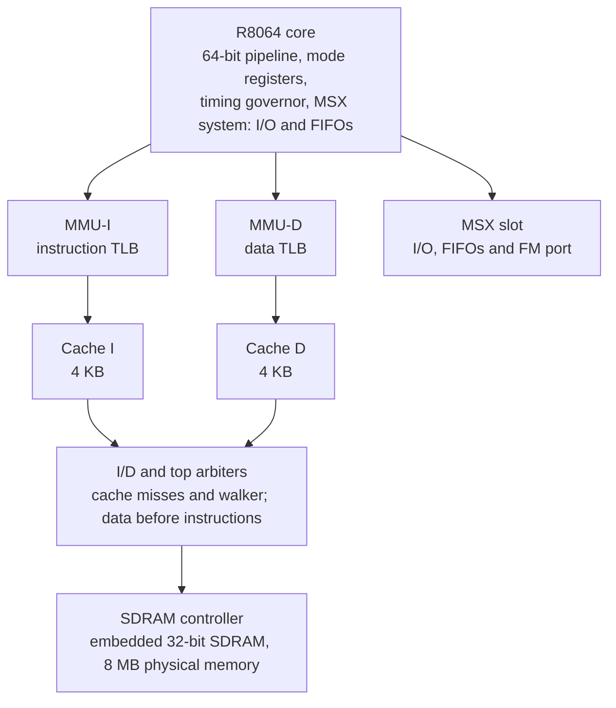

# R8064 - Datasheet (Preliminary) 2026

> Preliminary datasheet: the contents describe the REV48 design and may change. Appendix B (instruction tables by group, from the project document) is in [R8064_Datasheet_Appendix_B.md](R8064_Datasheet_Appendix_B.md). Appendix C (complete instruction list) is in [R8064_Datasheet_Appendix_C.md](R8064_Datasheet_Appendix_C.md) and Appendix D (measured instruction timing) in [R8064_Datasheet_Appendix_D.md](R8064_Datasheet_Appendix_D.md); both are generated from the sources (`modulos/13_soc/sim/meas/gen_doc_tables.py`).

Preliminary · November 20, 2026 · Edison · design revision REV48

64-bit CPU derived from the Z80, implemented in an FPGA (Tang Nano 20K, GW2AR-18) at 57.28 MHz, with Z80/R800 compatibility modes and a native 64-bit mode. **First silicon run on November 20, 2026**: the core runs on the Tang Nano 20K, and 256 of 256 measured instruction timings are equal to the simulation (section 11).

## 1. Overview

The R8064 is a 64-bit CPU derived from the Z80, described in Verilog and implemented in the Gowin GW2AR-18 FPGA of the Tang Nano 20K board. The clock target is 57.28 MHz (3.58 MHz × 16, the MSX frequency multiplied by 16).

**Main features**

- Single core with 5 operating modes (Z80 compatibility, R800 compatibility and native 64-bit mode, among others; see section 3).
- 64-bit registers with size-based access: B (8), W (16), L (32) and Q (64 bits).
- Floating-point arithmetic (FPU) done in firmware, with no dedicated hardware.
- Bank prefixes ED 0B / ED 0E / ED 0D to access the register banks.
- MMU with instruction and data TLBs (Sv39, Sv48, Sv57 and Sv64), 4 KB instruction cache and 4 KB data cache (direct-mapped, 32-byte lines).
- SDRAM controller for the board's embedded 32-bit memory (8 MB of physical memory, all reachable through the MMU).
- Bus and I/O interface for the MSX slot, FIFOs and FM port; MSX ↔ R8064 message protocol on I/O ports 0Bh–0Dh (chapter 8).
- 4-channel DMA (2 channels in the reduced cartridge builds), 5-master memory arbiter.
- Two privilege levels, system call and one-instruction context save (SVCTX/LDCTX) for multitasking (chapter 15).
- Software: resident monitor, `R8064.COM` and the `r8064io` driver for MSX-DOS, and the R8064AS assembler that runs on the MSX (section 8.2).

**Project status**

The project is verified by simulation (iverilog/vvp and Verilator), by synthesis and place-and-route (Gowin EDA; yosys/nextpnr for the earlier revisions) and, since November 20, 2026, **on the Tang Nano 20K**: the timing bench (section 11.1) runs the core from the board's 27 MHz crystal with the embedded SDRAM and measures 256 instruction cases, all equal to the simulation. Not yet tested on hardware: the MSX cartridge (slot interface, monitor, R8064.COM). Items not yet defined are marked "to be defined".

**Resource summary (Gowin EDA, GW2AR-LV18QN88C8/I7)**

| Resource | Cartridge, REV47 | Timing bench, REV48 (board-tested) |
| --- | --- | --- |
| Logic (LUT + ALU + RAM16) | 12,188 of 20,736 (59%) | 12,574 (61%) |
| Flip-flops | 5,600 (36%) | 6,098 (39%) |
| BSRAM | 46 of 46 | 46 of 46 |
| DSP | 4 of 24 | 4 of 24 |
| Clock / Fmax | 57.27 MHz / 59.94 MHz | 57.375 MHz / 58.51 MHz (TNS 0, setup and hold) |

The cartridge REV48 has not been placed and routed yet (same core as the bench; the slot interface replaces the bench UART).

**REV53c FPU on the board (2026-11-22):** the FPU test (`bench/fpu/gen_fpu_board.py`, Gowin project from `make_bench_pkg.py --fpu`) gives **60 OK, 0 different** on the Tang Nano 20K at 27 MHz: the 80-bit results and the latencies (FADD ~30 clocks, FMUL ~150, FDIV ~155, FSQRT ~220, FSIN/FCOS/FTAN 4,700-5,400) are equal to the RTL simulation (`docs/timings/fpu_tang20k_REV53c_2026-11-22.txt`).

**REV53c (2026-11-22): the FPU build runs on the board.** The REV53 bench with the FPU (98 % logic, 100 % CLS, 46/46 BSRAM) ran garbage from the first instruction, while the same bench without the FPU worked; the SDRAM phase sweep at 27 MHz (`r8064_sdtest_top -DR8064_SDT27`) passes at phases 12..15, so it was not the SDRAM (phase 14 is now the default at CPT 8). Fix: `R8064_NO_DMA` (the DMA keeps only the boot copy; CR19..CR30 and ports EDh-EFh are ignored) and page 32 of the ED decoder ROM_B as logic (the BSRAM ROM_B is exactly 8192 x 10). Gowin: 88 % logic, 94 % CLS, Fmax 35.97 MHz at 27 MHz. Bench on the Tang Nano 20K: selftest OK, **256 OK, 0 different** (`docs/timings/bench_tang20k_REV53c_2026-11-22.txt`). The bench does not contain FPU instructions, so the FPU itself is not yet exercised on the board.

**REV53 (2026-11-22): FPU back in the cartridge build at a reduced clock of 28.636 MHz (3.579545 × 8, rPLL ×2 from the board's 14.31818 MHz; CPT = 8, SDRAM REF_INT = 200 = 6.98 µs).** REV51 with the FPU reached 40.08 MHz in Gowin, so 28.64 MHz leaves margin. Z80 mode stays exact (Z80 Dhrystone on the RTL: 2,138,552 clocks = 267,319 T × 8). R800 mode is not exact at CPT 8: an R800 cycle would be 4 clocks, below the core issue floor of the governed mode, so short R800 instructions run longer than on a real R800. The bare-Tang timing bench and board benchmarks run at 27 MHz (rPLL ×1, SRC = 5; 28.64 MHz cannot be made from the 27 MHz crystal with PFD ≥ 3 MHz), so their Z80 mode runs at 3.375 MHz. Native performance scales with the clock (≈ 1.30 DMIPS at 28.64 MHz). Macros `R8064_CLK43` / `R8064_CLK57` select 42.95 / 57.27 MHz (they need the FPU-less build). Instruction timing reference: `bench/ref_rev53.json` (identical to REV52 in Z80 T-states). Not yet run in Gowin; SDRAM phase SDR_PSDA = 12 may need re-checking at the lower clock.

**REV52 (2026-11-21): cartridge clock 42.9545 MHz (3.579545 × 12, rPLL ×3 from the board's 14.31818 MHz).** The clock is a parameter chain (`CPT` = clocks per Z80 T-state: cart top → SoC → system → governor; `MUL14` in `r8064_clkgen`; SDRAM `REF_INT` = 25 × CPT = 300 = 6.98 µs). The governed modes stay exact (Z80 Dhrystone on the RTL: 3,207,828 clocks = 267,319 T × 12); R800 cycle = 6 clocks. Macro `R8064_CLK57` restores 57.2727 MHz. The cartridge build is again without the FPU (REV51 with the FPU reached only 40.08 MHz in Gowin: the FPU sequencer path mir → X has 25 logic levels; REV51 without it: 57.50 MHz, 64 % logic). Native performance scales with the clock (Dhrystone ≈ 3,420/s = 1.95 DMIPS at 42.95 MHz). SDRAM clock phase SDR_PSDA = 12 was measured at 57.27 MHz and may need a new sweep (`r8064_sdtest_top`).

**REV51 (2026-11-21): branch prediction in the decoder.** Stage A predicts JP nn (C3), JR e (18), CALL nn (CD) and RET (C9, 4-entry return stack), plus backward JR cc / DJNZ / JP cc, and restarts the fetch at the target immediately (the queue is rebased, the bytes of the instructions still in A/B stay counted before the target); the branch uop carries the prediction and X2 verifies it (taken to the same target: no flush; otherwise the normal flush, also to the next instruction when a predicted branch is not taken). Instructions that write CRs (except EI/DI/RETN/IM) or are privileged refetch the following instructions after they drain (MMU / mode changes). The fetch-fault distance is now full width. Gain over REV50: Dhrystone +9.6 % (2.60 DMIPS, 2.93× R800), Sieve +7 %, software float +7.6 %; Z80 mode unchanged; all regressions pass. Cost (yosys, cartridge): about +1,000 LUT4-eq (≈ 90 % of the GW2AR-18 estimated) — Gowin timing not yet run.

**REV50 (2026-11-21): overlapped decoder.** The decoder is now two overlapped stages: A (window capture, prefix removal, ED decoder and main-page ROMs, first-uop read, length) and B (complete decoded candidate: register indices, interlocks, issue). A starts the next instruction as soon as the length of the current one is known, so the issue floor between instructions is the same as inside a uop chain (4 clocks, 5 after a load / IN / MUL-DIV-FPU) instead of ≥ 8. Instructions that change state read at decode/issue time (CR writes, I/O, EI/DI/RETN/IM, privileged, EXX/EX AF) still wait for an empty pipeline; interrupts stop the issue and discard the candidate; the PC travels with the uop to M for the EPC. The partial-write interlock no longer waits for W. Gain (same binaries): Dhrystone +18 % (2.37 DMIPS), Sieve 1.19×, software float +19 %; Z80/R800 modes keep the governed timing (Z80 Dhrystone identical). All regressions pass (modules 09, 10 and 13, incl. 100 random free-running Z80 programs). Cost (yosys, cartridge): about +180 LUT4-eq. The measured instruction timings of Appendix D and the board bench reference (`bench/ref_rev48.json`) are REV48 values and must be regenerated.

**REV49c (2026-11-21): cartridge build = FPU, 2 DMA channels (`R8064_DMA2`), 32-bit addresses (`R8064_AW32`), without MLTSQ/MLTUQ/DIVSQ/DIVUQ (`R8064_NO_MD64`).** Yosys estimate (`synth_gowin`, cartridge top): LUT 15,318 + ALU 1,684 + 127 RAM16 ≈ 17,900 LUT4-eq (≈ 17,500 scaled to Gowin, ≈ 84 %) and 45 of 46 BSRAM — not yet run in Gowin. Measured steps: full core ≈ 19,600 (94 %); −AW32 −MD64 ≈ 18,050 (87 %); −DMA channels 2/3 ≈ 17,500 (84 %). The FPU itself is the large block (the REV48 build without it: 12,188). Regressions with these macros pass (SoC, SoC+DMA, exceptions, MMU 8 MB, native mapper, cartridge + monitor). `make_gowin_pkg.py --full` gives the full core, `--reduced-nofpu` the REV48 cartridge.

**REV49 (2026-11-21, superseded by REV49c): the cartridge build was the full core** (FPU, 64-bit MUL/DIV, 4 DMA channels, 64-bit addresses; no build macros). To make room for the FPU step ROM, the third register-file read port (`regfile64_d`, port D) moved from BSRAM to LUT RAM (frees 2 BSRAM). Yosys estimate (`synth_gowin`, cartridge top): about 20,060 LUT4-eq (LUT 17,222 + ALU 1,916 + 127 RAM16) and 45 of 46 BSRAM, against 12,469 and 46 for REV48; scaled to the REV48 Gowin result this is about 19,600 (≈ 94 %) — **not yet run in Gowin; timing at 57.27 MHz unknown**. If it does not fit or does not close timing: `make_gowin_pkg.py --reduced` (FPU kept; `R8064_DMA2 R8064_AW32 R8064_NO_MD64`, ≈ 14,900, 72 %) or `--reduced-nofpu` (the REV48 cartridge). Simulation regressions pass with the full core (SoC, exceptions, DMA, MMU, native mapper, cartridge + monitor); the timing bench (`bench/`) still uses the reduced macros.

**Tang Nano 20K build (REV47/REV48; option `--reduced-nofpu` since REV49).** The cartridge is synthesized with the macros `R8064_NOFPU` (no FPU), `R8064_DMA2` (2 DMA channels), `R8064_AW32` and `R8064_NO_MD64`. With `R8064_AW32` only the low 32 address bits are implemented: PC, fetch address, effective addresses and branch targets wrap modulo 2^32 and the high bits read as 0. With `R8064_NO_MD64`, MLTSQ, MLTUQ, DIVSQ and DIVUQ do not exist: they raise the unimplemented-instruction exception (cause 7) if CR14.TE = 1; otherwise they are skipped as a NOP of their own length.

Without these macros the core is the full 64-bit version, used in simulation. With yosys/nextpnr the cartridge uses 68% and does not route reliably; with Gowin EDA (Education edition) it closes with the figures in the table and generates the bitstream. The SDRAM clock phase was measured on the board: `SDR_PSDA` = 12 (270°), see section 7.

## 2. Architecture

The SoC consists of a core (R8064) with mode registers and a timing governor, the MSX system (I/O and FIFOs), an MMU with instruction and data TLBs, separate instruction (4 KB) and data (4 KB) caches, arbiters, the DMA and the SDRAM controller. The diagram below shows how the blocks connect.

The core reaches the SDRAM through the MMU and separate instruction and data caches:



With the MMU off (`mmu_en` = 0), the address passes straight through the low 32 bits.

## 3. Operating modes

The core is single; the 5 modes result from the combination of three configuration signals (`native64`, `is_z80`, `is_rom`):

| Mode | native64 | is\_z80 | is\_rom | Timing governor |
| --- | --- | --- | --- | --- |
| Z80 in ROM (reset) | 0 | 1 | 1 | active, Z80 timing |
| Z80 in DRAM | 0 | 1 | 0 | active, Z80 timing |
| R800 in ROM | 0 | 0 | 1 | active, R800 timing (+ ROM wait) |
| R800 in DRAM | 0 | 0 | 0 | active, R800 timing |
| Native 64-bit | 1 | – | – | off (no governor) |

**Mode registers (`r8064_mode.v`)**

- Port 3DH: a read returns 64H (ID); writing A5H arms **one** write to port 3EH (any other value disarms).
- Port 3EH (R8064\_MODE): bit 0 = NATIVE64; bits 2:1 = **reserved** (the system only runs at 57.28 MHz); bit 3 = BUSY (read-only).
- Ports E4H/E5H: S1990 emulated only in register 6 (bit 5: 0 = R800, 1 = Z80; bit 6: 0 = DRAM, 1 = ROM). Reset = 60H, i.e. Z80 in ROM.
- The other S1990 registers are not handled here; they are only passed through.
- The mode switch is applied at the instruction boundary (empty pipeline).

**Timing governor (`timing_gov.v`)**: holds the *issue* of the next instruction until the original time of the previous one has elapsed, so that Z80/R800 code keeps its timing. Details in chapter 6.

## 4. Programming model

**Registers and sizes.** The registers are 64 bits wide and can be accessed with four sizes: B (8 bits), W (16), L (32) and Q (64). Size encoding in the ED extensions: 00 = B, 01 = W, 10 = L, 11 = Q.

**Registers addressable in the ED 26 family (CPL/NEG)** — 3-bit `rr` field:

| rr | Register |
| --- | --- |
| 000 | BC |
| 010 | DE |
| 011 | IY |
| 100 | HL |
| 101 | IX |
| 111 | AX (accumulator, 64 bits) |
| 001, 110 | not registers |

The shadow set is accessed with EXX (BC', DE', HL') and EX AF,AF' (AX'). The physical map, the prefix banks, the control registers and the flags are in the subsections below.

**Control registers.** See subsection 4.3.

### 4.1 Physical register bank

The bank has 64 entries of 64 bits (`regfile64.v`, 2 reads and 1 write; two copies to infer BSRAM).

| Index | Register |
| --- | --- |
| 0 | QAX (accumulator AX) |
| 1, 2, 3 | QBC, QDE, QHL |
| 4 | QWX |
| 5, 6, 7, 8 | AX', BC', DE', HL' (shadow set) |
| 9, 10 | QIX, QIY |
| 11, 12 | QSP, QPC |
| 13 | internal temporary |
| 16 to 23 | N0 to N7 (prefix banks) |
| 32 to 63 | control registers |

Set swap: EXX swaps BC/DE/HL with BC'/DE'/HL'; EX AF,AF' swaps AX with AX'.

### 4.2 Prefix banks

| Prefix | Effect |
| --- | --- |
| ED 0B | shadow bank: executes EXX, the instruction and EXX again |
| ED 0E | bank N0 to N3: BC → N0, DE → N1, HL → N2, AX → N3 |
| ED 0D | bank N4 to N7: BC → N4, DE → N5, HL → N6, AX → N7 |

Illegality rules with a prefix: IX, IY, SP and PC are never banked; 8-bit operand in an N bank; instruction without a bankable operand; instruction longer than 12 bytes. In these cases the instruction is illegal (in this skeleton, it executes as a NOP with no write).

### 4.3 Control registers

Accessed by MFCR (`ED 0A n`) and MTCR (`ED 0C n`), with a 5-bit n. The control registers are numbered **CR00 to CR31**: CRnn is bank index 32 + nn, and the instruction's operand n is nn itself (for example, CR17 = index 49 = `MTCR 17`). Full map:

| CR | Bank index | Function |
| --- | --- | --- |
| CR00 to CR07 | 32 to 39 | free: software scratch (the exception handler uses them, for example, to switch stacks); no hardware function |
| CR08 | 40 | 64-bit timer comparator |
| CR09 | 41 | exception/interrupt vector (0040h after reset) |
| CR10 | 42 | interrupt enable (bit 0 = IE; the handler re-enables by writing here) |
| CR11 | 43 | exception cause |
| CR12 | 44 | fault address, or auxiliary value (SCALL: n; cause 7: 0 = illegal ED opcode, 2 = privileged in user mode) |
| CR13 | 45 | EPC |
| CR14 | 46 | MMU: bit 0 = enable, bit 1 = user (old form, accepted on write), bit 2 = TE (enables the illegal-instruction and divide-error exceptions), bits 15:8 = ASID, bits 18:16 = paging mode (0 Sv39, 1 Sv48, 2 Sv57, 3 Sv64) |
| CR15 | 47 | MMU: table root (20-bit PPN) |
| CR16 | 48 | write flushes the TLB by virtual address |
| CR17 | 49 | write: bit 0 = all, bit 1 = by ASID (bits 15:8), bit 2 = invalidates the caches |
| CR18 | 50 | privilege mode: bit 0 = U (current mode, 1 = user), bit 1 = PU (previous mode); SYSRT shifts it right by one bit |
| CR19 | 51 | DMA channel 0: SRC0 |
| CR20 | 52 | DMA channel 0: DST0 |
| CR21 | 53 | DMA channel 0: CTRL0 |
| CR22 | 54 | DMA channel 1: SRC1 |
| CR23 | 55 | DMA channel 1: DST1 |
| CR24 | 56 | DMA channel 1: CTRL1 |
| CR25 | 57 | DMA channel 2: SRC2 |
| CR26 | 58 | DMA channel 2: DST2 |
| CR27 | 59 | DMA channel 2: CTRL2 |
| CR28 | 60 | DMA channel 3: SRC3 |
| CR29 | 61 | DMA channel 3: DST3 |
| CR30 | 62 | DMA channel 3: CTRL3 |
| CR31 | 63 | free |

Final numbering (REV36, revised on 2026-11-16): CR00 to CR31 starting at index 32, with two digits. The privilege mode takes CR18 (implemented and tested in the core), so the DMA registers, formerly CR18 to CR29, moved to CR19 to CR30. The RTL, tests and old comments use the bank index (40 to 49 = CR08 to CR17); the comment in `regfile64.v` that numbered CR0 to CR19 was replaced by this table.

### 4.4 Flags

The flags register F is 8 bits wide, as in the Z80 (output `dbg_f[7:0]`). There is no 64-bit flags register. The bit layout is identical to the Z80 (table below), including the undocumented bits Y and X, which copy bits 5 and 3 of the result as on the Z80. The per-width rules (B, W, L, Q) follow the table. IFF1, IFF2 and the interrupt mode (IM 0/1/2) exist as in the Z80.

| Bit | 7 | 6 | 5 | 4 | 3 | 2 | 1 | 0 |
| --- | --- | --- | --- | --- | --- | --- | --- | --- |
| Flag | S | Z | Y | H | X | P/V | N | C |

Calculation rules by instruction width (B = 8, W = 16, L = 32, Q = 64 bits):

- C (carry): comes from the last bit of the operation (bit 7, 15, 31 or 63).
- Z (zero): tests the whole result, at the instruction width.
- S (sign): is the top bit of the width (7, 15, 31 or 63).
- P/V: in logical operations it is the parity of the low byte of the result only, as on the Z80; in arithmetic operations it is overflow, computed from the sign bit of the width used.
- H (half-carry): the carry from bit 3 to bit 4, at any width. Exception: ADD HL,pp, ADD IX,xx and ADD IY,yy use the carry from bit 11 to bit 12, as on the Z80; ADC HL,pp also uses the carry from bit 11 to bit 12 and SBC HL,pp uses the borrow at bit 12. In rotations, H is cleared (as on the classic Z80: RLCA, RLA, RRCA, RRA, RLC, RL, RRC, RR, RLD and RRD also clear H and N), and the same holds for shifts.
- N: independent of width; indicates that the last operation was a subtraction.
- Y and X: copy bits 5 and 3 of the result, as on the Z80.

PUSH AF, POP AF, SVCTX, LDCTX and SYSRT save and restore F in this same layout. These rules apply only to the flags an instruction affects; 16-bit INC and DEC, for example, change no flags.

## 5. Instruction set

The set starts from the Z80 and adds extensions through the ED prefix, indexed by decode pages (microcode ROM `uop.mem` and control ROM `ctrl.mem`).

**Summary.** The instruction set has 245 mnemonics in 495 operand forms: the whole Z80 set (including the undocumented instructions IXH/IXL/IYH/IYL, SLL, IN F,(C), OUT (C),0 and the CB forms with copy to a register), the R800 multiplications (MULUB/MULUW) and the R8064 extensions: 16/32/64-bit arithmetic, logic, shifts and rotations, compare, bit operations, loads with 64-bit absolute addresses and 16-bit displacements (QIX/QIY + dd), push/pop, 16/32/64-bit jumps, calls and returns (absolute, relative, through a register, conditional), multiply and divide, atomics (CAS, XCHG), port I/O by size, control registers, MMU and cache control, privilege and system calls, context save/load and the 80-bit FPU. The size is in the mnemonic: B = 8, W = 16, L = 32, Q = 64 bits.

- **Complete list:** Appendix C (generated from the assembler's instruction table, which is checked against the decode ROMs of the RTL): syntax, encoding, length, instruction id and measured clocks.
- **Measured timing:** Appendix D (REV48, native mode), confirmed on the board.
- **Descriptions:** Appendix A (operation, flags, binary encoding). **Tables by group:** Appendix B.

**Build options.** In the cartridge build (REV49b: `R8064_NO_MD64`; the REV48 build also had `R8064_NOFPU`) MLTSQ/MLTUQ/DIVSQ/DIVUQ (and, with `R8064_NOFPU`, the FPU instructions) do not exist: they raise cause 7 with CR14.TE = 1, otherwise they execute as a NOP of their own length.

**Encoding notes**

- **ED 26 family — CPL/NEG by size.** Third byte: size in \[7:6\] and register `rr` as in the table of section 4.
  - CPL x = `size,001,x` (register in \[2:0\]); NEG x = `size,x,001` (register in \[5:3\]).
  - Variants: CPLB/CPLW/CPLL/CPLQ and NEGB/NEGW/NEGL/NEGQ.
  - **Register A (the Z80 accumulator) is excluded**: the original Z80 CPL and NEG instructions remain valid for it. NEGB operates on AX.
  - Valid registers: for B, BC, DE and HL; for W, L and Q, BC, DE, HL and AX (according to the page 6 ROM).
- **Bank prefixes** ED 0B / ED 0E / ED 0D.
- **EXINI** (`ED 09`, id 291), **MFCR** (`ED 0A n`, id 292) and **MTCR** (`ED 0C n`, id 293) are defined; CPLB/NEGB have ids 294/295 (`ED 26`). Block instructions: LDIR `ED B0`, CPIR `ED B1`, INIR `ED B2`, OTIR `ED B3`, LDDR `ED B8`, CPDR `ED B9`, INDR `ED BA`, OTDR `ED BB`. Other encodings: **to be defined**.

**Known limitation.** NEGB writes the main AX and ignores the `swap_af` swap, as already happens in IN A,(C) and LD A,I.

The detailed description of each instruction is in Appendix A, the tables by group in Appendix B, the complete list with encodings in Appendix C and the measured timing in Appendix D. The "R8064 T / R8064 W" columns of Appendices A and B come from the planning model (`ref/expected_cycles.csv`) and are superseded by Appendix D.

### 5.1 ED prefix opcode table

Source: `ref/instr_ids.csv` (292 ids; CPLB and NEGB, ids 294 and 295, were added later). Opcodes ED 40 to 7F are the instructions inherited from the Z80. `rr` = register as in section 4; `uu`, `vv`, `tt`, `kk`, `u` are operands defined in the source.

| ED | Instructions |
| --- | --- |
| 00\~01 | PROT |
| 02 | CMPW, CMPL, CMPQ rr, rr' |
| 03 | RETL cc; RETQ cc |
| 04 | RETL |
| 05 | RETQ |
| 06 | RLCW, RLCL, RLCQ rr |
| 07 | RRCW, RRCL, RRCQ rr |
| B4\~B7 | JP USER, (uu) |
| 10 | FSINC ST0 |
| 11 | FSQRT ST0 |
| 12 | FST80 (QHL) |
| 13 | FSTP8 (QHL) |
| 14 | FSTSW |
| 15 | FTAN ST0 |
| 16 | FYL2P ST0 |
| 17 | FYL2X ST0 |
| 18\~1F | FSUB ST0, STn |
| 20 | LDCR kk, rr |
| 21 | STCR rr, kk |
| 22 | SCALL n |
| 23 | WAKE |
| 24 | STDBY |
| 25 | RESET |
| 26 | CPLB, CPLW, CPLL, CPLQ; NEGB, NEGW, NEGL, NEGQ (3rd byte: size in \[7:6\]) |
| 27 | INW, INL, INQ rr,(C); OUTW, OUTL, OUTQ (C),rr |
| 28 | SRLW, SRLL, SRLQ rr |
| 29 | SARB u; SARW, SARL, SARQ rr; SLAW, SLAL, SLAQ rr |
| 2A | JRW cc,nn; JPL (vv); JPL cc,(vv); JPL cc,nnnn; JPQ (vv); JPQ cc,(vv); JPQ cc,nnnnnnnn |
| 2B | JPQ nnnnnnnn |
| 2C | JPL nnnn |
| 2D | JRW nn |
| 2E | DJNZW nn |
| 2F | SETW bbbb,tt |
| 30 | BITW bbbb,tt; RESW bbbb,tt |
| 31 | SETL bbbbb,tt |
| 32 | RESL bbbbb,tt |
| 33 | BITL bbbbb,tt |
| 34 | CALLQ nnnnnnnn |
| 35 | CALLL nnnn |
| 36 | XORW, XORL, XORQ rr,rr'; CALLQ (rr); CALLQ cc,(rr) |
| 37 | ORW, ORL, ORQ rr,rr'; CALLL (rr); CALLL cc,(rr) |
| 38 | POPL, POPQ, PUSHL, PUSHQ rr; ANDW, ANDL, ANDQ rr,rr' |
| 39 | LDQ: (nnnnnnnn),rr; (rr),rr'; rr,(rr'); rr,nnnnnnnn; rr,rr'; rr,(nnnnnnnn) |
| 3A | LDL: (nnnnnnnn),rr; (rr),rr'; rr,(rr'); rr,nnnn; rr,rr'; rr,(nnnnnnnn) |
| 3B | LDW: (nnnnnnnn),rr; (rr),rr'; rr,(rr'); rr,nn; rr,rr'; rr,(nnnnnnnn) |
| 3C | DECW, DECL, DECQ rr; SUBW, SUBL, SUBQ rr,rr'; DIVUB, DIVUW, DIVUL, DIVUQ |
| 3D | SUBCW, SUBCL, SUBCQ rr,rr'; DIVSB, DIVSW, DIVSL, DIVSQ |
| 3E | ADDW, ADDL, ADDQ rr,rr'; INCW, INCL, INCQ rr; MLTUW, MLTUL, MLTUQ |
| 3F | ADCW, ADCL, ADCQ; MLTSB, MLTSW, MLTSL, MLTSQ |
| 40\~7F | Z80 ED instructions (IN r,(C); OUT (C),r; SBC/ADC HL,rr; LD (nn),rr; LD rr,(nn); NEG; RETN; RETI; IM 0/1/2; LD I,A; LD R,A; LD A,I; LD A,R; RRD; RLD; NOPs) |
| 80 | FCOPP ST0,ST1 |
| 81 | FCOS ST0 |
| 82 | FINIT |
| 83 | FIST |
| 84 | FISTP |
| 85 | FLD80 (QHL) |
| 86 | FLDL2 |
| 87 | FLDLG |
| 88\~8F | FDIV ST0,STn |
| 90 | FLDLN |
| 91 | FLDPI |
| 92 | FLDZ |
| 93 | FLN ST0 |
| 94 | FLUSH |
| 95 | FREM |
| 96 | FREM1 |
| 97 | FSIN ST0 |
| 98\~9F | FMUL ST0,STn |
| A0 to A3 | LDI, CPI, INI, OUTI |
| A4 | SYSRT |
| A5 | FENCE |
| A6 | ISYNC |
| A8 to AB | LDD, CPD, IND, OUTD |
| AC | XCHGL rr,(rr'); XCHGQ rr,(rr') |
| AD | CASL (rr'),rr; CASQ (rr'),rr |
| AE | SVCTX (uu); LDCTX (uu) |
| AF | FSAVE (uu); FRSTR (uu) |
| B0 to B3 | LDIR, CPIR, INIR, OTIR |
| B8 to BB | LDDR, CPDR, INDR, OTDR |
| BC | FADD ST0,STn; FXCH STn; FLD STn; FSTP STn; FCOM STn; FCHS; FABS; FLD1; FRINT; FILD, FLD32, FLD64, FST32, FSP32, FST64, FSP64 (QHL) |
| C3 | MLTUW HL,BC |
| C4\~FC | PGINV (uu) |
| DD | LDW, LDL, LDQ with (QIX+dd), register or immediate |
| FD | LDW, LDL, LDQ with (QIY+dd), register or immediate |
| F3 | MLTUW HL,SP |

Notes:

- `JP USER, (uu)` uses `ED B4~B7` (B4 = BC, B5 = DE, B6 = HL, B7 = AX; the register is given by the low 2 bits of the second byte). Decision of REV34 (2026-11-14): the range `ED 08~0F`, where it had been planned in REV33, stays with the opcodes the core has always used there: EXINI `ED 09`, MFCR `ED 0A n`, shadow bank prefix `ED 0B`, MTCR `ED 0C n`, N4 to N7 `ED 0D`, N0 to N3 `ED 0E`; `ED 08` and `ED 0F` are free (illegal). The remapping planned in REV33 (EXINI to B4, MFCR to B5, MTCR to B6, prefixes to BD, BE and BF) was **not** carried out, because it collided with JP USER. The RTL, the tests and the instruction tables follow this paragraph (re-checked on 2026-11-16).
- `MLTUB HL,u` is inherited from the R800: it needs no third byte; the register operand is defined in the second byte (`ED` followed by `11 r 001`).
- The 3D instructions (ED F8, FA, FB) were removed from the core and are nonexistent instructions.
- Instructions without the ED prefix (Z80 base set): same as the Z80, with the timing of `ref/z80_classico_tstates.csv`.

Remapped opcodes (ED + second byte):

| ED | Function |
| --- | --- |
| 09 | EXINI (undoes EXX and EX AF,AF') |
| 0A n | MFCR: AX ← CR\[n\] |
| 0B | shadow bank prefix |
| 0C n | MTCR: CR\[n\] ← AX |
| 0D | bank prefix N4 to N7 |
| 0E | bank prefix N0 to N3 |
| B4 to B7 | JP USER, (uu): BC, DE, HL, AX |

In the MFCR/MTCR encoding, operand n ranges from 0 to 31 and selects bank index 32 + n (CR00 = index 32 up to CR31 = index 63; CR08 = index 40, timer, up to CR17 = index 49).

## 6. Timing and clock

**Base clock.** 57.2727 MHz = 3.579545 MHz × 16, generated by a PLL from the 27 MHz crystal (or from an external clock, SRC 1/2/3). The generator is in `r8064_clkgen.v`.

**Governor units.** The governor (`timing_gov.v`) describes its times in pipeline clocks. The only operating clock is 57.28 MHz; the 114.56 MHz and 85.92 MHz clocks were discarded. At 57.28 MHz, the units are equivalent to:

| Mode | 1 unit | 57.28 MHz clocks | Equivalent frequency |
| --- | --- | --- | --- |
| Z80 | 1 T-state | 16 | 3.579545 MHz |
| R800 | 1 cycle | 8 | 7.15909 MHz |

**Time of an instruction**

- Z80: T-states from the table + (2-byte M1 ? 2 : 1) × M1\_WAIT, the same in ROM and DRAM.
- R800: total DRAM cycles from the table + (ROM mode ? WAIT\_ROM : 0) + dynamic extra (page break, external memory).
- False condition or last iteration: the `alt_ev` event shortens the time already loaded.
- R800 extras: refresh (REF\_CYC = 25 cycles every REF\_PER = 210) and an 8 µs pause between accesses to ports 98H–9BH.
- Default parameters: M1\_WAIT = 1, WAIT\_ROM = 3.

**Note.** The `timing_gov.v` RTL was adjusted to these constants (16 and 8 clocks per unit; 8 µs VDP pause = 458 clocks; 210-cycle refresh = 1680 clocks, 25-cycle duration = 200 clocks). The timing tests (`tb_gov`, `tb_mode`) were updated but have not yet been run.

### 6.1 Native-mode instruction timing (measured, REV48)

In native mode there is no governor: an instruction takes the clocks of the pipeline. Measured with code and data in the caches (Appendix D; 256 cases also measured on the Tang Nano 20K, identical):

- **Decoder floor: 8 clocks per instruction.** The 4-phase decoder takes 8 clocks; every register/ALU instruction of any size (B, W, L, Q), immediate loads, bit operations, shifts and rotations, FENCE, ISYNC and the not-taken branches take exactly 8 clocks. The fetch of the next bytes overlaps the decode, so these instructions have **no wait clocks**.
- **Memory waits** appear only where the core must stop for memory: a load waits 3 clocks for the data cache (loads take 11 clocks), a store takes 15 (absolute or indexed) or 11 (through a register); a taken jump or call restarts the fetch at the target (fetch wait of 3 to 5 clocks).
- **Multi-cycle units:** multiply 16–21 clocks, divide 25–49, CAS 31–35, XCHG 27, SVCTX 180.
- **Fractional values** (e.g. 17.12) are averages over 16 copies: the alignment of the code in the 32-byte cache line changes the fetch wait slightly.

Summary by class (native mode, cartridge build, in cache):

<!-- BEGIN TIMING_SUMMARY -->
| Class | Cases | Total (avg) | Execution (avg) | Wait (avg) | Fastest | Slowest |
| --- | --- | --- | --- | --- | --- | --- |
| ALU 64-bit (1 cycle) | 54 | 8.00 | 8.00 | 0.00 | 8.00 | 8.00 |
| Register/immediate | 6 | 8.00 | 8.00 | 0.00 | 8.00 | 8.00 |
| ALU/bit (1 cycle) | 6 | 8.00 | 8.00 | 0.00 | 8.00 | 8.00 |
| Control (CR) | 1 | 8.00 | 8.00 | 0.00 | 8.00 | 8.00 |
| Barrier | 2 | 8.00 | 8.00 | 0.00 | 8.00 | 8.00 |
| MMU | 1 | 8.00 | 8.00 | 0.00 | 8.00 | 8.00 |
| Load | 9 | 11.00 | 8.00 | 3.00 | 11.00 | 11.00 |
| Store | 12 | 14.00 | 11.00 | 3.00 | 11.00 | 15.00 |
| Branch | 16 | 14.80 | 11.75 | 3.05 | 8.00 | 20.00 |
| Push | 2 | 15.00 | 12.00 | 3.00 | 15.00 | 15.00 |
| Pop | 2 | 16.00 | 13.00 | 3.00 | 16.00 | 16.00 |
| Z80 ED instruction in native mode | 80 | 17.89 | 15.31 | 2.58 | 8.00 | 51.00 |
| Multiplier in DSP 18x18 | 8 | 18.50 | 18.50 | 0.00 | 16.00 | 21.00 |
| Call | 8 | 26.44 | 20.00 | 6.44 | 16.00 | 35.00 |
| Return | 6 | 27.33 | 19.33 | 8.00 | 16.00 | 35.00 |
| Atomic | 4 | 30.12 | 24.00 | 6.12 | 27.00 | 35.25 |
| Iterative divider 1 bit/cycle | 6 | 39.12 | 39.12 | 0.00 | 25.00 | 49.00 |
| Context | 1 | 180.00 | 132.00 | 48.00 | 180.00 | 180.00 |
<!-- END TIMING_SUMMARY -->

Typical values (clocks; ns at 57.375 MHz): register ALU 8 (139 ns); load 11 (192 ns); store 11–15; JPL/JPQ absolute 16.75; taken JR/JRW 17.12; CALL 27.75–31; RET 31 (return alone); PUSH 15, POP 16; DIVUL 49 (854 ns).

**REV48 changes (wait reduction).** With the MMU off, fetch and data requests skip the TLB stage (2 clocks less per cache access), consecutive fetch requests are issued back to back, and the decoder starts with 4 bytes of the instruction window instead of waiting for the whole window. Compared with REV47: loads, branches, calls and returns are 12 % to 40 % faster; ALU instructions are unchanged (they were already at the decoder floor). A further step would need a pipelined decoder (below 8 clocks); not done.

**Cache misses.** The values above assume hits. A miss fills a 32-byte line from the SDRAM (4 reads of 64 bits) and repeats the access; its cost depends on the open SDRAM page and on refresh, and has not been characterized yet.

### 6.2 PLL

**PLL in the board top.** With the 27 MHz crystal (SRC 0), the rPLL generates 57.375 MHz (REV26b), about 0.18% above the 57.2727 MHz target. As a result the internal Z80 (divider step 2^28, computed for 57.2727 MHz) runs near 3.586 MHz instead of 3.579545 MHz. With the 27 MHz crystal, 57.375 MHz is the best possible rPLL ratio (the exact 70/33 ratio would require a PFD below 3 MHz); the exact 57.2727 MHz clock only comes with SRC = 1 (external 3.579545 MHz), SRC = 2 (57.2727 MHz oscillator) or SRC = 3 (14.31818 MHz). The 0.18% error is accepted during bring-up. Decision for the final version: **to be defined**.

## 7. Memory

**Paths.** Instructions: core → MMU-I → I cache → I arbiter (I cache > I walker) → top arbiter (D > I) → SDRAM controller. Data: core → MMU-D → D cache → D arbiter (D cache > D walker) → top arbiter.

| Block | Characteristic |
| --- | --- |
| Instruction cache | 4 KB, direct-mapped, 128 lines of 32 bytes (4 × 64 bits) |
| Data cache | 4 KB, direct-mapped, 32-byte lines, write-through with a 4-entry write buffer, no write allocate |
| TLB | one for instructions and one for data |
| Physical memory | 8 MB (64-bit word index with 20 bits = `p_addr[22:3]`) |
| SDRAM | embedded in the Tang Nano 20K, 32 bits, 64 Mbit; CL = 2, BL = 2 (one 64-bit access = 2 words), open-page policy; `INIT_CYC` = 20000, `REF_INT` = 400; clock phase 270° (`SDR_PSDA` = 12) |

**MMU.** With `mmu_en` = 0 the address passes straight through (low 32 bits). Translation faults raise an exception: cause in CR11, address in CR12, EPC in CR13; jump to the vector in CR09. The MMU control is in CR14–CR17 (ASID, table root, TLB flush and cache invalidation). Page table format and replacement policy: **to be defined**.

**MMU prepared for 64 bits (REV38).** The paging mode is chosen in CR14\[18:16\]; switching the mode flushes the TLB. 4 KB pages, 9 index bits per level, 64-bit PTE (`V R W X U G A D` in bits 0 to 7, 44-bit PPN in bits 53:10).

| Mode | Name | Levels | VA bits translated | Canonicity check |
| --- | --- | --- | --- | --- |
| 0 | Sv39 (default) | 3 | 39 | bits 63:39 = copy of bit 38 |
| 1 | Sv48 | 4 | 48 | bits 63:48 = copy of bit 47 |
| 2 | Sv57 | 5 | 57 | bits 63:57 = copy of bit 56 |
| 3 | Sv64 | 6 | 64 (the top level indexes VA\[63:57\], 7 bits) | none: the whole 64-bit space is translatable |
| 4 to 7 | reserved | — | — | every translation faults (cause 1) |

- **Superpages:** the leaf may be at any level k (2 MB, 1 GB, ...). The PPN must be aligned to 2^(9k) pages, otherwise it faults (cause 1).
- **Physical memory:** today only PPNs within the 8 MB (PPN\[19:11\] = 0 and bits 53:30 = 0) are accepted; any other gives a bus fault (cause 4). The PTE format already holds physical addresses of up to 56 bits, but the memory path (caches, SDRAM, DMA) is still 8 MB.
- **TLB:** the tag stores VA\[63:12\] (52 bits) and the leaf level; the comparison ignores the low bits according to the level. The flush by virtual address (CR16) compares all 64 bits.
- **Cost:** +457 LUT4-eq in the board top (14,766 in total, 71.2%). Fmax with the 52-bit TLB comparators has not yet been measured.

### 7.1 Physical memory, MSX mapper, MegaRAM and MMU (REV41)

**8 MB physical map.** The embedded SDRAM is 64 Mbit (8 MB). Each access is a 64-bit word; the word index has 20 bits (`p_addr[22:3]`). The system ROM is in BSRAM, outside these 8 MB.

| Physical range | Size | Use |
| --- | --- | --- |
| 000000h–3FFFFFh | 4 MB | MSX mapper: 256 segments of 16 KB |
| 400000h–5FFFFFh | 2 MB | MegaRAM: 256 banks of 8 KB |
| 600000h–7FFFFFh | 2 MB | Free (general RAM; reachable by the MMU and the DMA) |

**The mapper and MegaRAM work in all modes** (Z80, R800 and native 64-bit). The registers and ports are always active. What changes between modes is the 16-bit address window:

- Z80/R800 modes: the 64 KB window always applies (the MMU does not take part).
- Native mode with the MMU off (CR14 bit 0 = 0): the window applies to addresses below 64 KB (VA\[63:16\] = 0). Above that the address passes straight through.
- Native mode with the MMU on: the window is off and the MMU rules. The registers remain accessible, and the physical mapper and MegaRAM areas are ordinary memory that software can map through the page tables.

With the slot register A8h at 00h (reset value), no page falls in the mapper or the MegaRAM; therefore native programs that do not use these ports are not affected.

**I/O registers (mapper and slots).**

| Port | Function | Reset |
| --- | --- | --- |
| A8h | Primary slot, 2 bits per page (bits 1:0 = page 0 ... bits 7:6 = page 3). Read and write. | 00h |
| FCh | Mapper segment in page 0 (0000h–3FFFh) | 3 |
| FDh | Segment in page 1 (4000h–7FFFh) | 2 |
| FEh | Segment in page 2 (8000h–BFFFh) | 1 |
| FFh | Segment in page 3 (C000h–FFFFh) | 0 |
| 8Eh | MegaRAM write mode | ASCII8 |

The mapper responds when the page's slot (A8h) is 3. Physical address = 000000h + {segment\[7:0\], address\[13:0\]}. The mapper RAM is always writable. A read of FCh–FFh returns the register, with the bits above the mask at 1 (with 8 bits all are valid: 4 MB).

**MegaRAM (port 8Eh).** It appears in slot 2, only in pages 1 and 2 (4000h–BFFFh). There are 256 banks of 8 KB (2 MB) at 400000h–5FFFFFh. Four 8 KB windows, each with a bank register (reset 0):

| Window | Bank register | Write address that changes it |
| --- | --- | --- |
| 4000h–5FFFh | bank 0 | 6000h |
| 6000h–7FFFh | bank 1 | 6800h |
| 8000h–9FFFh | bank 2 | 7000h |
| A000h–BFFFh | bank 3 | 7800h |

Physical address = 400000h + {bank\[7:0\], address\[12:0\]}. The bank register is selected by address\[12:11\] on a write to 6000h–7FFFh.

- `OUT (8Eh)` puts the MegaRAM in ASCII8 mode: the RAM becomes read-only and writes to 6000h–7FFFh only switch the bank.
- `IN (8Eh)` turns on write mode: the byte goes to the RAM and, if the address is in 6000h–7FFFh, it also updates the bank register.
- Protection is done in the system: a data write to the MegaRAM in ASCII8 mode goes out with byte-enable zero and does not change the memory.
- The semantics of 8Eh and the order of ports FCh–FFh follow the project specification and **have not yet been confirmed on real MSX hardware**.

**MMU (native mode).** Control registers via `MTCR`/`MFCR`: CR09 vector, CR11 cause, CR12 fault address, CR13 EPC, CR14 `{mode[18:16], ASID[15:8], user[1], en[0]}`, CR15 root PPN, CR16 (write) TLB flush by virtual address, CR17 (write) bit 0 all, bit 1 by ASID, bit 2 invalidates caches. With `en` = 0 the address passes straight through the low 32 bits and addresses from 8 MB up do not fault (the high part is ignored). With `en` = 1 the MMU translates 4 KB pages (9 bits per level) with a fully associative TLB (8-bit ASID, global bit, replacement: first invalid entry, otherwise round-robin). On a TLB miss the table walker reads memory through the same arbiter as the caches. Since REV44, each page-walk level costs the PTE read plus 1 clock to decode it: a full Sv39, Sv48, Sv57 or Sv64 walk adds 3, 4, 5 or 6 clocks, and a superpage adds 1 clock per level visited. PTE format: \[0\]V \[1\]R \[2\]W \[3\]X \[4\]U \[5\]G \[6\]A \[7\]D \[53:10\]PPN. A/D are handled by software. Causes: 1 page (invalid, non-canonical or misaligned superpage), 2 permission, 3 A/D, 4 outside memory (PPN above 8 MB). User mode only accesses pages with U = 1; supervisor does not execute U = 1 pages.

**Use of the 8 MB.** In Z80/R800 modes only the mapper (4 MB) and the MegaRAM (2 MB) apply; the 2 free MB are not reached. In native mode, the MMU can map any virtual address to any page of the 8 MB, and the DMA in physical mode sees the whole 8 MB. With the MMU off, the native program uses the mapper and the MegaRAM through the 64 KB window.

**Future 64-bit address access.** The MMU already translates 64-bit virtual addresses: CR14\[18:16\] = 0 Sv39 (default), 1 Sv48, 2 Sv57, 3 Sv64 (6 levels; the top level indexes VA\[63:57\], with no canonicity check); 4–7 reserved (every translation faults, cause 1). The TLB stores VA\[63:12\]. The PTE holds 56 bits of physical address, but the memory path (caches, arbiter, SDRAM controller) uses a 20-bit index and the embedded SDRAM is only 8 MB; going beyond requires widening these buses and an external memory. In the DMA the 64-bit access is only reserved: SRC/DST\[63:24\], CTRL\[21\] (VIRT) and CTRL\[62:32\] (high COUNT) must be zero, otherwise the channel ends with an error. A complete virtual version of the DMA was simulated and is kept outside the project (`.futuro` files).

### 7.2 SDRAM interface on the board

**Clock phase (measured, 2026-11-20).** The SDRAM clock is the rPLL output CLKOUTP, shifted by `SDR_PSDA` × 22.5° from the system clock. The SDRAM phase test (`rtl/r8064_sdtest_top.v`: the same `sdram_ctrl`, 57.375 MHz, 8,192 64-bit words written and read back for each of the 16 phases) gave:

| SDR_PSDA (phase) | 0–6 (0°–135°) | 7 (157.5°) | 8–9 | 10–13 (225°–292.5°) | 14 | 15 |
| --- | --- | --- | --- | --- | --- | --- |
| Words with errors (of 8,192) | all | 0 | all | **0** | 5,745 | all |

The design uses **12 (270°)**, the middle of the error-free window. The former default 4 (90°) read every word one clock late (the low 32 bits returned the high 32 bits), so the core fetched wrong instruction bytes.

**I/O standard.** The embedded SDRAM ports (`O_sdram_*`, `IO_sdram_dq`) have no `IO_LOC` but must be constrained as `LVCMOS33`: Gowin defaults unconstrained ports to LVCMOS18, which locks their bank at 1.8 V and conflicts with the 3.3 V pins of the same bank (error CT1136 with clk27 on pin 4).

**Part number.** The Tang Nano 20K uses the GW2AR-LV18QN88**C8/I7** (with the SDRAM). The variant GW2AR-LV18QN88**P**C8/I7 has a 1.8 V PSRAM instead and must not be selected in Gowin.

## 8. Interfaces

**MSX bus and I/O.** The SoC exposes I/O (`io_*`), external I/O (`io_x_*`), port `port_c`, FM port (`fm_*`) and FIFOs (base `E8H`, with `fifo_irq` and `fifo_rst`). In the current board top the MSX bus inputs are tied to 0; there is not yet a way to load a program beyond the `.mem` ROMs of the package.

**Pins of the timing bench (`r8064_bench_top`, bare Tang Nano 20K, QN88, 3.3 V)**

| Signal | Pin | Function |
| --- | --- | --- |
| clk27 | 4 | 27 MHz crystal |
| btn\_rst | 88 | KEY1: a level change restarts the bench |
| uart\_tx | 69 | UART to the board's USB serial (BL616), 115200 8N1 |
| uart\_rx | 70 | not used |
| led\[5:0\] | 15–20 | active low: PLL locked, clock blink, UART activity, SDRAM ready, KEY1, crystal blink |

The cartridge top (`r8064_cart_top`, V9968\_Cartridge board) uses the 14.31818 MHz clock of the board (pin 80, SRC = 3) and the slot pins of `pnr/tangnano20k_cart.cst`.

**Board top pins (`r8064_board_top`, earlier bring-up top, QN88, 3.3 V)**

| Signal | Pin | Function |
| --- | --- | --- |
| clk27 | 4 | 27 MHz crystal |
| clk\_ext | 13 / 10 / 80 | external clock (SRC 1 / 2 / 3); unused with SRC 0 |
| btn\_rst | 88 | reset, active high |
| dbg\_init | 84 | 1 when the SDRAM has finished initialization |
| dbg\_lock | 83 | 1 when the PLL has locked |
| dbg\_sig | 82 | registered XOR of the SoC outputs (only moves with the core running) |
| dbg\_hb | 81 | heartbeat, ≈ 1.7 Hz at 57.3 MHz |

The SDRAM is embedded, with no pin constraints. The pinout of the MSX expansion slot (50 pins) is in the table below; direction is seen from the computer.

| Pin | Signal | Direction | Description |
| --- | --- | --- | --- |
| 1 | /CS1 | Output | Memory read select, 4000h–7FFFh |
| 2 | /CS2 | Output | Memory read select, 8000h–BFFFh |
| 3 | /CS12 | Output | Memory read select, 4000h–BFFFh |
| 4 | /SLTSL | Output | Low when this slot is selected |
| 5 | n/c | – | Not connected |
| 6 | /RFSH | Output | CPU refresh cycle |
| 7 | /WAIT | Input (open collector) | Extends the bus cycle |
| 8 | /INT | Input (open collector) | Interrupt request |
| 9 | /M1 | Output | Opcode fetch cycle |
| 10 | /BUSDIR | Input | Data direction control (rarely used) |
| 11 | /IORQ | Output | I/O request (port number on the address bus) |
| 12 | /MREQ | Output | Memory request |
| 13 | /WR | Output | Write strobe |
| 14 | /RD | Output | Read strobe |
| 15 | /RESET | Input | System reset |
| 16 | n/c | – | Not connected |
| 17 to 32 | A0 to A15 | Output | Address bus |
| 33 to 40 | D0 to D7 | Bidirectional | Data bus |
| 41, 43 | GND | – | Ground |
| 42 | CLOCK | Output (from the MSX) | 3.58 MHz clock |
| 44, 46 | SW1, SW2 | – | Not connected (insertion detection) |
| 45, 47 | +5 V | Output | Supply, up to 300 mA per slot |
| 48 | +12 V | Output | Supply, 50 mA shared across all slots |
| 49 | SOUNDIN | Input | Audio input |
| 50 | -12 V | Output | Supply, 50 mA shared across all slots |

**Clock and usage flow.** The slot CLOCK (pin 42) is 3.58 MHz and, for the cartridge, read-only: the R8064 neither generates nor alters it, and keeps running at 57.28 MHz internally. The MSX sends data and programs to the R8064 through the slot; the R8064 processes them at 57.28 MHz and returns the results to the MSX through the same slot, respecting the 3.58 MHz cycles and the /SLTSL, /MREQ, /IORQ, /RD, /WR and /WAIT signals. The slot has only A0–A15 and D0–D7; therefore every exchange with the MSX is done in bytes with 16-bit addresses, and 16/32/64-bit accesses stay inside the SoC.

**Exchange window and control.** The exchange uses the window 8000h–BFFFh (MSX page 2), for both programs and data, in 16 KB blocks: the MSX writes (or reads) a whole block in the window and the R8064 consumes (or prepares) it. I/O port 0Bh is the status and command port of the exchange. The bit format of port 0Bh and the synchronization (no /WAIT; /INT optional) are in the protocol right below, **approved in REV46**.

**Block buffer (implementation proposal, to be validated in synthesis).** The 16 KB block of the window is kept in FPGA BSRAM: 128 kbit, about 8 to 10 blocks of 18 kbit out of the 828 kbit of the GW2AR-18, in addition to what the caches and TLBs already use. The MSX sees the buffer in the window 8000h–BFFFh; the core accesses it by physical address.

**MSX ↔ R8064 transfer protocol (approved in REV46).** The protocol uses I/O ports 0Bh, 0Ch and 0Dh and the window 8000h–BFFFh, and it reuses the FIFO interface that already exists in RTL (`r8064_fifo_if`: DATA, STATUS/CMD, LEN\_L and LEN\_H, 2,048-byte FIFOs, START, busy and done). It has two layers: (1) messages of up to 2,048 bytes through the FIFOs, for commands, replies and small data; (2) 16 KB blocks through the window. The MSX is always the master and there is one pending message at a time (stop and wait). /WAIT is not used: status and window reads answer within the Z80 cycle at 3.58 MHz. /INT is optional (command bit 2). Status (REV46): layer 1, window ownership (WINDOW bit), the ERROR bit, the decoding of ports 0Bh to 0Dh (`r8064_slot_dec`), the 16 KB buffer (`r8064_xbuf`) and the buffer ↔ SDRAM transfer by the DMA are in RTL and passed simulation; in the current board top the slot inputs are still tied to 0 (the slot pins are not assigned yet) and the R8064 monitor has not been written.

**Ports.**

| Port (MSX) | R8064 side (E8h + n) | Read | Write |
| --- | --- | --- | --- |
| 0Bh | +1 (STATUS) and +4 (FLAGS) | STATUS | COMMAND |
| 0Ch | +0 (DATA) | next byte of the R8064→MSX FIFO | pushes into the MSX→R8064 FIFO |
| 0Dh | +2 (LEN\_L) and +3 (LEN\_H) | LEN\_L then LEN\_H | LEN\_L then LEN\_H |

On port 0Dh a pointer alternates between LEN\_L and LEN\_H on each access; it returns to LEN\_L on reset and on the clear command (bit 1), so the two bytes must always be read or written in pairs, in the order L, H.

**STATUS (read of port 0Bh).**

| Bit | Name | Meaning |
| --- | --- | --- |
| 0 | DATA | there is a byte to read at 0Ch |
| 1 | SPACE | there is room to write at 0Ch |
| 2 | BUSY | the R8064 is processing; set by hardware on START |
| 3 | DONE | reply or event ready |
| 4 | IRQ | DONE with IRQ enabled |
| 5 | WINDOW (new) | 1 = the window belongs to the MSX |
| 6 | ERROR (new) | FIFO overflow or underflow; cleared by the clear command |
| 7 | (new) | always 0; a value of 1 means there is no card (a floating bus returns FFh) |

**COMMAND (write to port 0Bh).** Bit 0: START (the message is in the FIFOs and LEN has been written). Bit 1: clears the FIFOs, the LEN pointer and ERROR. Bit 2: enables /INT (level). Bit 3: restarts the R8064 (pulse). Bit 7: clears DONE and IRQ. Bits 4 to 6 are reserved (write 0). On START the hardware sets, in the same cycle, BUSY = 1, DONE = 0 and WINDOW = 0, so a status read right after START already sees BUSY. When the R8064 marks DONE (FLAGS bit 2), the hardware sets BUSY = 0 and WINDOW = 1.

**Window (layer 2).** With WINDOW = 1, a read or write at 8000h–BFFFh with /SLTSL active accesses the 16 KB buffer (address A\[13:0\]); with WINDOW = 0 a read returns FFh and a write is ignored. Buffer ownership therefore changes by itself: the MSX writes the block, gives START and loses the window; the R8064 consumes the block and, when done, gives the window back. After reset, the first 8 bytes of the buffer hold the signature "R8064", the protocol version (1) and two zeros, which lets the MSX find the card's slot by scanning the slots and reading 8000h. The buffer is single (8 BSRAM of 2 KB; only 10 of 46 are left), so the exchange is half-duplex.

**Message format** (little-endian integers, like the R8064). Request: `OP`, `SEQ`, parameters. Reply: `OP` with bit 7 set, `SEQ` repeated, `ST`, data. `SEQ` is a counter kept by the MSX that the R8064 only repeats; the MSX discards replies with a different `SEQ`. The total message size (in LEN, up to 2,048) applies to requests and replies.

| OP | Name | Parameters | Reply data |
| --- | --- | --- | --- |
| 00h | PING | — | — |
| 01h | HELLO | host version (1) | "R8064" (5), protocol version (1), maximum message size (2 = 2048), window block size (2 = 16384), features (1: b0 window, b1 EXEC, b2 CRC) |
| 02h | RESET | — | — (clears the protocol state and gives the window back to the MSX; does not stop a running program) |
| 10h | WIN\_PUT | physical destination (4), size (2; 0 = 16384) | block CRC-16 (2); copies the window to SDRAM |
| 11h | WIN\_GET | physical source (4), size (2; 0 = 16384) | block CRC-16 (2); copies SDRAM to the window |
| 12h | POKE | physical destination (4), data (up to 2,040) | — |
| 13h | PEEK | physical source (4), size (2, up to 2,040) | the bytes read |
| 20h | EXEC | entry (8), mode (1), argument (8) | — (replies when the program starts) |
| 21h | STOP | — | — (asks the monitor to stop the program) |
| 30h | CRC | physical address (4), size (4) | CRC-16 of the area (2) |
| F0h | EVT | code (1), data; sent by the R8064, with `SEQ` = 0 | codes: 01 program finished (exit code, 4), 02 exception (CR11 cause, 1; CR13 EPC, 8), 03 application message (n bytes) |

The CRC-16 is CCITT-FALSE (polynomial 1021h, initial value FFFFh), computed by the R8064, which is fast at it; the MSX only needs to check it when it wants to (the table version takes about 0.3 s per 16 KB block on a Z80 at 3.58 MHz). Addresses are physical (8 MB SDRAM, 0 to 7FFFFFh).

**EXEC (REV46).** Parameters: entry (8 bytes), mode (1 byte) and argument (8 bytes). Mode codes: 00h Z80 in ROM, 01h Z80 in DRAM, 02h R800 in ROM, 03h R800 in DRAM, 04h 64-bit native; any other value returns ST = 02. Before the jump the monitor applies the mode: for codes 00h to 03h it writes S1990 register 6 (port E4h = 06h, then E5h = 60h, 20h, 40h or 00h, respectively; bit 5 = 1 Z80 / 0 R800, bit 6 = 1 ROM / 0 DRAM) and sets NATIVE64 = 0 (port 3Dh = A5h, then 3Eh = 00h); for 04h it sets NATIVE64 = 1 (3Dh = A5h, 3Eh = 01h). The switch takes effect at an instruction boundary. The argument reaches the program in register **HL** (64 bits in native mode; 16 bits in modes 00h to 03h) and the entry is the PC (low 16 bits in modes 00h to 03h). The monitor calls the program as a subroutine: the program ends with RET and returns the exit code in HL (low 32 bits, sent in EVT 01). SP points to the stack the monitor left (the program may replace it). The monitor does not change the mapper (A8h, FCh to FFh): the MSX sets it up before the EXEC.

**ST codes.** 00 ok; 01 unknown command; 02 invalid parameter (zero size where not allowed, above the limit); 03 address outside SDRAM; 04 busy (EXEC with a program already running); 05 window unavailable; 06 execution error; 07 timeout in the R8064.

**Sequences.**

1. Send a block (MSX→R8064): the MSX waits for WINDOW = 1, selects the R8064 slot in page 2, copies the block to 8000h–BFFFh, gives page 2 back to RAM, writes the WIN\_PUT message to 0Ch, writes LEN to 0Dh and gives START. The R8064 monitor handles the "MSX slot block ready" interrupt, copies the buffer to SDRAM (DMA), replies with the CRC and marks DONE. The MSX reads LEN and the reply, checks `ST` and `SEQ` and clears DONE (command bit 7).
2. Receive a block (R8064→MSX): the MSX sends WIN\_GET and waits for DONE; with WINDOW = 1 it selects the slot in page 2, copies 8000h–BFFFh to RAM and restores page 2.
3. Send a program: HELLO; one WIN\_PUT per 16 KB block at consecutive addresses (the last one with the remaining size); optionally CRC over the whole; EXEC with the entry point and mode. When the program finishes or fails, the R8064 sends an EVT, and the MSX can exchange messages with the program (EVT 03 and POKE/PEEK).
4. Events: the R8064 only sends an EVT with BUSY = 0 and DONE = 0; the MSX notices it by polling the status or through /INT.
5. Recovery: with no reply within 1 s, the MSX gives the clear command, increments `SEQ` and retries, up to 3 times; after that it restarts the R8064 (command bit 3).

**Restrictions on the MSX.** The transfer routine must sit in page 3 RAM (page 2 changes slot during the copy) and so must the stack; interrupts stay disabled during the slot change. Data that sits in page 2 RAM must first be moved to pages 0, 1 or 3 (or read through a mapper segment). Without the window, layer 1 alone transfers everything in messages of up to 2,040 data bytes, with no slot change.

**Estimated performance** (Z80 at 3.58 MHz with 1 wait state per M1 and 1 per I/O cycle; calculation, not measured): LDIR to the window takes about 23 T-states per byte, i.e. \~105 ms per 16 KB block (\~155 KB/s); OTIR to port 0Ch takes about 24 T per byte, \~14 ms per 2 KB message (\~150 KB/s). The limit is the Z80, not the R8064 (which processes a block in under 1 ms); the window brings random access and direct use of the data, but is not faster than the FIFOs.

**MSX routine example** (sends one block; run it in page 3 RAM; `0024h` is the BIOS ENASLT):

```
PORT_ST EQU 0Bh
PORT_DT EQU 0Ch
PORT_LN EQU 0Dh
; Input: HL = block source (outside page 2), DE = 8-byte WIN_PUT message:
;        10h, SEQ, destination (4), 00h, 00h   (size 0 = 16384)
PUTBLK: PUSH DE
        PUSH HL
WAITW:  IN   A,(PORT_ST)
        BIT  5,A            ; WINDOW = 1?
        JR   Z,WAITW
        DI
        LD   A,(SLOTR)      ; R8064 slot ID
        LD   H,80h
        CALL 0024h          ; ENASLT: page 2 <- R8064
        POP  HL
        LD   DE,8000h
        LD   BC,4000h
        LDIR                ; block -> window
        LD   A,(SLOTRAM)    ; page 2 RAM slot ID
        LD   H,80h
        CALL 0024h          ; page 2 <- RAM
        EI
        POP  HL             ; HL = message
        LD   BC,080Ch       ; B = 8 bytes, C = PORT_DT
        OTIR
        LD   A,8
        OUT  (PORT_LN),A    ; LEN_L
        XOR  A
        OUT  (PORT_LN),A    ; LEN_H
        LD   A,01h
        OUT  (PORT_ST),A    ; START
WAITD:  IN   A,(PORT_ST)
        BIT  3,A            ; DONE?
        JR   Z,WAITD        ; (add the 1 s timeout)
        IN   A,(PORT_LN)    ; LEN_L
        LD   B,A
        IN   A,(PORT_LN)    ; LEN_H
        LD   HL,RESP
        LD   C,PORT_DT
        INIR                ; reads the reply (B bytes, B <> 0)
        LD   A,80h
        OUT  (PORT_ST),A    ; clears DONE
        RET
```

**Hardware and firmware changes (REV46).** Already done in RTL and simulated: (a) decoding of ports 0Bh, 0Ch and 0Dh (`r8064_slot_dec`), with the alternating LEN pointer (back to LEN\_L on reset and on the clear command). (b) Status bits 5 (WINDOW), 6 (ERROR) and 7 (always 0); WINDOW register (reset 1; START clears it; DONE or an R8064 restart sets it); bit 3 of FLAGS (R8064 side) reads WINDOW. (c) 16 KB buffer (`r8064_xbuf`): 8 single-port BSRAM (2,048 × 8 bits each); since ownership is exclusive, the address and data come from the slot (WINDOW = 1) or from the DMA (WINDOW = 0); without the window a read returns FFh and a write is ignored. The slot address must be stable for at least 1 clock before the read pulse (BSRAM latency). The initial contents (loaded with the bitstream) are the signature "R8064", the protocol version (1) and two zeros; the monitor should rebuild it at startup. (d) Core access to the buffer: **through the DMA**, with an address aperture (bit 23 of SRC/DST in mode 0), as the most efficient option: one 64-bit word per memory transaction (about 4 clocks per word in simulation since REV43b (buffer → SDRAM 8,472 clocks for 2,048 words; SDRAM → buffer 14,750), i.e. 16 KB in about 0.15 ms at 57.28 MHz, against about 105 ms for the Z80 on the same block), without occupying the core, without a reserved region in the core address space and without address translation; the core only programs CR19 to CR21 (SRC, DST, CTRL). The buffer overflow check (offset + COUNT ≤ 2,048) is done 1 clock after START, using registers only, so that no adder sits on the CR data path (it made routing diverge). Pending: (e) resident monitor on the R8064 (firmware, supervisor mode); for now it polls bit 0 of FLAGS (START), since START does not yet raise a core interrupt; (f) assign the slot pins (/SLTSL, /RD, /WR, A\[13:0\], D\[7:0\], /INT) and synchronize them to the clock; (g) PnR: with the buffer, PnR (nextpnr, 57.28 MHz) with the buffer wired to an internal stimulus (LFSR): 13,428 LUT4 (64%), 7,459 FF and 44 of 46 BSRAM (95%). Routing closes on all 4 seeds (20 to 151 iterations) and 3 of them meet timing: seed 3 at 77.8 MHz, seed 1 at 64.4 MHz and seed 4 at 58.6 MHz; seed 2 gives 51.1 MHz (fails, poor placement). Use seed 3. 2 BSRAM remain free. The hold warnings (−0.12 ns at the decoder ROM) are the same as before REV46. Ports 0Bh to 0Dh were confirmed free on the host MSX.

### 8.1 I/O port map

| Port | Function | Module |
| --- | --- | --- |
| 3DH | read = 64H (ID); writing A5H arms one write to 3EH | `r8064_mode` |
| 3EH | R8064\_MODE: bit 0 NATIVE64, bits 2:1 reserved, bit 3 BUSY | `r8064_mode` |
| E4H / E5H | emulated S1990: register 6 (bit 5: 0 = R800, 1 = Z80; bit 6: 0 = DRAM, 1 = ROM; reset 60H); the other registers are passed through | `r8064_mode` |
| A8H | slot select | `msx_mem` |
| 8EH | memory mode control (write clears `wmode`, read sets it) | `msx_mem` |
| FCH to FFH | range handled by the MSX memory (4 MB mapper at 000000h–3FFFFFh; 2 MB MegaRAM at 400000h–5FFFFFh, port 8Eh); details in the section "Physical memory, MSX mapper, MegaRAM and MMU"; order of ports FC–FF and port 8Eh **to be defined** | `msx_mem` |
| 98H to 9BH | VDP: in R800 mode there is an 8 µs pause between accesses | `timing_gov` |
| E8H (FIFO\_BASE) | FIFOs: base + 0 data, base + 1 status/control; 4-port range, details **to be defined** | `msx_if` |

### 8.2 Software

| Program | Where | Function |
| --- | --- | --- |
| Monitor | `modulos/13_soc/fw/monitor.asm` (boot image `monitor_l0..7.hex`, copied to SDRAM at reset) | Resident firmware of the R8064: protocol layer 1 (HELLO, PING, POKE, PEEK, CRC, EXEC, events) |
| R8064.COM | `modulos/13_soc/msx/` | MSX-DOS tool: detect, send/get files, dump, execute and run programs ([user guide](R8064_MSX_Software.md)) |
| r8064io | `modulos/13_soc/msx/r8064io.asm` | Z80 driver to include in MSX programs (same protocol) |
| R8064AS.COM | `modulos/13_soc/msx/asm/` | R8064 assembler that runs on the MSX: full instruction set, listing, symbols, send and run ([guide](R8064_Assembler.md)); `asmref.py` is the same assembler for the PC |
| Timing bench | `modulos/13_soc/bench/` | Firmware and bitstream that measure the instruction timing on a bare Tang Nano 20K (section 11.1) |

## 9. Interrupts and exceptions

- **IRQ.** SoC input `irq`, in addition to `fifo_irq` from the FIFOs. The governor has its own timing page for IRQ ("tempo\_irq" test passed).
- **MMU exceptions.** Instruction or data translation faults (`i_fault`/`d_fault`, 3-bit cause): CR11 = cause, CR12 = address, CR13 = EPC, jump to CR09.
- **Illegal opcode.** Invalid combinations in the ED 26 page are decoded as illegal and execute as NOP.
- Exception scenarios verified in simulation (`rodar_exc`): 8 scenarios OK.
- Priorities: when two sources arrive together, the cause recorded in CR11 follows a fixed hardware order, highest to lowest: MMU fault; MSX slot block ready (port 0Bh); DMA (channels 0 to 3); CR08 timer; FIFOs and FM. Since CR10 has a single enable bit, there is no nesting. Masks and NMI/IM modes: **to be defined**.

**4-channel DMA (REV34/REV35).** `r8064_dma` block in the SoC: a single physical-memory master (64-bit words, 8 MB) that serves channels 0 and 1 alternately, one word at a time, with the **lowest priority** in the 5-master arbiter (`mem_arb5`: D cache > MMU-D > I cache > MMU-I > DMA).

- **Programming:** via `MTCR` (`ED 0C n`) in CR19..CR24: SRC0, DST0, CTRL0, SRC1, DST1, CTRL1. SRC/DST are **physical** addresses aligned to 8 bytes; the registers accept 64 bits, but bits \[63:24\] (address ≥ 16 MB; bit 23 selects the exchange window, see below) are **reserved** for future 64-bit addressing and, if nonzero, the channel ends with an error. CTRL: COUNT\[18:0\] in 64-bit words (0 = nothing to do), MODE\[20:19\], START\[31\] (only starts with the channel stopped). Reserved (must be 0, otherwise error): VIRT = CTRL\[21\] and high COUNT = CTRL\[62:32\].
- **Modes:** 0 memory→memory; 1 memory→R8064→MSX FIFO; 2 MSX→R8064 FIFO→memory; 3 reserved (error). In modes 1 and 2 each word becomes 8 bytes (least significant byte first) and the channel waits for data/space in the FIFO.
- **MSX exchange window (REV46):** SRC or DST with bit 23 = 1 (address 800000h to 803FFFh) points at the 16 KB buffer of the 8000h–BFFFh window (2,048 64-bit words). It only works in mode 0 (memory→memory); only one side can be the buffer; the offset (bits \[13:3\]) plus COUNT cannot exceed 2,048 words, and bits \[22:14\] and \[2:0\] must be 0, otherwise the channel ends with an error. Buffer→SDRAM (WIN\_PUT) and SDRAM→buffer (WIN\_GET) are therefore a single DMA transfer, without going through the FIFOs or the core. The DMA only accesses the buffer with WINDOW = 0 (the buffer belongs to the R8064); with WINDOW = 1 it waits, and carries on by itself when the MSX START hands over ownership. Each word is one memory transaction (bytes are not serialized as in modes 1 and 2).
- **I/O ports:** `EEh` STATUS (read: b0 active0, b1 done0, b2 error0, b3 IRQ, b4 active1, b5 done1, b6 error1; write: b0/b4 clears done/error, b1/b5 aborts) and `EFh` IE (b0 channel 0, b1 channel 1). The DMA IRQ is added to the Z80 INT.
- **Coherence:** the data cache is write-through with no allocation and does not see DMA writes; on completing modes 0 and 2, and on abort, the DMA invalidates the I and D caches. Before starting a read of data written by the core, use `FENCE` (`ED A5`).
- **Area and verification:** cost measured in the board top: +562 LUT4-eq (+2.7 percentage points, see 10.2). Isolated, the DMA has about 1,340 LUT + 63 ALU + 495 FF and the arbiter about 850 LUT + muxes. Tested in simulation (unit and complete SoC, with the D cache invalidated); **Fmax at 57.28 MHz verified on 4 of 4 seeds and hardware not yet verified**.

**Channels 2 and 3 (REV35).** Same format as channels 0 and 1, programmed via `MTCR` in CR24..CR29 (channel 2: SRC CR24, DST CR25, CTRL CR26; channel 3: SRC CR27, DST CR28, CTRL CR29). Status of channels 2 and 3 at port `EDh` (same layout as `EEh`: b0..b2 channel 2, b4..b6 channel 3; write clears/aborts); `EFh` (IE) now uses b0..b3, one bit per channel. The four channels are served round-robin, one word at a time. The DMA now takes about 1,340 LUT + 63 ALU + 495 FF (isolated Yosys; the increase comes from the channel registers and the multiplexers), to be validated in the board-top PnR.

**8 MB physical memory map (REV37).** The MMU, the caches, the DMA and the SDRAM controller see the chip's 8 MB (64-bit word index with 20 bits; 23-bit physical address). In Z80/R800 modes the MSX memory occupies part of this space:

| Physical range | Size | Use |
| --- | --- | --- |
| 000000h–3FFFFFh | 4 MB | MSX mapped memory (ports FCh–FFh, 256 segments of 16 KB) |
| 400000h–5FFFFFh | 2 MB | MegaRAM (port 8Eh, 256 banks of 8 KB) |
| 600000h–7FFFFFh | 2 MB | free for the R8064 (no fixed use in MSX mode) |

In native mode, physical addressing is free across all 8 MB (via the MMU). The MMU raises a bus fault (cause 4) when a PPN points above 8 MB. With the MMU off the address passes straight through the low 32 bits and addresses ≥ 8 MB do **not** fault (the high part is ignored). Each DMA transfer is limited to 2^19 words (4 MB) and to the 8 MB physical space.

**DMA and 64 bits (REV40).** The DMA implements neither virtual nor 64-bit addressing on the chip; it only reserves the space: SRC/DST\[63:24\], CTRL\[21\] (VIRT) and CTRL\[62:32\] (high COUNT) must be zero. A complete virtual version (own MMU, Sv39..Sv64, \~2,600 LUT4-eq) was simulated and is kept outside the project for future use.

## 10. FPGA resources and performance

**Gowin EDA (current flow).** Timing bench REV48 (the cartridge core with the bench I/O instead of the slot interface): logic 12,574 of 20,736 (61%: 10,132 LUT, 1,488 ALU, 159 RAM16), 6,098 registers (39%), 46 of 46 BSRAM (8 SP, 12 SDPB, 14 pROM, 12 pROMX9), 4 DSP; clock 57.375 MHz, Fmax 58.51 MHz, no setup or hold violations. Cartridge REV47: 12,188 (59%), 5,600 FF, Fmax 59.94 MHz at 57.27 MHz. The ROMs whose width is not a multiple of 4 bits (`uop` 107 bits, `rom_ed_b` 10 bits) are given to Gowin as `$readmemb` files with the exact width (the packaging scripts convert them): with the hex files Gowin reported EX2526 and did not load them as the simulators do.

The figures below are from the earlier yosys/nextpnr flow.

**Board top (GW2AR-18, with CPLB/NEGB), yosys + nextpnr synthesis**

| Resource | Usage | Note |
| --- | --- | --- |
| LUT4 | 13,213 (63%) |  |
| MUX2 / ALU | 2,029 / 1,064 | total equivalent ≈ 13,651 LUT4 (65.8%, REV35) |
| Flip-flops | 7,405 (47%) |  |
| BSRAM | 36 of 46 | was 35 before CPLB/NEGB |
| DSP | 0 |  |

**Fmax per PnR seed**

| Seed | 1 | 2 | 3 | 4 |
| --- | --- | --- | --- | --- |
| With CPLB/NEGB (MHz) | 81.1 | 74.3 | 67.3 | 77.2 |
| Without CPLB/NEGB (MHz) | 72.4 | 67.5 | 76.9 | 43.4 (routing failure) |

Measurement of 2026-11-13 with the 4-channel DMA and the 5-master arbiter (yosys and nextpnr, 4 seeds, board top with SRC = 0): all four seeds pass the 57.28 MHz target (71.2, 73.1, 74.9 and 76.2 MHz on seeds 1 to 4); before the MMU walker fix, seed 4 **failed, at 31.6 MHz**. The fix was to register the PTE in the MMU walker (new state W\_EVAL, +1 clock per page-walk level), since it was decoded in the same cycle as the read. The critical path of seed 4 went from `u_dma.m_rd` to the restart logic of the instruction MMU (`u_mmu_i`), with 7.2 ns of routing on a single net. Now the critical path varies by seed and is limited by routing (8 to 10 ns of routing against 3 to 4.6 ns of logic): on seed 1 it goes from beat to u\_mmd.mreg, on seed 2 from cio\_a to dma\_cr\_wd, on seed 3 it is in the SDRAM controller and on seed 4 it goes from a8 to the D-cache s1\_be. Hold: the four seeds have 20, 28, 12 and 16 violations and on all of them the worst is in `u_dec.ctrl` (BSRAM, −0.12 ns) and looks like an artifact of the timing model, **not confirmed in hardware**. Per-module area table: **to be defined** (the board-top synthesis is flattened and does not separate the modules).

### 10.1 Area and Fmax per module

Isolated measurements (yosys + nextpnr, GW2AR-LV18QN88C8/I7), many with a test wrapper (LFSR) and a 100 MHz goal; therefore the sum of the rows is not the board-top total.

| Module | LUT4 | ALU | FF | BSRAM | Fmax (MHz) |
| --- | --- | --- | --- | --- | --- |
| Register file | 366 | – | 260 | 4 | 116 |
| Pipelined ALU | \~1100 | 66 | – | 0 | 110.4 |
| Multiplier | 218 | 268 | 837 | 0 (4 MULT18X18) | 120.9 |
| Divider | 520 | 513 | 465 | 0 | 113.4 |
| MSX interface and FIFOs | 83 | 92 | 238 | 2 | 121.7 |
| SDRAM controller | 224 | 128 | 440 | 0 | to be defined |
| D cache | 2543 | – | 1158 | 6 | 110.7 |
| MMU (TLB in flip-flops) | 2331 | – | 1541 | 0 | 111.6 |
| ED decoder | 164 | – | 4 | 6 | 111.1 |
| Minimal core (old skeleton) | 4904 | 426 | 2275 | 15 | 78.8 |
| **Complete board top** | **13,213** (+ 2,478 MUX2) | **1,064** | **7,405** | **36** | **71.2 to 76.2** |

Notes: the 1-stage ALU (1727 LUT4, 82 to 83 MHz) was rejected and replaced by the pipelined version. The minimal core was measured at an early stage, at 100 MHz. The isolated multiplier uses 4 MULT18X18, but the board top reports DSP = 0; the difference was not investigated. nextpnr Fmax is a pre-silicon estimate. The instruction cache row (approx. 500 equivalent LUT4, 341 FF, 3 BSRAM, 115.6 MHz in the module 06 measurement) needs to be confirmed.

### 10.2 Board-top LUT budget with the DMA (REV35)

Measured with Yosys `synth_gowin`, board top (SRC 0, 57.28 MHz), same source and same flow in the three configurations. GW2AR-18 device: 20,736 LUT4, 15,552 FF, 46 BSRAM. LUT4-eq = LUT1-4 + MUX2 + ALU.

| Configuration | LUT1-4 | MUX2 | ALU | FF | LUT4-eq | % of device |
| --- | --- | --- | --- | --- | --- | --- |
| No DMA | 9,981 | 2,215 | 893 | 6,166 | 13,089 | 63.1% |
| 2-channel DMA | 10,290 | 2,159 | 1,015 | 6,453 | 13,464 | 64.9% |
| 4-channel DMA | 10,660 | 2,029 | 962 | 6,663 | 13,651 | 65.8% |

- **Cost of the 4-channel DMA** relative to the design without DMA: +679 LUT, −186 MUX2, +69 ALU and +497 FF, i.e. +562 LUT4-eq (+2.7 percentage points). FF at 42.8%. BSRAM does not change (35/46 in the last PnR).
- **Headroom:** about 7,100 LUT4-eq (34%) by the conservative criterion. nextpnr counts only LUTs and should show about 10,700 LUT4 (\~52%) plus about 960 ALU.
- **Isolated vs in context:** isolated, the DMA (\~1,340 LUT, 63 ALU, 495 FF) and the 5-master arbiter (\~850 LUT, \~650 MUX2) add up to well more than the net cost, because Yosys merges logic across modules in the board top.
- **Pending:** hardware verification of timing at 57.28 MHz (with the 5th master and the DMA) and the per-module area table of section 10.1, which has not yet been redone with the 4-channel DMA and the 64-bit MMU.

**With 8 MB physical (REV37):** board top with LUT1-4 11,059, MUX2 2,286, ALU 964 and FF 6,719, i.e. 14,309 LUT4-eq (69.0%), +658 relative to the 4 MB measurement (cache tags, 8-bit mapper, wider address paths). FF at 43.2%.

**Current measurement (REV40, 2026-11-12):** board top with LUT1-4 11,781, MUX2 2,387, ALU 998 and FF 7,163, i.e. 15,166 LUT4-eq (about 73.1% of the 20,736) with the 4-channel physical DMA, the Sv39..Sv64 MMU and 8 MB. It replaces the 14,766 measurement of REV38, which was not reproduced (difference of about 400 LUT4-eq, not attributed to the DMA nor to the reserved bits; to be checked in PnR). BSRAM 28 of 46.

**REV43 measurement (2026-11-13):** board top with the 4-channel DMA, `mem_arb5` and the Sv39..Sv64 MMU. Yosys, full hierarchy: LUT1-4 12,077, MUX2 2,627 and ALU 998, i.e. 15,702 LUT4-eq (75.7 % of the 20,736); counting only the top module, as in earlier measurements, it is LUT1-4 11,821, MUX2 2,387 and ALU 998, i.e. 15,206 (73.3 %), and the difference is in the two decode ROMs (`r8064_rom_a` and `r8064_rom_amb`). FF 7,164. Nextpnr: LUT4 13,419 (64 %), ALU 1,158, DFF 7,302 (47 %), BSRAM 36 of 46 (78 %), DSP 0.

## 11. Verification and open items

**Verified**

- Simulation with iverilog/vvp: `rodar_tudo` suite (includes tempo\_irq, `tb_cplneg` for CPL/NEG) and `rodar_exc`; SoC regression (exceptions 1–14, MMU 64-bit and 8 MB, SoC + DMA, channel 3, native mapper and MegaRAM, DMA window, slot interface, cartridge + monitor), all passed with REV48.
- The whole timing bench (SoC, SDRAM model, firmware) also in Verilator, with every register starting at 0 (2-state), identical to iverilog.
- MSX software: R8064.COM (17 cases against the cartridge model), R8064AS (1,527 Z80 forms against sjasmplus, every R8064 extension against the decode ROMs, 15,975 lines cross-checked between the MSX program and the PC assembler).
- Gowin EDA synthesis, place and route and timing (TNS 0) of the timing bench REV48 and of the cartridge REV47.
- **Hardware (Tang Nano 20K, 2026-11-20):** PLL, embedded SDRAM (phase sweep, section 7.2), boot from the BSRAM image, native mode, self test (memory, stack, CALL, ED page) and 256 of 256 instruction timings equal to the simulation (11.1).

### 11.1 Timing bench (hardware)

`r8064_bench_top` = SoC + bench I/O for the bare board: UART on the USB serial, a counter that follows the core PC, and a SoC reset after each run. The firmware (`bench/gen_bench.py`) rebuilds each loop of the simulation at 3C1Eh (the same address modulo the 1 KB layout used in simulation), runs it with and without the instruction and prints clocks per instruction next to the simulation value. Result of the first run (`docs/timings/bench_tang20k_REV48_2026-11-20.txt`): `selftest: M=5A W=1234 D=2000 C=31 S=ABCD R K X=1234 E=7788` and `Done: 256 OK, 0 different`. The hardware also prints `FPGA up`, a periodic status line (PC, run, SDRAM ready, faults) and the first 48 PC values after reset, which located the SDRAM phase problem.

Problems found on the board and fixed (none showed in simulation):

1. SDRAM ports defaulted to LVCMOS18 (Gowin): constrained as LVCMOS33.
2. Microcode and ED decoder ROMs with widths of 107 and 10 bits: given to Gowin as exact-width binary files.
3. SDRAM clock phase 90°: every read one clock late; now 270° (measured window 225°–292.5°).
4. Boot image file names built by arithmetic in `r8064_xbuf`: now literal per lane (precaution; Gowin gives no message).

**Open items**

- Cartridge REV48: Gowin build and test on the MSX (slot interface, monitor, R8064.COM, R8064AS /G).
- Z80/R800 modes with the MSX timing on the real machine.
- Cache-miss timing on the board; DMA and MMU on the board.
- NEGB ignores `swap_af`.
- Sections with "to be defined" items: programming model, interfaces, interrupts. The item in section 15.7 (return to user mode) is also open.

## 12. Bring-up and flashing

**Gowin EDA flow (current).** The packaging scripts write one Verilog file with every module, the build macros and absolute ROM paths: `modulos/13_soc/gowin/make_gowin_pkg.py` (cartridge, `r8064_cart_all.v`) and `make_bench_pkg.py` (timing bench, `r8064_bench_all.v`).

1. New FPGA project, device **GW2AR-LV18QN88C8/I7**, version C (not the "P" variant). Add the `.v`, `.cst` and `.sdc` of the package; top module `r8064_cart_top` or `r8064_bench_top`; Verilog SystemVerilog 2017; dual-purpose pins MSPI, SSPI, READY, DONE and RECONFIG\_N as regular I/O. Run All. Gowin copies the files into the project folder: replace them there after regenerating the package.
2. Programmer: *SRAM Mode / SRAM Program* (temporary) or *External Flash Mode / exFlash Erase, Program* with *Generic Flash* (permanent). The board must not be opened by a terminal program while programming ("No USB Cable Connection").
3. Timing bench: open the board's COM port at 115200 8N1 (the Tang creates two COM ports; only one is the FPGA UART). After programming the flash, unplug and plug the board once.
4. SDRAM phase test (`r8064_sdtest_top`): one line per phase, to re-measure `SDR_PSDA` on another board.

**Earlier yosys/nextpnr flow (board top).**

1. Generate and flash: `pnr\gerar_bitstream_board.bat 0 3 gravar` (SRC = 0: the board's 27 MHz crystal; seed 3; writes to SRAM). Without `gravar`, it only generates `pnr\r8064_board_src0_s3.fs`. Permanent flashing: `openFPGALoader -b tangnano20k -f <file>.fs`. If the `gowin_pack` step fails inside the `.bat`, run `gowin_pack -d GW2A-18C -o <file>.fs board_pnr.json` directly in the OSS CAD Suite terminal.
2. Observation outputs (QN88, 3.3 V):
   - `dbg_init` (pin 84) = 1 when the SDRAM has finished initialization;
   - `dbg_lock` (pin 83) = 1 when the PLL has locked;
   - `dbg_sig` (pin 82) = registered XOR of SoC outputs, only "moves" with the core running;
   - `dbg_hb` (pin 81) = heartbeat, approximately 1.7 Hz at 57.3 MHz.
3. Expected: lock right after power-up; init a few ms later (INIT\_CYC = 20000 clocks, about 349 µs plus the sequence); heartbeat blinking.
4. Button (pin 88, active high) = SoC reset, synchronized; the PLL is not restarted.
5. `SDR_PSDA` is now 12 (270°), measured with the SDRAM phase test (section 7.2).
6. External clock (SRC 1, 2, 3): first check the signal and amplitude (LVCMOS33) on pins 13, 10 and 80.

In this earlier top the MSX bus (`io_*`, `fm_*`) has its inputs at 0; programs are loaded through the boot image or, in the cartridge, by the MSX (R8064.COM).

## 13. Electrical characteristics and limits

| Item | Value |
| --- | --- |
| Device | Gowin GW2AR-LV18QN88C8/I7 (Tang Nano 20K) |
| I/O level | LVCMOS33 (3.3 V) |
| Input clock | 27 MHz crystal (pin 4); optional external (pins 13, 10, 80) |
| System clock | 57.2727 MHz target; rPLL generates 57.375 MHz with the 27 MHz crystal |
| Fmax (Gowin EDA, REV48 timing bench) | 58.51 MHz at 57.375 MHz (no setup or hold violations); confirmed by the board run |
| SDRAM clock phase | 270° (`SDR_PSDA` = 12); error-free window measured 225°–292.5° |
| Physical memory | 8 MB (embedded 32-bit SDRAM) |
| Supply voltages, consumption, temperature, ESD | MSX slot interface: see below; other items to be defined (see the Gowin and board datasheets) |

**MSX slot electrical interface.** The slot bus is 5 V (TTL) and the FPGA I/O banks run at 3.3 V (LVCMOS33), so 74LVC-family level converters powered at 3.3 V are used; their inputs tolerate 5 V:

- D0–D7: bidirectional transceiver (for example 74LVC245 or 74LVC8T245), with the direction set by /RD and /SLTSL; the outputs to the slot are enabled only with /SLTSL and /RD low.
- A0–A15, /CS1, /CS2, /CS12, /SLTSL, /RFSH, /M1, /IORQ, /MREQ, /WR, /RD, /RESET and CLOCK (from the MSX to the FPGA): unidirectional buffers (for example 74LVC244, or 74LVC245 fixed in the input direction).
- /WAIT and /INT (open collector): open-drain buffers (for example 74LVC07 or 74LVC1G07), with the pull-up resistor on the MSX side.
- Power: the board uses the slot +5 V line (up to 300 mA per slot; the board consumption still has to be measured and checked against that limit). The +12 V and -12 V lines are unused (not connected). If the board can also be powered over USB, that supply must be prevented from feeding back into the slot (for example with a diode).

The R8064's electrical values depend on the device and the board; they were not measured in this project.

## 14. Revision history

Source: `13_soc/resultado_soc.txt`.

| Revision | Date | Summary |
| --- | --- | --- |
| REV20 | 2026-11-08 | MMU exceptions in the core |
| REV21 | 2026-11-08 | clock target of 86 MHz (was 100) |
| REV22b to 22d | 2026-11-08 | SoC PnR flow; D-side ack and data registered (+1 clock per data access) |
| REV23 | 2026-11-08 | new clock target: 57.28 MHz (3.58 MHz × 16) |
| REV24 | 2026-11-09 | `r8064_clkgen` clock generator |
| REV25 | 2026-11-09 | Z80 at 57.2727 MHz (step 2^28) |
| REV26 | 2026-11-09 | Tang Nano 20K board top |
| REV27 | 2026-11-09 | bitstream generation and bring-up |
| REV28 | 2026-11-09 | 3D instruction feasibility study |
| REV29 | 2026-11-10 | 3D instructions integrated into the core |
| REV30 | 2026-11-10 | 3D unit removed at the user's request |
| REV31 | 2026-11-10 | validation of REV30 |
| REV32 | 2026-11-10 | CPLB/NEGB; ED 26 family re-encoded |
| unnumbered | 2026-11-11 | time governor adjusted to 57.28 MHz (16 and 8 clocks per unit); tests not yet run |
| REV43 | 2026-11-16 | core cleanup (unused logic removed); 32-bit mnemonics renamed E to L (INL, OUTL, CALLL, ...); INW/OUTW; privilege model in CR18; DMA moved to CR19 to CR30 |
| REV47 | 2026-11-17 | area and timing reductions for the Tang Nano 20K; cartridge build macros; Gowin EDA flow; Version 0.0 Alpha |
| REV48 | 2026-11-19 | fewer memory waits: MMU-off bypass, back-to-back fetch, early decode capture |
| REV49 | 2026-11-21 | cartridge build with the FPU (REV49c: FPU, 2 DMA channels, 32-bit addresses, no MD64); register-file port D in LUT RAM |
| REV50 | 2026-11-21 | overlapped two-stage decoder (issue floor 8 → 4 clocks); partial-write interlock without the W wait; Dhrystone +18 % |
| REV51 | 2026-11-21 | static branch prediction in the decoder with X2 verification, return stack; refetch after CR writes; Dhrystone 2.60 DMIPS |
| REV53c | 2026-11-22 | FPU build without the DMA (boot copy only) and ROM_B page 32 as logic: 88 % logic; bench 256/256 OK on the board |
| REV53 | 2026-11-22 | FPU back in the cartridge at 28.636 MHz (CPT = 8); bench and board benchmarks at 27 MHz |
| REV52 | 2026-11-21 | cartridge clock 42.9545 MHz (CPT = 12, parameter chain); cartridge without the FPU (FPU path 40 MHz) |
| — | 2026-11-20 | first run on the Tang Nano 20K; SDRAM phase 270°, LVCMOS33 SDRAM ports, exact-width ROM files; Preliminary 2026 datasheet |

**REV33 (2026-11-11):** opcodes EXINI, MFCR, MTCR and bank prefixes remapped from `ED 09` through `ED 0E` to `ED B4`, `B5`, `B6`, `BD`, `BE` and `BF`, freeing `ED 08~0F` for `JP USER`. Superseded: this remapping was not kept (it collided with JP USER, moved to ED B4\~B7 in REV34); the RTL has always used ED 09, 0A, 0B, 0C, 0D, 0E for these instructions.

**REV34 (2026-11-11):** 2-channel DMA (`r8064_dma`, CR18..CR23, ports `EEh`/`EFh`) and 5-master arbiter (`mem_arb5`). SoC regressions (8 exception scenarios) and the 10\_mode\_gov package and new DMA tests passed in simulation; REV33 also validated. Pending: board-top PnR and hardware test.

**REV35 (2026-11-11):** DMA expanded from 2 to 4 channels (CR18..CR29, ports `EDh`/`EEh`/`EFh`). Simulated and passed: unit test with 4 simultaneous channels (copies, IRQs, abort), complete SoC (channels 0 and 3 programmed by MTCR), 8 exception scenarios and the 10\_mode\_gov regression. Pending: PnR and hardware.

**REV36 (2026-11-11):** control registers numbered CR00 to CR31 (CRnn = bank index 32 + nn = operand n of MTCR/MFCR). The old "CR40 to CR49" (indices) become CR08 to CR17; CR00 to CR07 reserved; CR18 to CR29 belong to the DMA; CR30 and CR31 free. Documentation and RTL comments only.

**REV37 (2026-11-11):** physical memory expanded from 4 to 8 MB (20-bit index in the SDRAM controller, caches, MMU, arbiter and DMA). 4 MB MSX mapper (000000h) and 2 MB MegaRAM (400000h, port 8Eh). Simulated and passed: MMU accessing PA 7007FEh, DMA up to the 8 MB top, mapper and MegaRAM at the limit, SoC and regressions. Pending: PnR (Fmax) and hardware.

**REV38 (2026-11-11):** MMU prepared for the 64-bit address space: modes Sv39, Sv48, Sv57 and Sv64 (CR14\[18:16\]), TLB with 52-bit VPN, superpages at any level and PTE with 44-bit PPN. Sv39 remains the default and its behavior did not change. Simulated and passed (Sv48/57/64, superpage, non-canonical, PPN outside 8 MB, mode switch). Pending: PnR (Fmax) and hardware.

**REV39 (2026-11-11):** DMA with 64-bit virtual addressing: 64-bit SRC/DST, CTRL\[21\] = VIRT, 50-bit COUNT, own MMU in the DMA (Sv39..Sv64 modes from CR14/CR15), a translation fault ends the channel with ERR. Simulated and passed (tb\_dma with 14 tests, SoC, exceptions, 64-bit MMU, governor regression). Pending: PnR (Fmax) and hardware.

**REV40 (2026-11-11):** REV39 was reverted on request: the DMA goes back to being physical 8 MB, with space reserved for 64 bits (high bits of SRC/DST and CTRL\[21\], CTRL\[62:32\] must be zero, otherwise ERR). The virtual code is kept as `.futuro`. Simulated and passed. Pending: PnR (Fmax) and hardware.

**REV41 (2026-11-12):** the MSX mapper and MegaRAM now also work in native mode (registers always active; 64 KB window with the MMU off). The MegaRAM in ASCII8 mode is now truly read-only (before, the protection signal did not reach the memory). New `tb_soc_nat` test and all regressions passed. Complete description included in the datasheet. Pending: PnR (Fmax) and hardware.

**REV42 (2026-11-12):** documentation. Chapter 15 (Multitasking) and chapter 16 (Multiprocessing, stating that the R8064 has a single core). Appendix A (instruction descriptions) in alphabetical order, with the JP cc,nn and CALL cc,nn opcodes corrected. Appendix B with the instruction tables from the ODT file (21 groups), in its own sub-tab because of the 20,000-block limit per tab. No hardware change. SCALL/SYSRT reconciled with the control-register map (n in CR11, QPC in CR13, state in CR14, vector in CR09). Pending: SVCTX layout, PnR (Fmax) and hardware.

**REV43 (2026-11-13):** documentation. Flags register F with the Z80 layout and per-width flag calculation rules (B, W, L, Q), with the ADD HL,pp/IX/IY exception (H from bit 11) and H undefined in rotations. MSX slot: 50-pin pinout, exchange window 8000h–BFFFh in 16 KB blocks and control port 0Bh. Section 15.8: context block layout of SVCTX/LDCTX and the QPC rule. Interrupt priority order. Slot electrical interface (74LVC converters, +5 V power, +12 V and -12 V unused). Board-top PnR (yosys and nextpnr, 4 seeds) with the 4-channel DMA and the 5-master arbiter: 3 of 4 seeds pass at 57.28 MHz (75.5, 67.0 and 70.8 MHz) and seed 4 fails (31.6 MHz); 13,419 LUT4 (64 %), 7,302 FF and 36 of 46 BSRAM. Pending: bit format of port 0Bh and use of /WAIT or /INT, per-module area table (10.1), the DMA-to-MMU path of seed 4 and hardware.

**REV44 (2026-11-13):** MMU walker with a registered PTE (new state `W_EVAL` in `mmu.v`): the PTE read enters a 64-bit register and is decoded in the next cycle, with +1 clock per page-walk level and identical functional behavior. Simulation regression without failures (`tb_mmu64`, `tb_soc`, `tb_soc_dma`, `tb_soc_dma3`, `tb_soc_hi`, `tb_soc_nat` and exceptions 1 to 8). Board-top PnR (yosys and nextpnr, 4 seeds): all 4 seeds pass at 57.28 MHz (71.2, 73.1, 74.9 and 76.2 MHz; seed 4 was 31.6 MHz), 13,213 LUT4 (63 %), 7,405 FF (47 %) and 36 of 46 BSRAM (78 %). Hold: 20, 28, 12 and 16 violations, the worst in `u_dec.ctrl` (−0.12 ns), **still not confirmed in hardware**. Documentation: H of ADC HL,pp and SBC HL,pp now follows the Z80 (bit 11 and bit 12) and the extra page-walk latency was recorded. Pending: bit format of port 0Bh and use of /WAIT or /INT, per-module area table (10.1; script rodar\_area\_modulos.bat ready, still to be run) and hardware.

**REV45 (2026-11-14):** MSX ↔ R8064 transfer protocol (proposal, to be approved): ports 0Bh (status and command), 0Ch (data) and 0Dh (length), window 8000h–BFFFh with ownership controlled by the WINDOW bit, messages of up to 2,048 bytes and 16 KB blocks, commands PING, HELLO, RESET, WIN\_PUT, WIN\_GET, POKE, PEEK, EXEC, STOP, CRC and EVT, no /WAIT and optional /INT. The hardware and firmware changes are listed in chapter 8. Pending: approval of the protocol, implementation (port decoding, status bits, BSRAM buffer, core access to the buffer, monitor) and confirmation that ports 0Bh to 0Dh are free on the MSX.

**REV46 (2026-11-14):** MSX ↔ R8064 protocol approved and implemented in RTL: ports 0Bh to 0Dh (`r8064_slot_dec`), WINDOW and ERROR bits, 16 KB buffer (`r8064_xbuf`, 8 BSRAM) and DMA with an address aperture at bit 23 of SRC/DST (buffer ↔ SDRAM in one transfer, about 20 clocks per word in REV46; 4 to 7 since REV43b). EXEC mode codes: 00h Z80 ROM, 01h Z80 DRAM, 02h R800 ROM, 03h R800 DRAM, 04h native; argument in HL, return value in HL. The H flag of shifts and rotations (including RLCA, RLA, RRCA, RRA, RLD and RRD) is cleared, as on the classic Z80 (this is what the RTL already did; the documentation said "undefined"). The DMA now rejects SRC/DST with bits \[63:24\] nonzero (before: \[63:23\]). Simulation: the new `tb_dma_win` testbench (status, signature, 16 KB through the slot, START/DONE, buffer → SDRAM and SDRAM → buffer with 2,048 words, offset in the buffer, DMA waiting without the window, 6 error cases, LEN pointer, ERROR, FIFO, restart) passed; the SoC regression (exceptions ×8, MMU 64-bit, SoC, SoC+DMA, channel 3, MMU 8 MB, native mapper, DMA) and the system/FIFO regression passed (`tb_fifo` now expects WINDOW = 1 in the status). PnR with the buffer wired: 44 of 46 BSRAM and 57.28 MHz is met on 3 of 4 seeds (best: 77.8 MHz). Pending: monitor, slot pins and hardware.

### 14.1 Core update notes (2026-11-16, REV43)

**Cleanup.** Everything the core no longer used was removed: the "unimplemented opcode" micro-op (bit 103 of the micro-op ROM), the second dead field (bit 64), the ALU copies that were no longer instantiated, and the stale test cases that exercised them. The micro-op ROM is 107 bits wide (bit 106 = FPU). The illegal-opcode and division-error exceptions are now gated only by TE (CR14 bit 2).

**Renamed mnemonics.** The 32-bit size letter is now **L** instead of E: INL, OUTL, CALLL and so on. Sizes are B, W, L and Q. The register names EA and QA, and the internal letters used by the ROM generators, are unchanged. The renamed mnemonics are applied in the instruction tables, the reference files (`instr_ids.csv`, `expected_cycles.csv`), the generators, the testbenches and the project notes.

**INW/OUTW.** The 16-bit port instructions transfer their bytes in sequence on port C, with the lane carried in the micro-op field `ioff`. They are validated in the core regressions.

**Privilege model.** CR18 = {PU, U}; SYSRT restores the mode from PU, IFF1 from IFF2 and the PC from CR13. Causes: 0 = interrupt in user mode, 5 = SCALL, 6 = division error, 7 = illegal opcode (aux 0) or privileged instruction (aux 2).

**Control registers.** CR00 to CR07 and CR31 are free. Because CR18 now holds the privilege mode, the DMA registers moved from CR18..CR29 to CR19..CR30.

**Status.** The core, mode governor, r64 and Z80 regressions pass. Fmax has not been measured after the cleanup (run the PnR script on the board machine). REV43b: the new exceptions (privilege, SCALL, user-mode interrupt, illegal ED with TE) pass in Z80 and R800 modes (tb\_soc\_exc scenarios 1 to 14); the division-error exception is tested only in native mode (the SoC has no mul/div); by the author's decision (2026-11-16) it will not be implemented in the legacy modes. The SoC testbenches were moved to the current CR numbering (DMA = CR19 to CR30) and pass, including tb\_soc\_nat (4 MB mapper + MegaRAM at 400000h, ASCII8 read-only protection). The "PUSH BC pushes AX" observation was a testbench error (ldrr(7,...) loads AX, and four testbenches used the toy uop ROM, which has no real PUSH); the core was correct. REV43d: r8064\_msx\_sys.v had lost the 4 MB mapper, the MegaRAM at 400000h, the native-mode mapper and the ASCII8 protection described in this datasheet; all three were restored and the SoC and module 10 regressions pass again. DMA: no idle states between words (buffer → SDRAM 14,694 → 8,472 clocks per 2,048 words; SDRAM → buffer 21,007 → 14,750); boot sequencer (BOOT\_WORDS) copies the buffer image to SDRAM before the core leaves reset. FLN error reduced from 8.9 to 1.9 ulp (LN2 split in two constants). Without the physical board, what remains is PnR/Fmax (rodar\_pnr\_board.bat in 13\_soc/pnr) while the cartridge top-level for the MSX slot (r8064\_cart\_top + r8064\_slot\_if, REV43e) is written and simulated: Z80 I/O cycles on ports 0Bh to 0Dh, PING/HELLO with the real monitor, INT and the slot /RESET. Target: the V9968\_Cartridge board (Tang Nano 20K + 3 SN74LVC8T245, 4th revision), which wires only A0-A7, D0-D7, /IORQ, /RD, /WR, /RESET, WAIT, INT and BUSDIR to the FPGA; therefore only protocol layer 1 (FIFOs, status, length) is available, not the 16 KB window (which needs /SLTSL, A8-A15 and /MREQ). Pin map: 13\_soc/pnr/tangnano20k\_cart.cst; PnR: rodar\_pnr\_cart.bat.

**REV47 (2026-11-17):** Tang Nano 20K cartridge build (`R8064_NOFPU`, `R8064_DMA2`, `R8064_AW32`, `R8064_NO_MD64`), area and timing reductions, Gowin EDA single-file package (59 % logic, Fmax 59.94 MHz). MSX software: R8064.COM and the r8064io driver (protocol layer 1, ports 0Bh–0Dh), the R8064AS assembler for MSX.

**REV48 (2026-11-19):** memory wait reduction. A: with the MMU off the fetch and data requests skip the TLB stage and fetch requests are issued back to back; B: the decoder captures the instruction window with 4 bytes and refreshes it while waiting. Fetch latency 5 → 3 clocks, data hold 4.7 → 2.8 clocks; loads, branches, calls and returns 12 % to 40 % faster (Appendix D). New measurement bench in simulation (`sim/tb_meas.v`, `sim/meas/gen_meas.py`) with the split into execution, fetch wait and data wait.

**Board bring-up (2026-11-20):** timing bench and SDRAM phase test for the bare board; four hardware problems found and fixed (section 11.1); 256 of 256 instruction timings on the board equal to the simulation. The cartridge package was regenerated with the same fixes.

## 15. Multitasking

The R8064 has **a single core**. Multitasking is the interleaved execution of several tasks on that core, driven by an operating system (kernel) in software and supported by four hardware features: two privilege levels, an MMU with an address-space identifier (ASID), a 64-bit timer, and one-instruction context save (SVCTX/LDCTX). Only the **64-bit native mode** has an MMU and privilege levels; in Z80 and R800 modes there is no protection, and multitasking can only be cooperative, done in software inside one address space.

**Status.** The instructions and registers named below are defined (section 4.3 and Appendix A). Chapter 11 does not yet record an end-to-end task-switch test, and the items marked "to be defined" depend on design decisions (list in 15.7).

### 15.1 Hardware used by multitasking

| Feature | Where | Role in multitasking |
| --- | --- | --- |
| Privilege levels | CR14 bit 1 (user); SCALL, SYSRT, PROT | User code only accesses pages with U = 1, and the supervisor does not execute pages with U = 1. SCALL enters the supervisor; SYSRT returns. |
| Per-task address space | CR15 (page-table root PPN), CR14\[15:8\] (ASID), CR14\[18:16\] (paging mode) | Each task has its own page table. The TLB stores the 8-bit ASID (256 spaces) and the global bit G, so a task switch does not need to flush the TLB. |
| TLB and cache control | CR16 (flush by virtual address), CR17 (bit 0 all, bit 1 by ASID, bit 2 invalidates caches), PGINV, FLUSH | Selective invalidation when a table changes or an ASID is reused. |
| Timer | CR08 (64-bit timer comparator) | Provides the preemption tick. |
| Exceptions and interrupts | CR09 vector, CR10 enable (bit 0 = IE; the handler re-enables by writing here), CR11 cause, CR12 fault address, CR13 EPC | Entry into the kernel by interrupt, page fault or SCALL. |
| Register context | SVCTX (uu) and LDCTX (uu) | Store and load 128 bytes of context: QAX, QBC, QDE, QHL, QWX, shadow set, QIX, QIY, QSP, QPC, F, I and R. Privileged instructions. |
| FPU context | FSAVE (uu) and FRSTR (uu) | Save and restore the state of the 80-bit FPU (which runs in firmware, on the same core). |
| Synchronization | CAS, XCHG, FENCE, ISYNC, DI, EI | Locks and access ordering (15.6). |
| Idle | HALT, STDBY, WAKE | The kernel's idle task. |

Cost of the central instructions, from the Appendix A tables (R8064 T / W columns): SVCTX 17 T and 36 W; FENCE 4 T and 4 W; SCALL and SYSRT 2 T and 4 W.

### 15.2 What the kernel keeps per task

The hardware does not define the task control block (TCB); it is a software structure. To switch tasks with the hardware above, the TCB must hold at least:

- the 128-byte context block written by SVCTX;
- the FPU area written by FSAVE (only for tasks that used the FPU);
- the values of CR15 (page-table root) and CR14 (ASID, paging mode, user and en bits);
- the user stack and the supervisor stack (the task uses the supervisor stack when entering through SCALL or an interrupt);
- the state (ready, running, blocked, terminated), the priority and the remaining quantum.

### 15.3 Context switch step by step

Sequence of a timer preemption, in the order the kernel runs it:

1. **Entry.** The CR08 comparator fires the interrupt (how it generates the IRQ: to be defined). As with MMU faults, the interrupted PC is kept in CR13 (EPC), the cause in CR11, and the core jumps to the vector in CR09. A task can also enter the kernel voluntarily with SCALL n (n = 0 to 255 identifies the service, for example yielding the processor).
2. **Save the current task.** The handler runs SVCTX (uu), with uu pointing to the context block in the TCB of the outgoing task. If the task used the FPU, it also runs FSAVE (uu).
3. **Pick the next task.** The scheduler (round-robin or priority-based, at the kernel's choice) selects the ready task.
4. **Switch the address space.** The kernel writes CR15 with the root of the new table and CR14 with the new ASID. Because the TLB is tagged by ASID, nothing needs to be flushed. Invalidation (CR17 bit 1, by ASID) is only needed when an ASID is reused by another task, or CR16 can be used for a single virtual address.
5. **Re-arm the timer.** The kernel writes the time of the next tick (quantum) to CR08.
6. **Load the new task.** The kernel runs FRSTR (uu) if the task uses the FPU and then LDCTX (uu): the core loads the registers and continues execution at the loaded QPC.
7. **Re-enable interrupts.** The handler re-enables by writing to CR10 (bit 0 = IE).

A task that yields through SCALL follows the same steps 2 to 7. A task blocked waiting for an event stays out of the ready queue; when no task is ready, the kernel runs HALT in the idle task and wakes on the next interrupt.

### 15.4 Kernel scratch registers

The kernel can use the prefix banks (ED 0B, ED 0E, ED 0D; section 4.2) as working registers, without having to save BC, DE, HL and AX of the interrupted task before calling SVCTX. Registers N0 to N7 (indices 16 to 23) are **not** in the SVCTX list: if tasks also use these prefixes, the kernel must save them in software or reserve them (to be defined).

### 15.5 Memory, protection and faults

- Each task sees its own virtual space (Sv39 by default; Sv48, Sv57 and Sv64 selectable in CR14\[18:16\]). 4 KB pages, 64-bit PTE with the bits V R W X U G A D.
- The kernel is mapped into every task with G = 1 and U = 0, so it survives an ASID switch and is inaccessible to user code.
- Translation fault: CR11 = cause (1 invalid page, non-canonical address or misaligned superpage; 2 permission; 3 A/D; 4 outside memory, PPN above 8 MB), CR12 = address, CR13 = EPC. The A and D bits are maintained by software: cause 3 calls the kernel to update them.
- The kernel can use faults for demand paging and copy-on-write, since the cause and address allow the instruction at EPC to be redone (the EPC holds the address of the faulting instruction itself, see 15.8).
- Total physical memory: 8 MB, shared by all tasks; each task's mapping can use any page of the 8 MB.

### 15.6 Synchronization

Even with one core, tasks, interrupt handlers and the DMA access the same structures. There are two tools.

- **Short critical section:** DI and EI (or CR10) prevent preemption. Use it for the kernel's own queues and counters.
- **Atomic locks:** CAS atomically compares the accumulator with memory and, if equal, stores the new value and sets Z = 1; otherwise it loads the memory value into the accumulator and sets Z = 0. XCHG atomically exchanges a register with a memory location. A simple lock uses CAS with accumulator = 0 (free) and new value = the task identifier; if Z = 0, the task yields the processor (SCALL) instead of spinning. To release, the task writes 0 and runs FENCE, which drains the write buffer and orders the accesses.

Semaphores, mutexes and message queues are built by the kernel on top of these two tools.

### 15.7 Items to be defined

- Layout of the 128 bytes of SVCTX/LDCTX and the rule for which QPC is stored when SVCTX runs inside a handler: defined in section 15.8.
- Entry into supervisor mode by interrupt and how a task returns to user mode: state restore by SYSRT or writing the user bit in CR14. SCALL/SYSRT follow the map in section 4.3: n in CR11 (cause), QPC saved and restored in CR13 (EPC), state in CR14 and vector in CR09.
- Interrupt generation by the CR08 comparator, masks and NMI/IM modes (already "to be defined" in chapter 9; the priority order among the sources is defined there).
- Whether N0 to N7 belong in the context (15.4).
- ASID reuse policy (256 spaces) and lazy FPU saving.
- A multitasking test (two or more tasks, timer, SCALL, page fault) to add to chapter 11.

### 15.8 Context block (SVCTX/LDCTX) and the QPC rule

SVCTX stores and LDCTX loads a 128-byte block, with the 64-bit registers in 8-byte words (least significant byte first), in this layout:

| Offset | Contents | Bytes |
| --- | --- | --- |
| 00h | QAX | 8 |
| 08h | QBC | 8 |
| 10h | QDE | 8 |
| 18h | QHL | 8 |
| 20h | QWX (has no shadow) | 8 |
| 28h | AX' | 8 |
| 30h | BC' | 8 |
| 38h | DE' | 8 |
| 40h | HL' | 8 |
| 48h | QIX | 8 |
| 50h | QIY | 8 |
| 58h | QSP | 8 |
| 60h | QPC | 8 |
| 68h | F (same layout as section 4.4) | 1 |
| 69h | I | 1 |
| 6Ah | R | 1 |
| 6Bh | bit 0 = IFF1, bit 1 = IFF2, bits 3:2 = IM mode (0, 1 or 2) | 1 |
| 6Ch–7Fh | reserved (write 0; LDCTX ignores) | 20 |

Registers N0 to N7 and the FPU are not part of the block (FSAVE/FRSTR handle the FPU; see 15.3). The 20 reserved bytes allow fields to be added without changing the 128-byte size.

**QPC rule.** (1) On an MMU fault, the EPC (CR13) holds the address of the instruction that faulted, so the kernel can redo it after fixing the page. (2) On SCALL and on an interrupt, the EPC holds the address of the next instruction, and SYSRT returns to it. (3) LDCTX continues execution at the QPC loaded from the block. (4) When SVCTX runs inside a handler, the stored QPC is the handler's own; for LDCTX to resume the interrupted task, the kernel reads CR13 (STCR) and writes that value into the QPC field of the block (offset 60h) before switching tasks.

## 16. Multiprocessing

### 16.1 Current situation

The R8064 has **a single core**, and it does **not** implement symmetric multiprocessing (SMP). The five modes of chapter 3 (Z80 in ROM, Z80 in DRAM, R800 in ROM, R800 in DRAM and 64-bit native) are configurations of the same core, selected at run time and applied at an instruction boundary. They do not run at the same time. The 80-bit FPU runs in firmware on the core itself; it is not a second processor.

The concurrent processing that exists today is **asymmetric**: several masters share the 8 MB physical memory.

| Master | Priority in the mem\_arb5 arbiter | Function |
| --- | --- | --- |
| D cache | 1 (highest) | Core data |
| MMU-D | 2 | Page-table walker for data |
| I cache | 3 | Core instructions |
| MMU-I | 4 | Page-table walker for instructions |
| DMA (4 channels) | 5 (lowest) | Memory↔memory and memory↔MSX FIFO transfers |

The four DMA channels are served round-robin, one 64-bit word at a time, and having the lowest priority they only advance when the core leaves memory access free.

### 16.2 Core and DMA cooperation

1. The core programs the channel with MTCR (ED 0C n): CR19 to CR30 (SRC, DST and CTRL of each channel; physical addresses aligned to 8 bytes).
2. If the DMA will read data the core wrote, the core runs FENCE (ED A5) first, to drain the write buffer.
3. The core starts the channel by writing START (CTRL\[31\]) while the channel is stopped. Modes: 0 memory→memory; 1 memory→FIFO R8064→MSX; 2 FIFO MSX→R8064→memory.
4. The core keeps running (other tasks included). The end of the transfer is seen in STATUS (ports EEh for channels 0 and 1, EDh for 2 and 3) or by interrupt, enabled in EFh (IE, one bit per channel), which is added to the Z80 INT.
5. When modes 0 and 2 complete, and on abort, the DMA invalidates the I and D caches.

The DMA works on **physical** addresses and ignores the MMU and the ASID. In a multitasking system it is therefore recommended that only the kernel program CR19 to CR30, validating the addresses requested by tasks (the virtual DMA was simulated and is kept outside the project, in the .futuro files).

### 16.3 Coherence and ordering

- The data cache is write-through with no allocation and does **not see** DMA writes; that is why the DMA invalidates the caches when it finishes.
- FENCE orders earlier memory accesses before later ones. ISYNC drains the pipeline and the fetch buffer (it does not touch the TLB).
- CAS and XCHG are atomic with respect to the core and to interrupts; today no other processor contends for them.
- There is no bus snooping or cache-coherence protocol between caches, because there is only one core.

### 16.4 Extension to several cores (proposal, not implemented)

The elements of the current design are already the blocks an SMP needs. What is missing, and would be the work of a multi-core version:

| Need | Existing basis | What to add |
| --- | --- | --- |
| Identify the core | CR31 (index 63) is free | A core-number register (to be defined) |
| Shared memory | 5-master arbiter, 8 MB SDRAM | More masters in the arbiter and bus locking during CAS and XCHG |
| Cache coherence | Write-through D cache with no allocation | Invalidation on another core's write (write-through simplifies the protocol) |
| Inter-core interrupt | irq input and CR09 to CR13 | Inter-processor interrupt (IPI) |
| TLB consistency | PGINV, FLUSH, CR16, CR17 (local) | An IPI so each core invalidates its TLB (shootdown) |
| Scheduling | Context by SVCTX/LDCTX, ASID | Per-core or global ready queue, protected by a CAS lock |

**Feasibility on the current device.** The board top uses 15,702 LUT4-eq (75.7 % of the 20,736 in the GW2AR-18, full yosys hierarchy, REV43), leaving about 5,030 (24.3 %). From the isolated measurements in section 10.1, a second core with its own MMU and D cache would cost on the order of 9,800 LUT4 (minimal core 4,904, MMU 2,331, D cache 2,543; the sum of isolated measurements is an overestimate, but the order of magnitude holds). **A complete second core does not fit on the Tang Nano 20K.** In addition, the cores would share one 32-bit SDRAM, and bandwidth would be the other limit. Possible paths, all to be evaluated: a larger FPGA; or an auxiliary core without an MMU, in Z80/R800 modes, dedicated to I/O (the minimal core measures 4,904 LUT4, little headroom and no proven timing margin).

This section is a design analysis. None of it is in the RTL, the tests or the verification figures of chapter 11.

### Appendix A — Instruction Descriptions

Each entry follows the format of the Zilog Z380 manual: title, syntax, operation, description, flags and a table of addressing modes (syntax), instruction format (opcode) and execution time (T-states Z80 / Z80+M1 / R800 / R800+Wait / R8064 / R8064 waits; "–" = not yet defined).

> **Timing columns.** The Z80 and R800 columns are the times the governor reproduces in those modes. The "R8064 T" and "R8064 W" columns are the early planning model and **do not** describe the hardware: the measured native-mode clocks (execution and waits) are in Appendix D, and the complete list of forms with their encodings in Appendix C.

#### ADC — Add with Carry

**Syntax:** `ADC[W|L|Q] dst, src`

**Operation:** `A ← A + (HL) + CY`; `A ← A + n + CY`

Adds the source operand and the carry flag to the destination. Suffix: none = 8 bits, W = 16, L = 32, Q = 64.

**Flags** (C Z P/V S N H): C, Z, S affected; P/V overflow; N cleared; H as on the Z80: in ADC HL,pp, from bit 11 to bit 12; in the others, from bit 3 to bit 4

| Syntax | Opcode (binary / hex) | Z80 T | Z80+M1 | R800 T | R800+W | R8064 T | R8064 W |
| --- | --- | --- | --- | --- | --- | --- | --- |
| ADC (HL) | 10 001 110 / 8E | 07 | 08 | 02 | 04 | 1 | 4 |
| ADC (IX+d) | 11 011 101 · 10 001 110 · ←d→ / DD 8E -- | 19 | 21 | 05 | 07 | 1 | 4 |
| ADC (IY+d) | 11 111 101 · 10 001 110 · ←d→ / FD 8E -- | 19 | 21 | 05 | 07 | 1 | 4 |
| ADC n | 11 001 110 · ←n→ / CE -- | 07 | 08 | 02 | 02 | 1 | 4 |
| ADC p | 11 011 101 · 10 001 r / DD -- | 08 | 10 | 02 | 02 | 1 | 4 |
| ADC q | 11 111 101 · 10 001 r / FD -- | 08 | 10 | 02 | 02 | 1 | 4 |
| ADC r | 10 001 r / -- | 04 | 05 | 01 | 01 | 1 | 4 |
| ADC HL,pp | 11 101 101 · 01 pp1 010 / ED -- | 15 | 17 | 02 | 02 | – | – |
| ADCW HL, rr | 11 101 101 · 00 111 111 · 00 rr rr’ / ED 3F -- | – | – | – | – | 1 | 4 |
| ADCL LAX, rr \[32 bits\] | 11 101 101 · 00 111 111 · 01 rr rr’ / ED 3F -- | – | – | – | – | 1 | 4 |
| ADCQ QAX, rr \[64 bits\] | 11 101 101 · 00 111 111 · 10 rr rr’ / ED 3F -- | – | – | – | – | 1 | 4 |

#### ADD — Add

**Syntax:** `ADD[W|L|Q] dst, src`

**Operation:** `A ← A + (HL)`; `A ← A + n`

Adds the source operand to the destination and stores the result in the destination. Suffix: none = 8 bits, W = 16, L = 32, Q = 64.

**Flags** (C Z P/V S N H): 8-bit ADD and ADDW/ADDL/ADDQ: C, Z, S affected; P/V overflow; N cleared; H from bit 3 to bit 4. Exception, as on the Z80: ADD HL,pp, ADD IX,xx and ADD IY,yy affect only C and H (H from bit 11 to bit 12) and clear N; Z, P/V and S are unaffected.

| Syntax | Opcode (binary / hex) | Z80 T | Z80+M1 | R800 T | R800+W | R8064 T | R8064 W |
| --- | --- | --- | --- | --- | --- | --- | --- |
| ADD (HL) | 10 000 110 / 86 | 07 | 08 | 02 | 04 | 1 | 4 |
| ADD (IX+d) | 11 011 101 · 10 000 110 · ←d→ / DD 86 -- | 19 | 21 | 05 | 07 | 1 | 4 |
| ADD (IY+d) | 11 111 101 · 10 000 110 · ←d→ / FD 86 -- | 19 | 21 | 05 | 07 | 1 | 4 |
| ADD n | 11 000 110 · ←n→ / C6 -- | 07 | 08 | 02 | 02 | 1 | 4 |
| ADD p | 11 011 101 · 10 000 r / DD -- | 08 | 10 | 02 | 02 | 1 | 4 |
| ADD q | 11 111 101 · 10 000 r / FD -- | 08 | 10 | 02 | 02 | 1 | 4 |
| ADD r | 10 000 r / -- | 04 | 05 | 01 | 01 | 1 | 4 |
| ADD HL,pp | 00 pp1 001 / -- | 11 | 12 | 01 | 01 | – | – |
| ADD IX,xx | 11 011 101 · 00 xx1 001 / DD -- | 15 | 17 | 02 | 02 | – | – |
| ADD IY,yy | 11 111 101 · 00 yy1 001 / FD -- | 15 | 17 | 02 | 02 | – | – |
| ADDW rr, rr’ | 11 101 101 · 00 111 110 · 00 rr rr’ / ED 3E -- | – | – | – | – | 1 | 4 |
| ADDL rr, rr’ \[32 bits\] | 11 101 101 · 00 111 110 · 01 rr rr’ / ED 3E -- | – | – | – | – | 1 | 4 |
| ADDQ rr, rr’ \[64 bits\] | 11 101 101 · 00 111 110 · 10 rr rr’ / ED 3E -- | – | – | – | – | 1 | 4 |

#### AND — Logical AND

**Syntax:** `AND[W|L|Q] dst, src`

**Operation:** `A ← A ∧ r`; `A ← A ∧ (HL)`; `A ← A ∧ n`

Bitwise AND of the source and the destination. Suffix: none = 8 bits, W = 16, L = 32, Q = 64.

**Flags** (C Z P/V S N H): C cleared; Z, S affected; P/V parity; N cleared; H set

| Syntax | Opcode (binary / hex) | Z80 T | Z80+M1 | R800 T | R800+W | R8064 T | R8064 W |
| --- | --- | --- | --- | --- | --- | --- | --- |
| AND r | 10 100 r / -- | 04 | 05 | 01 | 01 | – | – |
| AND p | 11 011 101 · 10 100 p / DD -- | 08 | 10 | 02 | 02 | – | – |
| AND q | 11 111 101 · 10 100 p / FD -- | 08 | 10 | 02 | 02 | – | – |
| AND (HL) | 10 100 110 / A6 | 07 | 08 | 02 | 04 | – | – |
| AND (IX+d) | 11 011 101 · 10 100 110 · ← d → / DD A6 -- | 19 | 21 | 05 | 07 | – | – |
| AND (IY+d) | 11 111 101 · 10 100 110 · ← d → / FD A6 -- | 19 | 21 | 05 | 07 | – | – |
| AND n | 11 100 110 · ← n → / E6 -- | 07 | 08 | 02 | 02 | – | – |
| ANDW rr, rr’ | 11 101 101 · 00 111 000 · 00 rr rr’ / ED 38 -- | – | – | – | – | 1 | 4 |
| ANDL rr, rr’ | 11 101 101 · 00 111 000 · 01 rr rr’ / ED 38 -- | – | – | – | – | 1 | 4 |
| ANDQ rr, rr’ | 11 101 101 · 00 111 000 · 10 rr rr’ / ED 38 -- | – | – | – | – | 1 | 4 |

#### BIT / SET / RES — Bit Operations

**Syntax:** `BIT[W|L] b, src | SET[W|L] b, dst | RES[W|L] b, dst`

**Operation:** `BIT: Z ← complement of bit b`; `SET: bit b ← 1`; `RES: bit b ← 0`

BIT copies the complement of bit b to the Z flag; SET sets bit b to 1; RES clears bit b. The W and L forms operate on 16/32-bit registers.

**Flags** (C Z P/V S N H): BIT: Z affected; N cleared; H set; P/V and S undefined. SET and RES: no flags affected

| Syntax | Opcode (binary / hex) | Z80 T | Z80+M1 | R800 T | R800+W | R8064 T | R8064 W |
| --- | --- | --- | --- | --- | --- | --- | --- |
| BIT b,r | 11 001 011 · 01 b r / CB -- | 08 | 10 | 02 | 02 | – | – |
| BIT b,(HL) | 11 001 011 · 01 b 110 / CB -- | 12 | 14 | 03 | 05 | – | – |
| BIT b,(IX+d) | 11 011 101 · 11 001 011 · ← d → · 01 b 110 / DD CB -- -- | 20 | 22 | 05 | 07 | – | – |
| BIT b,(IY+d) | 11 111 101 · 11 001 011 · ← d → · 01 b 110 / FD CB -- -- | 20 | 22 | 05 | 07 | – | – |
| BITW b, tt | 11 101 101 · 00 110 000 · 0b bbb tt / ED 30 -- | – | – | – | – | 1 | 4 |
| BITL b, tt | 11 101 101 · 00 110 011 · bb bbb tt / ED 33 -- | – | – | – | – | 1 | 4 |
| SET b,r | 11 001 011 · 11 b r / CB -- | 08 | 10 | 02 | 02 | – | – |
| SET b,(HL) | 11 001 011 · 11 b 110 / CB -- | 15 | 17 | 05 | 08 | – | – |
| SET b,(IX+d) | 11 011 101 · 11 001 011 · ← d → · 11 b 110 / DD CB -- -- | 23 | 25 | 07 | 10 | – | – |
| SET b,(IY+d) | 11 111 101 · 11 001 011 · ← d → · 11 b 110 / FD CB -- -- | 23 | 25 | 07 | 10 | – | – |
| SETW b, tt | 11 101 101 · 00 101 111 · 0b bbb reg / ED 2F -- | – | – | – | – | 1 | 4 |
| SETL b, tt | 11 101 101 · 00 110 001 · bb bbb tt / ED 31 -- | – | – | – | – | 1 | 4 |
| RES b,r | 11 001 011 · 10 b r / CB -- | 08 | 10 | 02 | 02 | – | – |
| RES b,(HL) | 11 001 011 · 10 b 110 / CB -- | 15 | 17 | 05 | 08 | – | – |
| RES b,(IX+d) | 11 011 101 · 11 001 011 · ← d → · 10 b 110 / DD CB -- -- | 23 | 25 | 07 | 10 | – | – |
| RES b,(IY+d) | 11 111 101 · 11 001 011 · ← d → · 10 b 110 / FD CB -- -- | 23 | 25 | 07 | 10 | – | – |
| RESW b, tt | 11 101 101 · 00 110 000 · 1b bbb tt / ED 30 -- | – | – | – | – | 1 | 4 |
| RESL b, tt | 11 101 101 · 00 110 010 · bb bbb tt / ED 32 -- | – | – | – | – | 1 | 4 |

#### CALL — Call Subroutine

**Syntax:** `CALL[L|Q] [cc,] dst`

**Operation:** `if cc true: (SP-1) ← PCH, (SP-2) ← PCL, PC ← nn`; `CALLL: push LPC (4 bytes), LPC ← target`; `CALLQ: push QPC (8 bytes), QPC ← target`

Pushes the return address (16/32/64 bits) and transfers control to the target, optionally conditioned on cc.

**Flags** (C Z P/V S N H): none affected

| Syntax | Opcode (binary / hex) | Z80 T | Z80+M1 | R800 T | R800+W | R8064 T | R8064 W |
| --- | --- | --- | --- | --- | --- | --- | --- |
| CALL cc,nn | 11 cc 100 · ← n1 → · ← n0 → / -- -- -- | 10 / 17 | 11 / 18 | 03 / 05 | 03 / 08 | – | – |
| CALL nn | 11 001 101 · ← n1 → · ← n0 → / CD -- -- | 17 | 18 | 05 | 08 | – | – |
| CALLL (rr) | 11 101 101 · 00 110 111 · 00 001 tt / ED 37 -- | – | – | – | – | – | – |
| CALLL cc,(rr) | 11 101 101 · 00 110 111 · 11 cc tt / ED 37 -- | – | – | – | – | – | – |
| CALLL imm32 | 11 101 101 · 00 110 101 · imm32 / ED 35 -- -- -- | – | – | – | – | 2 | 6 |
| CALLQ (rr) | 11 101 101 · 00 110 110 · 00 001 tt / ED 36 -- | – | – | – | – | – | – |
| CALLQ cc,(rr) | 11 101 101 · 00 110 110 · 11 cc tt / ED 36 -- | – | – | – | – | – | – |
| CALLQ imm64 | 11 101 101 · 00 110 100 · imm64 / ED 34 -- -- -- | – | – | – | – | 3 | 10 |

#### CAS / XCHG — Atomic Operations

**Syntax:** `CAS[L|Q] (rr'), rr | XCHG[L|Q] rr, (rr')`

**Operation:** `CAS: if accumulator = (rr’), then (rr’) ← rr and Z ← 1; else accumulator ← (rr’) and Z ← 0 (atomic)`; `XCHG: rr ↔ (rr’) (atomic exchange)`

CAS atomically compares the accumulator (LAX/QAX) with memory; XCHG atomically exchanges a register with a memory location.

**Flags** (C Z P/V S N H): CAS: Z affected; others unaffected. XCHG: none affected

| Syntax | Opcode (binary / hex) | Z80 T | Z80+M1 | R800 T | R800+W | R8064 T | R8064 W |
| --- | --- | --- | --- | --- | --- | --- | --- |
| CASL (rr’), rr \[rr = 32 bits; rr’ = 64 bits\] | 11 101 101 · 10 101 101 · 00 rr rr’ / ED AD -- | – | – | – | – | 3 | 10 |
| CASQ (rr’), rr \[rr = 64 bits; rr’ = 64 bits\] | 11 101 101 · 10 101 101 · 01 rr rr’ / ED AD -- | – | – | – | – | 3 | 10 |
| XCHGL rr, (rr’) \[rr = 32 bits; rr’ = 64 bits\] | 11 101 101 · 10 101 100 · 00 rr rr’ / ED AC -- | – | – | – | – | 3 | 10 |
| XCHGQ rr, (rr’) \[rr = 64 bits; rr’ = 64 bits\] | 11 101 101 · 10 101 100 · 01 rr rr’ / ED AC -- | – | – | – | – | 3 | 10 |

#### CCF / SCF / DAA / NOP — Flag Control and No Operation

**Syntax:** `CCF | SCF | DAA | NOP`

**Operation:** `CCF: CY ← NOT CY`; `SCF: CY ← 1`; `DAA: convert A to BCD`; `NOP: no action`

CCF inverts the carry; SCF sets the carry to 1; DAA adjusts A to BCD after an addition or subtraction; NOP only advances PC.

**Flags** (C Z P/V S N H): CCF: C complemented, H = previous carry, N cleared. SCF: C = 1, N and H cleared. DAA: C, Z, P/V (parity), S, H affected; N unaffected. NOP: none

| Syntax | Opcode (binary / hex) | Z80 T | Z80+M1 | R800 T | R800+W | R8064 T | R8064 W |
| --- | --- | --- | --- | --- | --- | --- | --- |
| CCF | 00 111 111 / 3F | 04 | 05 | 01 | 01 | – | – |
| SCF | 00 110 111 / 37 | 04 | 05 | 01 | 01 | – | – |
| DAA | 00 100 111 / 27 | 04 | 05 | 01 | 01 | – | – |
| NOP | 00 000 000 / 00 | 04 | 05 | 01 | 01 | – | – |

#### CP / CMP — Compare

**Syntax:** `CP src / CMP[W|L|Q] rr, rr'`

**Operation:** `A – r`; `A – (HL)`; `A – n`; `rr – rr’`

Subtracts the source from the destination without storing the result; only the flags are updated. CMPW, CMPL and CMPQ compare 16, 32 and 64-bit registers.

**Flags** (C Z P/V S N H): C, Z, P/V (overflow), S, H affected; N set

| Syntax | Opcode (binary / hex) | Z80 T | Z80+M1 | R800 T | R800+W | R8064 T | R8064 W |
| --- | --- | --- | --- | --- | --- | --- | --- |
| CP A,r | 10 111 r / -- | 04 | 05 | 01 | 01 | – | – |
| CP A,p | 11 011 101 · 10 111 p / DD -- | 08 | 10 | 02 | 02 | – | – |
| CP A,q | 11 111 101 · 10 111 p / FD -- | 08 | 10 | 02 | 02 | – | – |
| CP A,(HL) | 10 111 110 / BE | 07 | 08 | 02 | 04 | – | – |
| CP A,(IX+d) | 11 011 101 · 10 111 110 · ← d → / DD BE -- | 19 | 21 | 05 | 07 | – | – |
| CP A,(IY+d) | 11 111 101 · 10 111 110 · ← d → / FD BE -- | 19 | 21 | 05 | 07 | – | – |
| CP A,n | 11 111 110 · ← n → / FE -- | 07 | 08 | 02 | 02 | – | – |
| CMPW rr, rr’ | 11 101 101 · 00 000 010 · 00 rr rr’ / ED 02 -- | – | – | – | – | 1 | 4 |
| CMPL rr, rr’ | 11 101 101 · 00 000 010 · 01 rr rr’ / ED 02 -- | – | – | – | – | 1 | 4 |
| CMPQ rr, rr’ | 11 101 101 · 00 000 010 · 10 rr rr’ / ED 02 -- | – | – | – | – | 1 | 4 |

#### CPI / CPD / CPIR / CPDR — Block Compare

**Syntax:** `CPI | CPD | CPIR | CPDR`

**Operation:** `A – (HL), HL ← HL ± 1, BC ← BC-1`; `CPIR/CPDR: repeat until BC = 0 or A = (HL)`

Compares A with (HL), decrements BC and increments (CPI/CPIR) or decrements (CPD/CPDR) HL. The R variants repeat until BC = 0 or A = (HL).

**Flags** (C Z P/V S N H): Z, S, H affected; P/V = (BC ≠ 0); N set; C unaffected

| Syntax | Opcode (binary / hex) | Z80 T | Z80+M1 | R800 T | R800+W | R8064 T | R8064 W |
| --- | --- | --- | --- | --- | --- | --- | --- |
| CPI | 11 101 101 · 10 100 001 / ED A1 | 16 | 18 | 04 | 06 | 2 | 8 |
| CPD | 11 101 101 · 10 101 001 / ED A9 | 16 | 18 | 04 | 06 | 2 | 8 |
| CPIR | 11 101 101 · 10 110 001 / ED B1 | 21 / 16 | 23 / 18 | 05 / 05 | ? / 08 | 2 | 8 |
| CPDR | 11 101 101 · 10 111 001 / ED B9 | 21 / 16 | 23 / 18 | 05 / 05 | ? / 08 | 2 | 8 |

#### CPL / NEG — Complement and Negate

**Syntax:** `CPL | CPL[B|W|L|Q] s/rr | NEG | NEG[B|W|L|Q] s/rr`

**Operation:** `CPL: A ← NOT A; CPLB/W/L/Q: op ← NOT op`; `NEG: A ← 0 - A; NEGB/W/L/Q: op ← 0 - op`

CPL and NEG are the classic Z80 accumulator instructions; the B, W, L and Q suffixed forms operate on 8, 16, 32 and 64-bit operands.

**Flags** (C Z P/V S N H): CPL\*: N and H set, others unaffected. NEG\*: C, Z, P/V (overflow), S, H affected; N set

| Syntax | Opcode (binary / hex) | Z80 T | Z80+M1 | R800 T | R800+W | R8064 T | R8064 W |
| --- | --- | --- | --- | --- | --- | --- | --- |
| CPL | 00 101 111 / 2F | 04 | 05 | 01 | 01 | – | – |
| CPLB s | 11 101 101 · 00 100 110 · 00 001 s / ED 26 -- | – | – | – | – | 1 | 4 |
| CPLW rr | 11 101 101 · 00 100 110 · 01 001 rr / ED 26 -- | – | – | – | – | 1 | 4 |
| CPLL rr | 11 101 101 · 00 100 110 · 10 001 rr / ED 26 -- | – | – | – | – | 1 | 4 |
| CPLQ rr | 11 101 101 · 00 100 110 · 11 001 rr / ED 26 -- | – | – | – | – | 1 | 4 |
| NEG | 11 101 101 · 01 000 100 / ED 44 | 08 | 10 | 02 | 02 | – | – |
| NEGB s | 11 101 101 · 00 100 110 · 00 s 001 / ED 26 -- | – | – | – | – | 1 | 4 |
| NEGW rr | 11 101 101 · 00 100 110 · 01 rr 001 / ED 26 -- | – | – | – | – | 1 | 4 |
| NEGL rr | 11 101 101 · 00 100 110 · 10 rr 001 / ED 26 -- | – | – | – | – | 1 | 4 |
| NEGQ rr | 11 101 101 · 00 100 110 · 11 rr 001 / ED 26 -- | – | – | – | – | 1 | 4 |

#### DEC — Decrement

**Syntax:** `DEC[W|L|Q] dst`

**Operation:** `(HL) ← (HL) - 1`; `r ← r – 1`

Subtracts 1 from the operand. Suffix: none = 8 bits, W = 16, L = 32, Q = 64.

**Flags** (C Z P/V S N H): C unaffected; Z, S, H affected; P/V overflow; N set (16-bit DEC: no flags affected)

| Syntax | Opcode (binary / hex) | Z80 T | Z80+M1 | R800 T | R800+W | R8064 T | R8064 W |
| --- | --- | --- | --- | --- | --- | --- | --- |
| DEC (HL) | 00 110 101 / 35 | 11 | 12 | 04 | 07 | 1 | 4 |
| DEC (IX+d) | 11 011 101 · 00 110 101 · ←d→ / DD 35 -- | 23 | 25 | 07 | 10 | 1 | 4 |
| DEC (IY+d) | 11 111 101 · 00 110 101 · ←d→ / FD 35 -- | 23 | 25 | 07 | 10 | 1 | 4 |
| DEC r | 00 r 101 / -- | 04 | 05 | 01 | 01 | 1 | 4 |
| DEC IX | 11 011 101 · 00 101 011 / DD 2B | 10 | 12 | 02 | 02 | – | – |
| DEC IY | 11 111 101 · 00 101 011 / FD 2B | 10 | 12 | 02 | 02 | – | – |
| DEC pp | 00 pp1 011 / -- | 06 | 07 | 01 | 01 | – | – |
| DECW rr | 11 101 101 · 00 111 100 · 00 rr 001 / ED 3C -- | – | – | – | – | 1 | 4 |
| DECL rr \[32 bits\] | 11 101 101 · 00 111 100 · 01 rr 001 / ED 3C -- | – | – | – | – | 1 | 4 |
| DECQ rr \[64 bits\] | 11 101 101 · 00 111 100 · 10 rr 001 / ED 3C -- | – | – | – | – | 1 | 4 |

#### DI / EI / HALT / IM — Interrupt Control and Halt

**Syntax:** `DI | EI | HALT | IM n`

**Operation:** `DI: IFF ← 0`; `EI: IFF ← 1`; `HALT: CPU halted until interrupt or reset`; `IM n: selects interrupt mode 0, 1 or 2`

DI and EI disable and enable maskable interrupts; HALT stops the CPU; IM selects the interrupt mode.

**Flags** (C Z P/V S N H): none affected

| Syntax | Opcode (binary / hex) | Z80 T | Z80+M1 | R800 T | R800+W | R8064 T | R8064 W |
| --- | --- | --- | --- | --- | --- | --- | --- |
| DI | 11 110 011 / F3 | 04 | 05 | 02 | 02 | – | – |
| EI | 11 111 011 / FB | 04 | 05 | 01 | 01 | – | – |
| HALT | 01 110 110 / 76 | 04 | 05 | 02 | 02 | – | – |
| IM 0 | 11 101 101 · 01 000 110 / ED 46 | 08 | 10 | 03 | 03 | – | – |
| IM 1 | 11 101 101 · 01 010 110 / ED 56 | 08 | 10 | 03 | 03 | – | – |
| IM 2 | 11 101 101 · 01 011 110 / ED 5E | 08 | 10 | 03 | 03 | – | – |

#### DIVS — Signed Divide

**Syntax:** `DIVS[B|W|L|Q] ...`

**Operation:** `A ← AX / r, AH ← AX % r (remainder) [r = 8 bits]`; `AX ← DX:AX / rr, DX ← DX:AX % rr`; `QAX ← QAX / rr, LDE ← QAX % rr`; `QAX ← QDE:QAX / rr, QDE ← QDE:QAX % rr`

Signed division; produces quotient and remainder.

**Flags** (C Z P/V S N H): C and N cleared; Z, P/V, S affected; H undefined

| Syntax | Opcode (binary / hex) | Z80 T | Z80+M1 | R800 T | R800+W | R8064 T | R8064 W |
| --- | --- | --- | --- | --- | --- | --- | --- |
| DIVSB r | 11 101 101 · 00 111 101 · 00 001 r / ED 3D -- | – | – | – | – | 12 | 4 |
| DIVSW DX:AX, rr | 11 101 101 · 00 111 101 · 01 001 rr / ED 3D -- | – | – | – | – | 20 | 4 |
| DIVSL QAX, rr \[32 bits\] | 11 101 101 · 00 111 101 · 10 001 rr / ED 3D -- | – | – | – | – | 36 | 4 |
| DIVSQ QDE:QAX, rr \[64 bits\] | 11 101 101 · 00 111 101 · 11 001 rr / ED 3D -- | – | – | – | – | 68 | 4 |

#### DIVU — Unsigned Divide

**Syntax:** `DIVU[B|W|L|Q] ...`

**Operation:** `A ← AX / r, AH ← AX % r (remainder) [r = 8 bits]`; `AX ← DX:AX / rr, DX ← DX:AX % rr`; `QAX ← QAX / rr, LDE ← QAX % rr`; `QAX ← QDE:QAX / rr, QDE ← QDE:QAX % rr`

Unsigned division; produces quotient and remainder.

**Flags** (C Z P/V S N H): C and N cleared; Z, P/V, S affected; H undefined

| Syntax | Opcode (binary / hex) | Z80 T | Z80+M1 | R800 T | R800+W | R8064 T | R8064 W |
| --- | --- | --- | --- | --- | --- | --- | --- |
| DIVUB r | 11 101 101 · 00 111 100 · 00 001 r / ED 3C -- | – | – | – | – | 10 | 4 |
| DIVUW DX:AX, rr | 11 101 101 · 00 111 100 · 01 001 rr / ED 3C -- | – | – | – | – | 18 | 4 |
| DIVUL QAX, rr \[32 bits\] | 11 101 101 · 00 111 100 · 10 001 rr / ED 3C -- | – | – | – | – | 34 | 4 |
| DIVUQ QDE:QAX, rr \[64 bits\] | 11 101 101 · 00 111 100 · 11 001 rr / ED 3C -- | – | – | – | – | 66 | 4 |

#### DJNZ — Decrement and Jump if Not Zero

**Syntax:** `DJNZ e | DJNZW ee`

**Operation:** `DJNZ: B ← B-1; if B ≠ 0, PC ← PC + e + 2`; `DJNZW: BC ← BC-1; if BC ≠ 0, PC ← PC + ee + 2 (ee = -32768 ~ +32767)`

Decrements B (DJNZW: the 16-bit counter) and, if the result is not zero, performs a relative jump.

**Flags** (C Z P/V S N H): none affected

| Syntax | Opcode (binary / hex) | Z80 T | Z80+M1 | R800 T | R800+W | R8064 T | R8064 W |
| --- | --- | --- | --- | --- | --- | --- | --- |
| DJNZ e | 00 010 000 · ← e → / 10 -- | 08 / 13 | 09 / 14 | 02 / 03 | 02 / 03 | – | – |
| DJNZW ee | 11 101 101 · 00 101 110 · ← e1 → · ← e0 → / ED 2E -- -- | – | – | – | – | 1 | 4 |

#### EX / EXX / EXINI — Register Exchanges

**Syntax:** `EX op1, op2 | EXX | EXINI`

**Operation:** `DE ↔ HL`; `AF ↔ AF'`; `H ↔ (SP+1), L ↔ (SP)`; `EXX: BC ↔ BC', DE ↔ DE', HL ↔ HL'`; `EXINI: return to the main register group`

EX exchanges two registers or a register and the top of the stack; EXX exchanges BC, DE and HL with their shadow registers; EXINI (ED 09) returns to the main register group.

**Flags** (C Z P/V S N H): none affected (EX AF,AF' loads the alternate AF pair)

| Syntax | Opcode (binary / hex) | Z80 T | Z80+M1 | R800 T | R800+W | R8064 T | R8064 W |
| --- | --- | --- | --- | --- | --- | --- | --- |
| EX DE,HL | 11 101 011 / EB | 04 | 05 | 01 | 01 | – | – |
| EX AF,AF' | 00 001 000 / 08 | 04 | 05 | 01 | 01 | – | – |
| EX (SP),HL | 11 100 011 / E3 | 19 | 20 | 05 | 07 | – | – |
| EX (SP),IX | 11 011 101 · 11 100 011 / DD E3 | 23 | 25 | 06 | 08 | – | – |
| EX (SP),IY | 11 111 101 · 11 100 011 / FD E3 | 23 | 25 | 06 | 08 | – | – |
| EXX | 11 011 001 / D9 | 04 | 05 | 01 | 01 | – | – |
| EXINI | 11 101 101 · 10 110 100 / ED 09 | – | – | – | – | – | – |

#### IN / OUT — Port Input and Output

**Syntax:** `IN[W|L|Q] dst, (port) | OUT[W|L|Q] (port), src`

**Operation:** `IN: A ← (n); r ← (C); rr ← (C) [16/32/64 bits]`; `OUT: (n) ← A; (C) ← r; (C) ← rr [16/32/64 bits]`

IN reads the port into the destination; OUT writes the source to the port. Suffix: none = 8 bits, W = 16, L = 32, Q = 64.

**Flags** (C Z P/V S N H): IN A,(n) and OUT: none affected; IN r,(C): Z, P/V (parity), S affected, N and H cleared; W/L/Q forms: none affected

| Syntax | Opcode (binary / hex) | Z80 T | Z80+M1 | R800 T | R800+W | R8064 T | R8064 W |
| --- | --- | --- | --- | --- | --- | --- | --- |
| IN A,(n) | 11 011 011 · ← n → / DB -- | 11 | 12 | 03 | 10 / 09 | – | – |
| IN r,(C) | 11 101 101 · 01 r 000 / ED -- | 12 | 14 | 03 | 10 / 09 | – | – |
| INW rr, (C) | 11 101 101 · 00 100 111 · 00 rr 001 / ED 27 -- | – | – | – | – | 1 | 5 |
| INL rr, (C) | 11 101 101 · 00 100 111 · 01 rr 001 / ED 27 -- | – | – | – | – | 1 | 5 |
| INQ rr, (C) | 11 101 101 · 00 100 111 · 10 rr 001 / ED 27 -- | – | – | – | – | 1 | 5 |
| OUT (C),r | 11 101 101 · 01 r 001 / ED -- | 12 | 14 | 03 | 10 / 09 | – | – |
| OUT (n),A | 11 010 011 · ← n → / D3 -- | 11 | 12 | 03 | 10 / 09 | – | – |
| OUTW (C), rr | 11 101 101 · 00 100 111 · 00 rr 110 / ED 27 -- | – | – | – | – | 1 | 5 |
| OUTL (C), rr | 11 101 101 · 00 100 111 · 01 rr 110 / ED 27 -- | – | – | – | – | 1 | 5 |
| OUTQ (C), rr | 11 101 101 · 00 100 111 · 10 rr 110 / ED 27 -- | – | – | – | – | 1 | 5 |

#### INC — Increment

**Syntax:** `INC[W|L|Q] dst`

**Operation:** `(HL) ← (HL) + 1`; `r ← r + 1`

Adds 1 to the operand. Suffix: none = 8 bits, W = 16, L = 32, Q = 64.

**Flags** (C Z P/V S N H): C unaffected; Z, S, H affected; P/V overflow; N cleared (16-bit INC: no flags affected)

| Syntax | Opcode (binary / hex) | Z80 T | Z80+M1 | R800 T | R800+W | R8064 T | R8064 W |
| --- | --- | --- | --- | --- | --- | --- | --- |
| INC (HL) | 00 110 100 / 34 | 11 | 12 | 04 | 07 | 1 | 4 |
| INC (IX+d) | 11 011 101 · 00 110 100 · ←d→ / DD 34 -- | 23 | 25 | 07 | 10 | 1 | 4 |
| INC (IY+d) | 11 111 101 · 00 110 100 · ←d→ / FD 34 -- | 23 | 25 | 07 | 10 | 1 | 4 |
| INC r | 00 r 100 / -- | 04 | 05 | 01 | 01 | 1 | 4 |
| INC IX | 11 011 101 · 00 100 011 / DD 23 | 10 | 12 | 02 | 02 | – | – |
| INC IY | 11 111 101 · 00 100 011 / FD 23 | 10 | 12 | 02 | 02 | – | – |
| INC pp | 00 pp0 011 / -- | 06 | 07 | 01 | 01 | – | – |
| INCW rr | 11 101 101 · 00 111 110 · 00 rr 001 / ED 3E -- | – | – | – | – | 1 | 4 |
| INCL rr \[32 bits\] | 11 101 101 · 00 111 110 · 01 rr 001 / ED 3E -- | – | – | – | – | 1 | 4 |
| INCQ rr \[64 bits\] | 11 101 101 · 00 111 110 · 10 rr 001 / ED 3E -- | – | – | – | – | 1 | 4 |

#### INI / IND / INIR / INDR / OUTI / OUTD / OTIR / OTDR — Block I/O

**Syntax:** `INI | IND | INIR | INDR | OUTI | OUTD | OTIR | OTDR`

**Operation:** `INI/IND: (HL) ← (C), B ← B-1, HL ← HL ± 1`; `OUTI/OUTD: (C) ← (HL), B ← B-1, HL ← HL ± 1`; `INIR/INDR/OTIR/OTDR: repeat until B = 0`

Transfer one byte between port (C) and memory at (HL), decrement B and increment (I) or decrement (D) HL. The R variants repeat until B = 0.

**Flags** (C Z P/V S N H): C unaffected; Z affected; N set; P/V, S and H undefined

| Syntax | Opcode (binary / hex) | Z80 T | Z80+M1 | R800 T | R800+W | R8064 T | R8064 W |
| --- | --- | --- | --- | --- | --- | --- | --- |
| INI | 11 101 101 · 10 100 010 / ED A2 | 16 | 18 | 04 | 12 / 11 | – | – |
| IND | 11 101 101 · 10 101 010 / ED AA | 16 | 18 | 04 | 12 / 11 | – | – |
| INIR | 11 101 101 · 10 110 010 / ED B2 | 21 / 16 | 23 / 18 | 04 / 03 | ? / 11 / 12 | – | – |
| INDR | 11 101 101 · 10 111 010 / ED BA | 21 / 16 | 23 / 18 | 04 / 03 | ? / 11 / 12 | – | – |
| OUTI | 11 101 101 · 10 100 011 / ED A3 | 16 | 18 | 04 | 12 / 11 | – | – |
| OUTD | 11 101 101 · 10 101 011 / ED AB | 16 | 18 | 04 | 12 / 11 | – | – |
| OTIR | 11 101 101 · 10 110 011 / ED B3 | 21 / 16 | 23 / 18 | 04 / 03 | ? / 11 / 12 | – | – |
| OTDR | 11 101 101 · 10 111 011 / ED BB | 21 / 16 | 23 / 18 | 04 / 03 | ? / 11 / 12 | – | – |

#### JP — Jump

**Syntax:** `JP[L|Q] [cc,] dst`

**Operation:** `PC ← HL | IX | IY | nn`; `if cc true, PC ← nn`; `JPL: LPC ← imm32 | (vv)`; `JPQ: QPC ← imm64 | (vv)`

Transfers control to the target address, optionally conditioned on cc. JPL/JPQ use 32/64-bit addresses. JP USER hands control to ordinary user software (P0).

**Flags** (C Z P/V S N H): none affected

| Syntax | Opcode (binary / hex) | Z80 T | Z80+M1 | R800 T | R800+W | R8064 T | R8064 W |
| --- | --- | --- | --- | --- | --- | --- | --- |
| JP (HL) | 11 101 001 / E9 | 04 | 05 | 01 | 03 | – | – |
| JP (IX) | 11 011 101 · 11 101 001 / DD E9 | 08 | 10 | 02 | 04 | – | – |
| JP (IY) | 11 111 101 · 11 101 001 / FD E9 | 08 | 10 | 02 | 04 | – | – |
| JP cc,nn | 11 cc 010 · ← n1 → · ← n0 → / -- -- -- | 10 / 10 | 11 / 11 | 03 / 03 | 03 / 05 | – | – |
| JP nn | 11 000 011 · ← n1 → · ← n0 → / C3 -- -- | 10 | 11 | 03 | 05 | – | – |
| JP USER, (uu) \[uu = 64 bits\] | 11 101 101 · 00 001 uu / ED -- | – | – | – | – | 2 | 4 |
| JPL (vv) | 11 101 101 · 00 101 010 · 01 vv 001 / ED 2A -- | – | – | – | – | 1 | 4 |
| JPL cc, (vv) | 11 101 101 · 00 101 010 · 00 cc vv / ED 2A -- | – | – | – | – | 1 | 4 |
| JPL cc, imm32 | 11 101 101 · 00 101 010 · 10 cc 001 · imm32 / ED 2A -- … -- | – | – | – | – | 1 | 4 |
| JPL imm32 | 11 101 101 · 00 101 100 · imm32 / ED 2C -- … -- | – | – | – | – | 1 | 4 |
| JPQ (vv) | 11 101 101 · 00 101 010 · 11 vv 001 / ED 2A -- | – | – | – | – | 1 | 4 |
| JPQ cc, (vv) | 11 101 101 · 00 101 010 · 01 cc vv / ED 2A -- | – | – | – | – | 1 | 4 |
| JPQ cc, imm64 | 11 101 101 · 00 101 010 · 11 cc 110 · imm64 / ED 2A -- … -- | – | – | – | – | 2 | 8 |
| JPQ imm64 | 11 101 101 · 00 101 011 · imm64 / ED 2B -- … -- | – | – | – | – | 2 | 8 |

#### JR — Jump Relative

**Syntax:** `JR[W] [cc,] e`

**Operation:** `if cc true, PC ← PC + e + 2` (JR: 8 bits; JRW: ee = -32768 \~ +32767)

Relative jump by a signed displacement (8 bits for JR, 16 bits for JRW), optionally conditioned on cc.

**Flags** (C Z P/V S N H): none affected

| Syntax | Opcode (binary / hex) | Z80 T | Z80+M1 | R800 T | R800+W | R8064 T | R8064 W |
| --- | --- | --- | --- | --- | --- | --- | --- |
| JR C,e | 00 111 000 · ← e → / 38 -- | 07 / 12 | 08 / 13 | 02 / 03 | 02 / 03 | – | – |
| JR e | 00 011 000 · ← e → / 18 -- | 12 | 13 | 03 | 03 | – | – |
| JR NC,e | 00 110 000 · ← e → / 30 -- | 07 / 12 | 08 / 13 | 02 / 03 | 02 / 03 | – | – |
| JR NZ,e | 00 100 000 · ← e → / 20 -- | 07 / 12 | 08 / 13 | 02 / 03 | 02 / 03 | – | – |
| JR Z,e | 00 101 000 · ← e → / 28 -- | 07 / 12 | 08 / 13 | 02 / 03 | 02 / 03 | – | – |
| JRW cc, ee | 11 101 101 · 00 101 010 · 00 cc 001 · ← e1 → · ← e0 → / ED 2A -- -- -- | – | – | – | – | 1 | 4 |
| JRW ee | 11 101 101 · 00 101 101 · ← e1 → · ← e0 → / ED 2D -- -- | – | – | – | – | 1 | 4 |

#### LD — Load

**Syntax:** `LD[W|L|Q] dst, src`

**Operation:** `dst ← src`

Copies the source operand (register, immediate, memory or special register) to the destination. Suffix: none = 8 bits, W = 16, L = 32, Q = 64. Flags are not affected, except for LD A,I and LD A,R (S, Z affected; P/V = IFF2; N and H cleared).

**Flags** (C Z P/V S N H): none affected (except LD A,I / LD A,R)

| Syntax | Opcode (binary / hex) | Z80 T | Z80+M1 | R800 T | R800+W | R8064 T | R8064 W |
| --- | --- | --- | --- | --- | --- | --- | --- |
| LD r,r' | 01 r r' / -- | 04 | 05 | 01 | 01 | – | – |
| LD r,n | 00 r 110 · ← n → / -- -- | 07 | 08 | 02 | 02 | – | – |
| LD u,u' | 11 011 101 · 01 u u' / DD -- | 08 | 10 | 02 | 02 | – | – |
| LD v,v' | 11 111 101 · 01 v v' / FD -- | 08 | 10 | 02 | 02 | – | – |
| LD u,n | 11 011 101 · 00 u 110 · ← n → / DD -- -- | 11 | 13 | 03 | 03 | – | – |
| LD v,n | 11 111 101 · 00 v 110 · ← n → / FD -- -- | 11 | 13 | 03 | 03 | – | – |
| LD r,(HL) | 01 r 110 / -- | 07 | 08 | 02 | 04 | – | – |
| LD r,(IX+d) | 11 011 101 · 01 r 110 · ← d → / DD -- -- | 19 | 21 | 05 | 07 | – | – |
| LD r,(IY+d) | 11 111 101 · 01 r 110 · ← d → / FD -- -- | 19 | 21 | 05 | 07 | – | – |
| LD (HL),r | 01 110 r / -- | 07 | 08 | 02 | 04 | – | – |
| LD (IX+d),r | 11 011 101 · 01 110 r · ← d → / DD -- -- | 19 | 21 | 05 | 07 | – | – |
| LD (IY+d),r | 11 111 101 · 01 110 r · ← d → / FD -- -- | 19 | 21 | 05 | 07 | – | – |
| LD (HL),n | 00 110 110 · ← n → / 36 -- | 10 | 11 | 03 | 05 | – | – |
| LD (IX+d),n | 11 011 101 · 00 110 110 · ← d → · ← n → / DD 36 -- -- | 19 | 21 | 05 | 07 | – | – |
| LD (IY+d),n | 11 111 101 · 00 110 110 · ← d → · ← n → / FD 36 -- -- | 19 | 21 | 05 | 07 | – | – |
| LD A,(BC) | 00 001 010 / 0A | 07 | 08 | 02 | 04 | – | – |
| LD A,(DE) | 00 011 010 / 1A | 07 | 08 | 02 | 04 | – | – |
| LD A,(nn) | 00 111 010 · ← n1 → · ← n0 → / 3A -- -- | 13 | 14 | 04 | 06 | – | – |
| LD (BC),A | 00 000 010 / 02 | 07 | 08 | 02 | 04 | – | – |
| LD (DE),A | 00 010 010 / 12 | 07 | 08 | 02 | 04 | – | – |
| LD (nn),A | 00 110 010 · ← n1 → · ← n0 → / 32 -- -- | 13 | 14 | 04 | 06 | – | – |
| LD A,I | 11 101 101 · 01 010 111 / ED 57 | 09 | 11 | 02 | 02 | – | – |
| LD A,R | 11 101 101 · 01 011 111 / ED 5F | 09 | 11 | 02 | 02 | – | – |
| LD I,A | 11 101 101 · 01 000 111 / ED 47 | 09 | 11 | 02 | 02 | – | – |
| LD R,A | 11 101 101 · 01 001 111 / ED 4F | 09 | 11 | 02 | 02 | – | – |
| LD (nn),pp | 11 101 101 · 01 pp0 011 · ← n1 → · ← n0 → / ED -- -- -- | 20 | 22 | 06 | 08 | – | – |
| LD (nn),HL | 00 100 010 · ← n1 → · ← n0 → / 22 -- -- | 16 | 17 | 05 | 07 | – | – |
| LD (nn),IX | 11 011 101 · 00 100 010 · ← n1 → · ← n0 → / DD 22 -- -- | 20 | 22 | 06 | 08 | – | – |
| LD (nn),IY | 11 111 101 · 00 100 010 · ← n1 → · ← n0 → / FD 22 -- -- | 20 | 22 | 06 | 08 | – | – |
| LD pp,(nn) | 11 101 101 · 01 pp1 011 · ← n1 → · ← n0 → / ED -- -- -- | 20 | 22 | 06 | 08 | – | – |
| LD pp,nn | 00 pp0 001 · ← n1 → · ← n0 → / -- -- -- | 10 | 11 | 03 | 03 | – | – |
| LD HL,(nn) | 00 101 010 · ← n1 → · ← n0 → / 2A -- -- | 16 | 17 | 05 | 07 | – | – |
| LD IX,(nn) | 11 011 101 · 00 101 010 · ← n1 → · ← n0 → / DD 2A -- -- | 20 | 22 | 06 | 08 | – | – |
| LD IX,nn | 11 011 101 · 00 100 001 · ← n1 → · ← n0 → / DD 21 -- -- | 14 | 16 | 04 | 04 | – | – |
| LD IY,(nn) | 11 111 101 · 00 101 010 · ← n1 → · ← n0 → / FD 2A -- -- | 20 | 22 | 06 | 08 | – | – |
| LD IY,nn | 11 111 101 · 00 100 001 · ← n1 → · ← n0 → / FD 21 -- -- | 14 | 16 | 04 | 04 | – | – |
| LD SP,HL | 11 111 001 / F9 | 06 | 07 | 01 | 01 | – | – |
| LD SP,IX | 11 011 101 · 11 111 001 / DD F9 | 10 | 12 | 02 | 02 | – | – |
| LD SP,IY | 11 111 101 · 11 111 001 / FD F9 | 10 | 12 | 02 | 02 | – | – |
| LDW (adr64), rr | 11 101 101 · 00 111 011 · 00 rr 001 · adr64 / ED 3B -- -- | – | – | – | – | 3 | 10 |
| LDW (QIX+dd), nn | 11 101 101 · 11 011 101 · 01 rr 001 · dd · nn / ED DD -- | – | – | – | – | 2 | 6 |
| LDW (QIX+dd), rr | 11 101 101 · 11 011 101 · 00 rr 001 · dd / ED DD -- | – | – | – | – | 2 | 6 |
| LDW (QIY+dd), nn | 11 101 101 · 11 111 101 · 01 rr 001 · dd · nn / ED FD -- | – | – | – | – | 2 | 6 |
| LDW (QIY+dd), rr | 11 101 101 · 11 111 101 · 00 rr 001 · dd / ED FD -- | – | – | – | – | 2 | 6 |
| LDW (rr), rr’ \[rr = 64 bits; rr’ = 16 bits\] | 11 101 101 · 00 111 011 · 11 rr rr’ / ED 3B -- | – | – | – | – | 2 | 6 |
| LDW rr, (adr64) | 11 101 101 · 00 111 011 · 10 rr 001 · adr64 / ED 3B -- -- | – | – | – | – | 3 | 12 |
| LDW rr, (QIX+dd) | 11 101 101 · 11 011 101 · 10 rr 001 · dd / ED DD -- | – | – | – | – | 2 | 8 |
| LDW rr, (QIY+dd) | 11 101 101 · 11 111 101 · 10 rr 001 · dd / ED FD -- | – | – | – | – | 2 | 8 |
| LDW rr, (rr’) \[rr = 16 bits; rr’ = 64 bits\] | 11 101 101 · 00 111 011 · 00 rr rr’ / ED 3B -- | – | – | – | – | 2 | 8 |
| LDW rr, nn | 11 101 101 · 00 111 011 · 01 rr 001 · ← n1 → · ← n0 → / ED 3B -- -- -- | – | – | – | – | 1 | 4 |
| LDW rr, rr’ | 11 101 101 · 00 111 011 · 01 rr rr’ / ED 3B -- | – | – | – | – | 1 | 4 |
| LDL (adr64), rr | 11 101 101 · 00 111 010 · 00 rr 001 · adr64 / ED 3A -- … -- | – | – | – | – | 3 | 10 |
| LDL (QIX+dd), rr | 11 101 101 · 11 011 101 · 00 rr 001 · dd / ED DD -- | – | – | – | – | 2 | 6 |
| LDL (QIX+dd), imm32 | 11 101 101 · 11 011 101 · 01 rr 001 · dd · imm32 / ED DD -- | – | – | – | – | 3 | 10 |
| LDL (QIY+dd), rr | 11 101 101 · 11 111 101 · 00 rr 001 · dd / ED FD -- | – | – | – | – | 2 | 6 |
| LDL (QIY+dd), imm32 | 11 101 101 · 11 111 101 · 01 rr 001 · dd · imm32 / ED FD -- | – | – | – | – | 3 | 10 |
| LDL (rr), rr’ \[rr = 64 bits; rr’ = 32 bits\] | 11 101 101 · 00 111 010 · 11 rr rr’ / ED 3A -- | – | – | – | – | 2 | 6 |
| LDL rr, (QIX+dd) | 11 101 101 · 11 011 101 · 10 rr 001 · dd / ED DD -- | – | – | – | – | 2 | 8 |
| LDL rr, (QIY+dd) | 11 101 101 · 11 111 101 · 10 rr 001 · dd / ED FD -- | – | – | – | – | 2 | 8 |
| LDL rr, (rr’) \[rr = 32 bits; rr’ = 64 bits\] | 11 101 101 · 00 111 010 · 00 rr rr’ / ED 3A -- | – | – | – | – | 2 | 8 |
| LDL rr, imm32 | 11 101 101 · 00 111 010 · 01 rr 001 · imm32 / ED 3A -- … -- | – | – | – | – | 1 | 4 |
| LDL rr, rr’ | 11 101 101 · 00 111 010 · 01 rr rr’ / ED 3A -- | – | – | – | – | 1 | 4 |
| LDL rr, (adr64) | 11 101 101 · 00 111 010 · 10 rr 001 · adr64 / ED 3A -- … -- | – | – | – | – | 3 | 12 |
| LDQ (adr64), rr | 11 101 101 · 00 111 001 · 00 rr 001 · adr64 / ED 39 -- … -- | – | – | – | – | 3 | 10 |
| LDQ (QIX+dd), rr | 11 101 101 · 11 011 101 · 00 rr 000 · dd / ED DD -- | – | – | – | – | 2 | 6 |
| LDQ (QIX+dd), imm64 | 11 101 101 · 11 011 101 · 01 rr 000 · dd · imm64 / ED DD -- | – | – | – | – | 3 | 10 |
| LDQ (QIY+dd), rr | 11 101 101 · 11 111 101 · 00 rr 000 · dd / ED FD -- | – | – | – | – | 2 | 6 |
| LDQ (QIY+dd), imm64 | 11 101 101 · 11 111 101 · 01 rr 000 · dd · imm64 / ED FD -- | – | – | – | – | 3 | 10 |
| LDQ (rr), rr’ | 11 101 101 · 00 111 001 · 11 rr rr’ / ED 39 -- | – | – | – | – | 2 | 6 |
| LDQ rr, (QIX+dd) | 11 101 101 · 11 011 101 · 10 rr 000 · dd / ED DD -- | – | – | – | – | 2 | 8 |
| LDQ rr, (QIY+dd) | 11 101 101 · 11 111 101 · 10 rr 000 · dd / ED FD -- | – | – | – | – | 2 | 8 |
| LDQ rr, (rr’) | 11 101 101 · 00 111 001 · 00 rr rr’ / ED 39 -- | – | – | – | – | 2 | 8 |
| LDQ rr, imm64 | 11 101 101 · 00 111 001 · 01 rr 001 · imm64 / ED 39 -- … -- | – | – | – | – | 2 | 8 |
| LDQ rr, rr’ | 11 101 101 · 00 111 001 · 01 rr rr’ / ED 39 -- | – | – | – | – | 1 | 4 |
| LDQ rr, (adr64) | 11 101 101 · 00 111 001 · 10 rr 001 · adr64 / ED 39 -- … -- | – | – | – | – | 3 | 12 |

#### LDI / LDD / LDIR / LDDR — Block Load

**Syntax:** `LDI | LDD | LDIR | LDDR`

**Operation:** `(DE) ← (HL), DE ← DE ± 1, HL ← HL ± 1, BC ← BC-1`; `LDIR/LDDR: repeat until BC = 0`

Copies (HL) to (DE), decrements BC and increments (LDI/LDIR) or decrements (LDD/LDDR) HL and DE. The R variants repeat until BC = 0.

**Flags** (C Z P/V S N H): P/V = (BC ≠ 0) for LDI/LDD and 0 for LDIR/LDDR; N and H cleared; C, Z, S unaffected

| Syntax | Opcode (binary / hex) | Z80 T | Z80+M1 | R800 T | R800+W | R8064 T | R8064 W |
| --- | --- | --- | --- | --- | --- | --- | --- |
| LDI | 11 101 101 · 10 100 000 / ED A0 | 16 | 18 | 04 | 07 | 3 | 10 |
| LDD | 11 101 101 · 10 101 000 / ED A8 | 16 | 18 | 04 | 07 | 3 | 10 |
| LDIR | 11 101 101 · 10 110 000 / ED B0 | 21 / 16 | 23 / 18 | 04 / 04 | ? / 07 | 3 | 10 |
| LDDR | 11 101 101 · 10 111 000 / ED B8 | 21 / 16 | 23 / 18 | 04 / 04 | ? / 07 | 3 | 10 |

#### MLTS — Signed Multiply

**Syntax:** `MLTS[B|W|L|Q] ...`

**Operation:** `AX ← A * r [r = 8 bits]`; `LHL ← HL * rr`; `QAX ← LAX * rr`; `QDE:QAX ← QAX * rr`

Signed multiplication; the product has twice the width of the operands.

**Flags** (C Z P/V S N H): C, Z, P/V, S affected; N cleared; H undefined

| Syntax | Opcode (binary / hex) | Z80 T | Z80+M1 | R800 T | R800+W | R8064 T | R8064 W |
| --- | --- | --- | --- | --- | --- | --- | --- |
| MLTSB r | 11 101 101 · 00 111 111 · 00 001 r / ED 3F -- | – | – | – | – | 1 | 4 |
| MLTSW HL,rr | 11 101 101 · 00 111 111 · 01 001 rr / ED 3F -- | – | – | – | – | 1 | 4 |
| MLTSL QAX, rr \[32 bits\] | 11 101 101 · 00 111 111 · 10 001 rr / ED 3F -- | – | – | – | – | 1 | 4 |
| MLTSQ QDE:QAX, rr \[64 bits\] | 11 101 101 · 00 111 111 · 11 001 rr / ED 3F -- | – | – | – | – | 4 | 4 |

#### MLTU — Unsigned Multiply

**Syntax:** `MLTU[B|W|L|Q] ...`

**Operation:** `HL ← A * r [r = 8 bits]`; `DE:HL ← HL * BC`; `LHL ← HL * rr`; `DE:HL ← HL * SP`

Unsigned multiplication; the product has twice the width of the operands. MLTUB is inherited from the R800 (registers defined in the second byte).

**Flags** (C Z P/V S N H): C, Z affected; P/V and H undefined; S and N cleared

| Syntax | Opcode (binary / hex) | Z80 T | Z80+M1 | R800 T | R800+W | R8064 T | R8064 W |
| --- | --- | --- | --- | --- | --- | --- | --- |
| MLTUB r | 11 101 101 · 11 r 001 / ED -- | – | – | 14 | 14 | 1 | 4 |
| MLTUW HL, BC | 11 101 101 · 11 000 011 / ED C3 | – | – | – | – | 1 | 4 |
| MLTUW HL, rr | 11 101 101 · 00 111 110 · 01 001 rr / ED 3E -- | – | – | – | – | 1 | 4 |
| MLTUW HL, SP | 11 101 101 · 11 110 011 / ED F3 | – | – | – | – | 1 | 4 |
| MLTUL LAX, rr \[32 bits\] | 11 101 101 · 00 111 110 · 10 001 rr / ED 3E -- | – | – | – | – | 1 | 4 |
| MLTUQ QAX, rr \[64 bits\] | 11 101 101 · 00 111 110 · 11 001 rr / ED 3E -- | – | – | – | – | 4 | 4 |

#### OR — Logical OR

**Syntax:** `OR[W|L|Q] dst, src`

**Operation:** `A ← A ∨ r`; `A ← A ∨ (HL)`; `A ← A ∨ n`

Bitwise OR of the source and the destination. Suffix: none = 8 bits, W = 16, L = 32, Q = 64.

**Flags** (C Z P/V S N H): C, N, H cleared; Z, S affected; P/V parity

| Syntax | Opcode (binary / hex) | Z80 T | Z80+M1 | R800 T | R800+W | R8064 T | R8064 W |
| --- | --- | --- | --- | --- | --- | --- | --- |
| OR r | 10 110 r / -- | 04 | 05 | 01 | 01 | – | – |
| OR p | 11 011 101 · 10 110 p / DD -- | 08 | 10 | 02 | 02 | – | – |
| OR q | 11 111 101 · 10 110 p / FD -- | 08 | 10 | 02 | 02 | – | – |
| OR (HL) | 10 110 110 / B6 | 07 | 08 | 02 | 04 | – | – |
| OR (IX+d) | 11 011 101 · 10 110 110 · ← d → / DD B6 -- | 19 | 21 | 05 | 07 | – | – |
| OR (IY+d) | 11 111 101 · 10 110 110 · ← d → / FD B6 -- | 19 | 21 | 05 | 07 | – | – |
| OR n | 11 110 110 · ← n → / F6 -- | 07 | 08 | 02 | 02 | – | – |
| ORW rr, rr’ | 11 101 101 · 00 110 111 · 00 rr rr’ / ED 37 -- | – | – | – | – | 1 | 4 |
| ORL rr, rr’ | 11 101 101 · 00 110 111 · 01 rr rr’ / ED 37 -- | – | – | – | – | 1 | 4 |
| ORQ rr, rr’ | 11 101 101 · 00 110 111 · 10 rr rr’ / ED 37 -- | – | – | – | – | 1 | 4 |

#### POP — Pop from Stack

**Syntax:** `POP[L|Q] rr`

**Operation:** `IXh ← (SP+1), IXl ← (SP), SP ← SP + 2`; `qqH ← (SP+1), qqL ← (SP), SP ← SP + 2`; `rrl ← (SP+3) … rrh ← (SP)`

Loads the register from the top of the stack and increments SP by 2 (POP), 4 (POPL) or 8 (POPQ).

**Flags** (C Z P/V S N H): none affected

| Syntax | Opcode (binary / hex) | Z80 T | Z80+M1 | R800 T | R800+W | R8064 T | R8064 W |
| --- | --- | --- | --- | --- | --- | --- | --- |
| POP IX | 11 011 101 · 11 100 001 / DD E1 | 14 | 16 | 04 | 06 | – | – |
| POP IY | 11 111 101 · 11 100 001 / FD E1 | 14 | 16 | 04 | 06 | – | – |
| POP qq | 11 qq0 001 / -- | 10 | 11 | 03 | 05 | – | – |
| POPL rr | 11 101 101 · 00 111 000 · 00 001 rr / ED 38 -- | – | – | – | – | 2 | 8 |
| POPQ rr | 11 101 101 · 00 111 000 · 01 001 rr / ED 38 -- | – | – | – | – | 2 | 8 |

#### PUSH — Push onto Stack

**Syntax:** `PUSH[L|Q] rr`

**Operation:** `(SP-2) ← qqL, (SP-1) ← qqH, SP ← SP – 2`; `(SP+3) ← rrl … (SP) ← rrh`

Decrements SP by 2 (PUSH), 4 (PUSHL) or 8 (PUSHQ) and stores the register at the new top of the stack.

**Flags** (C Z P/V S N H): none affected

| Syntax | Opcode (binary / hex) | Z80 T | Z80+M1 | R800 T | R800+W | R8064 T | R8064 W |
| --- | --- | --- | --- | --- | --- | --- | --- |
| PUSH IX | 11 011 101 · 11 100 101 / DD E5 | 15 | 17 | 05 | 07 | – | – |
| PUSH IY | 11 111 101 · 11 100 101 / FD E5 | 15 | 17 | 05 | 07 | – | – |
| PUSH qq | 11 qq0 101 / -- | 11 | 12 | 04 | 06 | – | – |
| PUSHL rr | 11 101 101 · 00 111 000 · 10 001 rr / ED 38 -- | – | – | – | – | 2 | 6 |
| PUSHQ rr | 11 101 101 · 00 111 000 · 11 001 rr / ED 38 -- | – | – | – | – | 2 | 6 |

#### RET / RETI / RETN / RST — Returns and Restart

**Syntax:** `RET[L|Q] [cc] | RETI | RETN | RST p`

**Operation:** `RET: PCH ← (SP+1), PCL ← (SP)`; `RETL: LPC ← (LSP), LSP ← LSP + 4`; `RETQ: QPC ← (QSP), QSP ← QSP + 8`; `RST: push PC; PC ← t*8`

RET pops the return address from the stack (optionally conditioned on cc); RETI and RETN return from a maskable and a non-maskable interrupt (RETN restores IFF1 from IFF2); RST pushes PC and jumps to the fixed vector p.

**Flags** (C Z P/V S N H): none affected

| Syntax | Opcode (binary / hex) | Z80 T | Z80+M1 | R800 T | R800+W | R8064 T | R8064 W |
| --- | --- | --- | --- | --- | --- | --- | --- |
| RET | 11 001 001 / C9 | 10 | 11 | 03 | 05 | – | – |
| RET cc | 11 cc 000 / -- | 05 / 11 | 06 / 12 | 01 / 03 | 01 / 05 | – | – |
| RETL cc | 11 101 101 · 00 000 011 · 01 cc 000 / ED 03 -- | – | – | – | – | 2 | 8 |
| RETL | 11 101 101 · 00 000 100 / ED 04 | – | – | – | – | 2 | 8 |
| RETQ cc | 11 101 101 · 00 000 011 · 10 cc 000 / ED 03 -- | – | – | – | – | 2 | 8 |
| RETQ | 11 101 101 · 00 000 101 / ED 05 | – | – | – | – | 2 | 8 |
| RETI | 11 101 101 · 01 001 101 / ED 4D | 14 | 16 | 05 | 07 | – | – |
| RETN | 11 101 101 · 01 000 101 / ED 45 | 14 | 16 | 05 | 07 | – | – |
| RST p | 11 t 111 / -- | 11 | 12 | 04 | 06 / 07 | – | – |

#### RL — Rotate Left through Carry

**Syntax:** `RL dst`

**Operation:** `CY ← r[7]; r ← (r << 1) | previous CY`

Rotates the operand left through the carry flag (9-bit rotation).

**Flags** (C Z P/V S N H): C, Z, S affected; P/V parity; N cleared; H cleared

| Syntax | Opcode (binary / hex) | Z80 T | Z80+M1 | R800 T | R800+W | R8064 T | R8064 W |
| --- | --- | --- | --- | --- | --- | --- | --- |
| RL r | 11 001 011 · 00 010 r / CB -- | 08 | 10 | 02 | 02 | – | – |
| RL (HL) | 11 001 011 · 00 010 110 / CB 16 | 15 | 17 | 05 | 08 | – | – |
| RL (IX+d) | 11 011 101 · 11 001 011 · ← d → · 00 010 110 / DD CB -- 16 | 23 | 25 | 07 | 10 | – | – |
| RL (IY+d) | 11 111 101 · 11 001 011 · ← d → · 00 010 110 / FD CB -- 16 | 23 | 25 | 07 | 10 | – | – |

#### RLC — Rotate Left Circular

**Syntax:** `RLC[W|L|Q] dst`

**Operation:** `CY ← r[7]; r ← (r << 1) | r[7]` (MSB of the operand)

Rotates the operand left; the most significant bit goes to both the carry and bit 0.

**Flags** (C Z P/V S N H): C, Z, S affected; P/V parity (8 bits); N cleared; H cleared

| Syntax | Opcode (binary / hex) | Z80 T | Z80+M1 | R800 T | R800+W | R8064 T | R8064 W |
| --- | --- | --- | --- | --- | --- | --- | --- |
| RLC r | 11 001 011 · 00 000 r / CB -- | 08 | 10 | 02 | 02 | – | – |
| RLC (HL) | 11 001 011 · 00 000 110 / CB 06 | 15 | 17 | 05 | 08 | – | – |
| RLC (IX+d) | 11 011 101 · 11 001 011 · ← d → · 00 000 110 / DD CB -- 06 | 23 | 25 | 07 | 10 | – | – |
| RLC (IY+d) | 11 111 101 · 11 001 011 · ← d → · 00 000 110 / FD CB -- 06 | 23 | 25 | 07 | 10 | – | – |
| RLCW rr \[16 bits\] | 11 101 101 · 00 000 110 · 01 rr 110 / ED 06 -- | – | – | – | – | 1 | 4 |
| RLCL rr \[32 bits\] | 11 101 101 · 00 000 110 · 10 rr 110 / ED 06 -- | – | – | – | – | 1 | 4 |
| RLCQ rr \[64 bits\] | 11 101 101 · 00 000 110 · 11 rr 110 / ED 06 -- | – | – | – | – | 1 | 4 |

#### RLCA / RLA / RRCA / RRA — Accumulator Rotates

**Syntax:** `RLCA | RLA | RRCA | RRA`

**Operation:** `RLCA: CY ← A[7], A ← A<<1 | A[7]`; `RLA: A ← A<<1 | CY, CY ← A[7]`; `RRCA: CY ← A[0], A ← A>>1 | A[0]<<7`; `RRA: A ← A>>1 | CY<<7, CY ← A[0]`

Rotate the accumulator left/right, either circularly (RLCA/RRCA) or through the carry (RLA/RRA).

**Flags** (C Z P/V S N H): C affected; Z, P/V, S unaffected; N cleared; H cleared

| Syntax | Opcode (binary / hex) | Z80 T | Z80+M1 | R800 T | R800+W | R8064 T | R8064 W |
| --- | --- | --- | --- | --- | --- | --- | --- |
| RLCA | 00 000 111 / 07 | 04 | 05 | 01 | 01 | – | – |
| RLA | 00 010 111 / 17 | 04 | 05 | 01 | 01 | – | – |
| RRCA | 00 001 111 / 0F | 04 | 05 | 01 | 01 | – | – |
| RRA | 00 011 111 / 1F | 04 | 05 | 01 | 01 | – | – |

#### RLD / RRD — Rotate BCD Digit

**Syntax:** `RLD | RRD`

**Operation:** `RLD: the nibbles of A[3:0] and (HL) rotate left`; `RRD: they rotate right`

Rotate the BCD digits of A and (HL) by one nibble to the left (RLD) or right (RRD).

**Flags** (C Z P/V S N H): C unaffected; Z, S affected; P/V parity; N cleared; H cleared

| Syntax | Opcode (binary / hex) | Z80 T | Z80+M1 | R800 T | R800+W | R8064 T | R8064 W |
| --- | --- | --- | --- | --- | --- | --- | --- |
| RLD | 11 101 101 · 01 101 111 / ED 6F | 18 | 20 | 05 | 08 | – | – |
| RRD | 11 101 101 · 01 100 111 / ED 67 | 18 | 20 | 05 | 08 | – | – |

#### RR — Rotate Right through Carry

**Syntax:** `RR dst`

**Operation:** `CY ← r[0]; r ← (r >> 1) | (previous CY << MSB)`

Rotates the operand right through the carry flag (9-bit rotation).

**Flags** (C Z P/V S N H): C, Z, S affected; P/V parity; N cleared; H cleared

| Syntax | Opcode (binary / hex) | Z80 T | Z80+M1 | R800 T | R800+W | R8064 T | R8064 W |
| --- | --- | --- | --- | --- | --- | --- | --- |
| RR r | 11 001 011 · 00 011 r / CB -- | 08 | 10 | 02 | 02 | – | – |
| RR (HL) | 11 001 011 · 00 011 110 / CB 1E | 15 | 17 | 05 | 08 | – | – |
| RR (IX+d) | 11 011 101 · 11 001 011 · ← d → · 00 011 110 / DD CB -- 1E | 23 | 25 | 07 | 10 | – | – |
| RR (IY+d) | 11 111 101 · 11 001 011 · ← d → · 00 011 110 / FD CB -- 1E | 23 | 25 | 07 | 10 | – | – |

#### RRC — Rotate Right Circular

**Syntax:** `RRC[W|L|Q] dst`

**Operation:** `CY ← r[0]; r ← (r >> 1) | (r[0] << MSB)`

Rotates the operand right; bit 0 goes to both the carry and the most significant bit.

**Flags** (C Z P/V S N H): C, Z, S affected; P/V parity (8 bits); N cleared; H cleared

| Syntax | Opcode (binary / hex) | Z80 T | Z80+M1 | R800 T | R800+W | R8064 T | R8064 W |
| --- | --- | --- | --- | --- | --- | --- | --- |
| RRC r | 11 001 011 · 00 001 r / CB -- | 08 | 10 | 02 | 02 | – | – |
| RRC (HL) | 11 001 011 · 00 001 110 / CB 0E | 15 | 17 | 05 | 08 | – | – |
| RRC (IX+d) | 11 011 101 · 11 001 011 · ← d → · 00 001 110 / DD CB -- 0E | 23 | 25 | 07 | 10 | – | – |
| RRC (IY+d) | 11 111 101 · 11 001 011 · ← d → · 00 001 110 / FD CB -- 0E | 23 | 25 | 07 | 10 | – | – |
| RRCW rr \[16 bits\] | 11 101 101 · 00 000 111 · 01 rr 110 / ED 07 -- | – | – | – | – | 1 | 4 |
| RRCL rr \[32 bits\] | 11 101 101 · 00 000 111 · 10 rr 110 / ED 07 -- | – | – | – | – | 1 | 4 |
| RRCQ rr \[64 bits\] | 11 101 101 · 00 000 111 · 11 rr 110 / ED 07 -- | – | – | – | – | 1 | 4 |

#### SAR / SHL / SHR — Multi-bit Shifts

**Syntax:** `SAR[B|W|L|Q] ... | SHL[B|W|L|Q] ... | SHR[B|W|L|Q] ...`

**Operation:** `SAR: CY ← last bit shifted out; operand ← operand >> n (sign replicated)`; `SHL: CY ← last bit shifted out; operand ← operand << n`; `SHR: CY ← last bit shifted out; operand ← operand >> n (zeros enter on the left)`

Shifts by a variable count on 8, 16, 32 and 64-bit operands: SAR arithmetic right, SHL logical left, SHR logical right.

**Flags** (C Z P/V S N H): C, Z, P/V, S affected; N and H cleared

| Syntax | Opcode (binary / hex) | Z80 T | Z80+M1 | R800 T | R800+W | R8064 T | R8064 W |
| --- | --- | --- | --- | --- | --- | --- | --- |
| SARB s \[s = 8 bits\] | 11 101 101 · 00 101 001 · 00 110 s / ED 29 -- | – | – | – | – | 1 | 4 |
| SARW rr \[16 bits\] | 11 101 101 · 00 101 001 · 01 110 rr / ED 29 -- | – | – | – | – | 1 | 4 |
| SARL rr \[32 bits\] | 11 101 101 · 00 101 001 · 10 110 rr / ED 29 -- | – | – | – | – | 1 | 4 |
| SARQ rr \[64 bits\] | 11 101 101 · 00 101 001 · 11 110 rr / ED 29 -- | – | – | – | – | 1 | 4 |
| SLAW rr \[16 bits\] | 11 101 101 · 00 101 001 · 01 rr 110 / ED 29 -- | – | – | – | – | 1 | 4 |
| SLAL rr \[32 bits\] | 11 101 101 · 00 101 001 · 10 rr 110 / ED 29 -- | – | – | – | – | 1 | 4 |
| SLAQ rr \[64 bits\] | 11 101 101 · 00 101 001 · 11 rr 110 / ED 29 -- | – | – | – | – | 1 | 4 |
| SRLW rr \[16 bits\] | 11 101 101 · 00 101 000 · 01 rr 110 / ED 28 -- | – | – | – | – | 1 | 4 |
| SRLL rr \[32 bits\] | 11 101 101 · 00 101 000 · 10 rr 110 / ED 28 -- | – | – | – | – | 1 | 4 |
| SRLQ rr \[64 bits\] | 11 101 101 · 00 101 000 · 11 rr 110 / ED 28 -- | – | – | – | – | 1 | 4 |

#### SBC — Subtract with Carry

**Syntax:** `SBC dst, src`

**Operation:** `A ← A - (HL) - CY`; `A ← A - n - CY`

Subtracts the source operand and the carry flag from the destination.

**Flags** (C Z P/V S N H): C, Z, S affected; P/V overflow; N set; H as on the Z80: in SBC HL,pp, from the borrow at bit 12; in the others, from bit 3 to bit 4

| Syntax | Opcode (binary / hex) | Z80 T | Z80+M1 | R800 T | R800+W | R8064 T | R8064 W |
| --- | --- | --- | --- | --- | --- | --- | --- |
| SBC (HL) | 10 011 110 / 9E | 07 | 08 | 02 | 04 | 1 | 4 |
| SBC (IX+d) | 11 011 101 · 10 011 110 · ←d→ / DD 9E -- | 19 | 21 | 05 | 07 | 1 | 4 |
| SBC (IY+d) | 11 111 101 · 10 011 110 · ←d→ / FD 9E -- | 19 | 21 | 05 | 07 | 1 | 4 |
| SBC n | 11 011 110 · ←n→ / DE -- | 07 | 08 | 02 | 02 | 1 | 4 |
| SBC p | 11 011 101 · 10 011 r / DD -- | 08 | 10 | 02 | 02 | 1 | 4 |
| SBC q | 11 111 101 · 10 011 r / FD -- | 08 | 10 | 02 | 02 | 1 | 4 |
| SBC r | 10 011 r / -- | 04 | 05 | 01 | 01 | 1 | 4 |
| SBC HL,pp | 11 101 101 · 01 pp0 010 / ED -- | 15 | 17 | 02 | 02 | – | – |

#### SLA — Shift Left Arithmetic

**Syntax:** `SLA dst`

**Operation:** `CY ← r[7]; r ← r << 1; r[0] ← 0`

Shifts the operand left; bit 7 goes to the carry and bit 0 is cleared.

**Flags** (C Z P/V S N H): C, Z, S affected; P/V parity; N and H cleared

| Syntax | Opcode (binary / hex) | Z80 T | Z80+M1 | R800 T | R800+W | R8064 T | R8064 W |
| --- | --- | --- | --- | --- | --- | --- | --- |
| SLA r | 11 001 011 · 00 100 r / CB -- | 08 | 10 | 02 | 02 | – | – |
| SLA (HL) | 11 001 011 · 00 100 110 / CB 26 | 15 | 17 | 05 | 08 | – | – |
| SLA (IX+d) | 11 011 101 · 11 001 011 · ← d → · 00 100 110 / DD CB -- 26 | 23 | 25 | 07 | 10 | – | – |
| SLA (IY+d) | 11 111 101 · 11 001 011 · ← d → · 00 100 110 / FD CB -- 26 | 23 | 25 | 07 | 10 | – | – |

#### SRA — Shift Right Arithmetic

**Syntax:** `SRA dst`

**Operation:** `CY ← r[0]; r ← r >> 1 (sign bit kept)`

Shifts the operand right keeping the sign bit; bit 0 goes to the carry.

**Flags** (C Z P/V S N H): C, Z, S affected; P/V parity; N and H cleared

| Syntax | Opcode (binary / hex) | Z80 T | Z80+M1 | R800 T | R800+W | R8064 T | R8064 W |
| --- | --- | --- | --- | --- | --- | --- | --- |
| SRA r | 11 001 011 · 00 101 r / CB -- | 08 | 10 | 02 | 02 | – | – |
| SRA (HL) | 11 001 011 · 00 101 110 / CB 2E | 15 | 17 | 05 | 08 | – | – |
| SRA (IX+d) | 11 011 101 · 11 001 011 · ← d → · 00 101 110 / DD CB -- 2E | 23 | 25 | 07 | 10 | – | – |
| SRA (IY+d) | 11 111 101 · 11 001 011 · ← d → · 00 101 110 / FD CB -- 2E | 23 | 25 | 07 | 10 | – | – |

#### SRL — Shift Right Logical

**Syntax:** `SRL dst`

**Operation:** `CY ← r[0]; r ← r >> 1; r[7] ← 0`

Shifts the operand right; bit 7 is cleared and bit 0 goes to the carry.

**Flags** (C Z P/V S N H): C, Z, S affected; P/V parity; N and H cleared

| Syntax | Opcode (binary / hex) | Z80 T | Z80+M1 | R800 T | R800+W | R8064 T | R8064 W |
| --- | --- | --- | --- | --- | --- | --- | --- |
| SRL r | 11 001 011 · 00 111 r / CB -- | 08 | 10 | 02 | 02 | – | – |
| SRL (HL) | 11 001 011 · 00 111 110 / CB 3E | 15 | 17 | 05 | 08 | – | – |
| SRL (IX+d) | 11 011 101 · 11 001 011 · ← d → · 00 111 110 / DD CB -- 3E | 23 | 25 | 07 | 10 | – | – |
| SRL (IY+d) | 11 111 101 · 11 001 011 · ← d → · 00 111 110 / FD CB -- 3E | 23 | 25 | 07 | 10 | – | – |

#### SUB — Subtract

**Syntax:** `SUB[W|L|Q] dst, src`

**Operation:** `A ← A – (HL)`; `A ← A – n`

Subtracts the source operand from the destination and stores the result in the destination. Suffix: none = 8 bits, W = 16, L = 32, Q = 64.

**Flags** (C Z P/V S N H): C, Z, S, H affected; P/V overflow; N set

| Syntax | Opcode (binary / hex) | Z80 T | Z80+M1 | R800 T | R800+W | R8064 T | R8064 W |
| --- | --- | --- | --- | --- | --- | --- | --- |
| SUB (HL) | 10 010 110 / 96 | 07 | 08 | 02 | 04 | 1 | 4 |
| SUB (IX+d) | 11 011 101 · 10 010 110 · ←d→ / DD 96 -- | 19 | 21 | 05 | 07 | 1 | 4 |
| SUB (IY+d) | 11 111 101 · 10 010 110 · ←d→ / FD 96 -- | 19 | 21 | 05 | 07 | 1 | 4 |
| SUB n | 11 010 110 · ←n→ / D6 -- | 07 | 08 | 02 | 02 | 1 | 4 |
| SUB p | 11 011 101 · 10 010 r / DD -- | 08 | 10 | 02 | 02 | 1 | 4 |
| SUB q | 11 111 101 · 10 010 r / FD -- | 08 | 10 | 02 | 02 | 1 | 4 |
| SUB r | 10 010 r / -- | 04 | 05 | 01 | 01 | 1 | 4 |
| SUBW rr, rr’ | 11 101 101 · 00 111 100 · 00 rr rr’ / ED 3C -- | – | – | – | – | 1 | 4 |
| SUBL rr, rr’ \[32 bits\] | 11 101 101 · 00 111 100 · 01 rr rr’ / ED 3C -- | – | – | – | – | 1 | 4 |
| SUBQ rr, rr’ \[64 bits\] | 11 101 101 · 00 111 100 · 10 rr rr’ / ED 3C -- | – | – | – | – | 1 | 4 |

#### SUBC — Subtract with Carry (16/32/64 bits)

**Syntax:** `SUBC[W|L|Q] dst, src`

**Operation:** `rr ← rr - rr’ – CY`

Subtracts the source operand and the carry flag from the destination for 16, 32 and 64-bit operands.

**Flags** (C Z P/V S N H): all affected; N set

| Syntax | Opcode (binary / hex) | Z80 T | Z80+M1 | R800 T | R800+W | R8064 T | R8064 W |
| --- | --- | --- | --- | --- | --- | --- | --- |
| SUBCW rr, rr’ | 11 101 101 · 00 111 101 · 00 rr rr’ / ED 3D -- | – | – | – | – | 1 | 4 |
| SUBCL rr, rr’ \[32 bits\] | 11 101 101 · 00 111 101 · 01 rr rr’ / ED 3D -- | – | – | – | – | 1 | 4 |
| SUBCQ rr, rr’ \[64 bits\] | 11 101 101 · 00 111 101 · 10 rr rr’ / ED 3D -- | – | – | – | – | 1 | 4 |

#### XOR — Logical Exclusive OR

**Syntax:** `XOR[W|L|Q] dst, src`

**Operation:** `A ← A ⊕ r`; `A ← A ⊕ (HL)`; `A ← A ⊕ n`

Bitwise exclusive OR of the source and the destination. Suffix: none = 8 bits, W = 16, L = 32, Q = 64.

**Flags** (C Z P/V S N H): C, N, H cleared; Z, S affected; P/V parity

| Syntax | Opcode (binary / hex) | Z80 T | Z80+M1 | R800 T | R800+W | R8064 T | R8064 W |
| --- | --- | --- | --- | --- | --- | --- | --- |
| XOR r | 10 101 r / -- | 04 | 05 | 01 | 01 | – | – |
| XOR p | 11 011 101 · 10 101 p / DD -- | 08 | 10 | 02 | 02 | – | – |
| XOR q | 11 111 101 · 10 101 p / FD -- | 08 | 10 | 02 | 02 | – | – |
| XOR (HL) | 10 101 110 / AE | 07 | 08 | 02 | 04 | – | – |
| XOR (IX+d) | 11 011 101 · 10 101 110 · ← d → / DD AE -- | 19 | 21 | 05 | 07 | – | – |
| XOR (IY+d) | 11 111 101 · 10 101 110 · ← d → / FD AE -- | 19 | 21 | 05 | 07 | – | – |
| XOR n | 11 101 110 · ← n → / EE -- | 07 | 08 | 02 | 02 | – | – |
| XORW rr, rr’ | 11 101 101 · 00 110 110 · 00 rr rr’ / ED 36 -- | – | – | – | – | 1 | 4 |
| XORL rr, rr’ | 11 101 101 · 00 110 110 · 01 rr rr’ / ED 36 -- | – | – | – | – | 1 | 4 |
| XORQ rr, rr’ | 11 101 101 · 00 110 110 · 10 rr rr’ / ED 36 -- | – | – | – | – | 1 | 4 |

#### System Instructions (privileged) — FENCE, ISYNC, FSAVE, FRSTR, SVCTX, LDCTX, LDCR, STCR, PGINV, FLUSH, PROT, RESET, SCALL, SYSRT, STDBY, WAKE

**Syntax:** `FENCE | ISYNC | FSAVE (uu) | FRSTR (uu) | SVCTX (uu) | LDCTX (uu) | LDCR n, rr | STCR rr, n | PGINV (uu) | FLUSH | PROT ON/OFF | RESET | SCALL n | SYSRT | STDBY | WAKE`

**Operation:** `FENCE: drains the write buffer and orders earlier accesses before later ones`; `ISYNC: flushes the pipeline and the fetch buffer (does not touch the TLB)`; `FSAVE/FRSTR: store/load ST0–ST7 and CR13/CR14 at (uu)`; `SVCTX: stores at (uu) QAX, QBC, QDE, QHL, QWX, AX', BC', DE', HL' (QWX has no shadow), QIX, QIY, QSP, QPC, F, I, R, IFF1, IFF2, IM (128 bytes; layout in 15.8)`; `LDCTX: loads the context and executes at the loaded QPC`; `LDCR: CR[n] ← rr`; `STCR: rr ← CR[n]`; `PGINV: invalidates the TLB entry for the address in uu`; `FLUSH: clears the TLB and the pipeline`; `PROT: ON = 01, OFF = 00`; `SCALL: saves QPC in CR13 and the state in CR14, CR11 ← n, enters supervisor mode, QPC ← CR09`; `SYSRT: QPC ← CR13, state ← CR14`

System control instructions: barriers, FPU and task context, control registers, TLB, protected mode, system call and return, APU reset, static standby (STDBY) and synchronous wake-up of the cores in multiprocessing mode (WAKE). Those that change system state require supervisor privilege (Ring 0).

**Flags** (C Z P/V S N H): not affected, except LDCTX and SYSRT (restore register F) and RESET (clears all)

| Syntax | Opcode (binary / hex) | Z80 T | Z80+M1 | R800 T | R800+W | R8064 T | R8064 W |
| --- | --- | --- | --- | --- | --- | --- | --- |
| FENCE | 11 101 101 · 10 100 101 / ED A5 | – | – | – | – | 4 | 4 |
| ISYNC | 11 101 101 · 10 100 110 / ED A6 | – | – | – | – | 1 | 4 |
| FSAVE (uu) \[uu = 64 bits\] | 11 101 101 · 10 101 111 · 00 001 uu / ED AF -- | – | – | – | – | 18 | 38 |
| FRSTR (uu) \[uu = 64 bits\] | 11 101 101 · 10 101 111 · 01 001 uu / ED AF -- | – | – | – | – | 18 | 72 |
| SVCTX (uu) \[uu = 64 bits\] | 11 101 101 · 10 101 110 · 00 001 uu / ED AE -- | – | – | – | – | 17 | 36 |
| LDCTX (uu) \[uu = 64 bits\] | 11 101 101 · 10 101 110 · 01 001 uu / ED AE -- | – | – | – | – | 17 | 68 |
| LDCR bbbbb, rr \[rr = 64 bits; bbbbb = 0\~31\] | 11 101 101 · 00 100 000 · bb bbb rr / ED 20 -- | – | – | – | – | 1 | 4 |
| STCR rr, kk \[rr = 64 bits; kk = 0\~31\] | 11 101 101 · 00 100 001 · kk kkk rr / ED 21 -- | – | – | – | – | 1 | 4 |
| PGINV (uu) \[uu = 64 bits\] | 11 101 101 · 11 uu 100 / ED -- | – | – | – | – | 2 | 4 |
| FLUSH | 11 101 101 · 10 010 100 / ED 94 | – | – | – | – | 2 | 4 |
| PROT | 11 101 101 · 00 000 00x / ED -- | – | – | – | – | 2 | 4 |
| RESET | 11 101 101 · 00 100 101 / ED 25 | – | – | – | – | 8 | 4 |
| SCALL n \[n = 0\~255\] | 11 101 101 · 00 100 010 · ← n → / ED 22 -- | – | – | – | – | 2 | 4 |
| SYSRT | 11 101 101 · 10 100 100 / ED A4 | – | – | – | – | 2 | 4 |
| STDBY | 11 101 101 · 00 100 100 / ED 24 | – | – | – | – | 1 | 4 |
| WAKE | 11 101 101 · 00 100 011 / ED 23 | – | – | – | – | 2 | 4 |

#### FPU Instructions (80-bit, in firmware)

**Syntax:** `FLD[32|64|80]/FILD/FLD1/FLDZ/FLDPI/FLDL2/FLDLG/FLDLN | FST[32|64|80]/FSP[32|64]/FSTP/FSTP8/FIST/FISTP | FADD/FSUB/FMUL/FDIV/FREM/FREM1/FABS/FCHS/FSQRT/FRINT | FSIN/FCOS/FSINC/FTAN/FLN/FYL2X/FYL2P | FCOM/FCOPP/FXCH/FSTSW/FINIT`

**Operation:** `Load: pushes onto ST0 a register STn, a constant or a value from (QHL)`; `Store: (QHL) ← ST0 (P = pop the stack)`; `Arithmetic: ST0 ← ST0 op STn`; `Transcendental: ST0 ← f(ST0)`; `FSTSW: moves the FPU status flags to the CPU`

The FPU works on a stack of eight 80-bit registers (ST0–ST7), with constant loads, conversions between IEEE 32/64/80-bit and 64-bit integer formats, basic arithmetic, transcendental functions and compare/control instructions. It is executed in firmware (no dedicated hardware).

**Flags** (C Z P/V S N H): CPU flags are not changed directly; the FPU status is transferred to the CPU with FSTSW

| Syntax | Opcode (binary / hex) | Z80 T | Z80+M1 | R800 T | R800+W | R8064 T | R8064 W |
| --- | --- | --- | --- | --- | --- | --- | --- |
| FLD STn | 11 101 101 · 10 111 100 · 00 010 STn / ED BC -- | – | – | – | – | 2 | 4 |
| FLD1 | 11 101 101 · 10 111 100 · 01 000 010 / ED BC -- | – | – | – | – | 2 | 4 |
| FLD32 (QHL) | 11 101 101 · 10 111 100 · 01 001 001 / ED BC -- | – | – | – | – | 4 | 8 |
| FLD64 (QHL) | 11 101 101 · 10 111 100 · 01 001 010 / ED BC -- | – | – | – | – | 4 | 8 |
| FLD80 (QHL) | 11 101 101 · 10 000 101 / ED 85 | – | – | – | – | 3 | 12 |
| FLDL2 | 11 101 101 · 10 000 110 / ED 86 | – | – | – | – | 2 | 4 |
| FLDLG | 11 101 101 · 10 000 111 / ED 87 | – | – | – | – | 2 | 4 |
| FLDLN | 11 101 101 · 10 010 000 / ED 90 | – | – | – | – | 2 | 4 |
| FLDPI | 11 101 101 · 10 010 001 / ED 91 | – | – | – | – | 2 | 4 |
| FLDZ | 11 101 101 · 10 010 010 / ED 92 | – | – | – | – | 2 | 4 |
| FILD (QHL) | 11 101 101 · 10 111 100 · 01 001 000 / ED BC -- | – | – | – | – | 4 | 8 |
| FST32 (QHL) | 11 101 101 · 10 111 100 · 01 001 011 / ED BC -- | – | – | – | – | 4 | 6 |
| FST64 (QHL) | 11 101 101 · 10 111 100 · 01 001 101 / ED BC -- | – | – | – | – | 4 | 6 |
| FST80 (QHL) | 11 101 101 · 00 010 010 / ED 12 | – | – | – | – | 3 | 8 |
| FSP32 (QHL) | 11 101 101 · 10 111 100 · 01 001 100 / ED BC -- | – | – | – | – | 4 | 6 |
| FSP64 (QHL) | 11 101 101 · 10 111 100 · 01 001 110 / ED BC -- | – | – | – | – | 4 | 6 |
| FSTP STn | 11 101 101 · 10 111 100 · 00 011 STn / ED BC -- | – | – | – | – | 2 | 4 |
| FSTP8 (QHL) | 11 101 101 · 00 010 011 / ED 13 | – | – | – | – | 3 | 8 |
| FIST | 11 101 101 · 10 000 011 / ED 83 | – | – | – | – | 4 | 8 |
| FISTP | 11 101 101 · 10 000 100 / ED 84 | – | – | – | – | 4 | 8 |
| FADD ST0, STn | 11 101 101 · 10 111 100 · 00 000 STn / ED BC -- | – | – | – | – | 6 | 4 |
| FSUB ST0, STn | 11 101 101 · 00 011 STn / ED -- | – | – | – | – | 6 | 4 |
| FMUL ST0, STn | 11 101 101 · 10 011 STn / ED -- | – | – | – | – | 6 | 4 |
| FDIV ST0, STn | 11 101 101 · 10 001 STn / ED -- | – | – | – | – | 68 | 4 |
| FREM | 11 101 101 · 10 010 101 / ED 95 | – | – | – | – | 70 | 4 |
| FREM1 | 11 101 101 · 10 010 110 / ED 96 | – | – | – | – | 70 | 4 |
| FABS | 11 101 101 · 10 111 100 · 01 000 001 / ED BC -- | – | – | – | – | 1 | 4 |
| FCHS | 11 101 101 · 10 111 100 · 01 000 000 / ED BC -- | – | – | – | – | 1 | 4 |
| FSQRT ST0 | 11 101 101 · 00 010 001 / ED 11 | – | – | – | – | 68 | 4 |
| FRINT | 11 101 101 · 10 111 100 · 01 000 011 / ED BC -- | – | – | – | – | 4 | 4 |
| FSIN ST0 | 11 101 101 · 10 010 111 / ED 97 | – | – | – | – | 70 | 4 |
| FCOS ST0 | 11 101 101 · 10 000 001 / ED 81 | – | – | – | – | 70 | 4 |
| FSINC ST0 | 11 101 101 · 00 010 000 / ED 10 | – | – | – | – | 70 | 4 |
| FTAN ST0 | 11 101 101 · 00 010 101 / ED 15 | – | – | – | – | 138 | 4 |
| FLN ST0 | 11 101 101 · 10 010 011 / ED 93 | – | – | – | – | 70 | 4 |
| FYL2X ST0 | 11 101 101 · 00 010 111 / ED 17 | – | – | – | – | 76 | 4 |
| FYL2P ST0 | 11 101 101 · 00 010 110 / ED 16 | – | – | – | – | 76 | 4 |
| FCOM STn | 11 101 101 · 10 111 100 · 00 100 STn / ED BC -- | – | – | – | – | 3 | 4 |
| FCOPP ST0, ST1 | 11 101 101 · 10 000 000 / ED 80 | – | – | – | – | 3 | 4 |
| FXCH STn | 11 101 101 · 10 111 100 · 00 001 STn / ED BC -- | – | – | – | – | 2 | 4 |
| FSTSW | 11 101 101 · 00 010 100 / ED 14 | – | – | – | – | 1 | 4 |
| FINIT | 11 101 101 · 10 000 010 / ED 82 | – | – | – | – | 4 | 4 |

### Appendices B, C and D

- [Appendix B — Instruction tables by group](R8064_Datasheet_Appendix_B.md)
- [Appendix C — Complete instruction list](R8064_Datasheet_Appendix_C.md)
- [Appendix D — Measured instruction timing (REV48, native mode)](R8064_Datasheet_Appendix_D.md)
